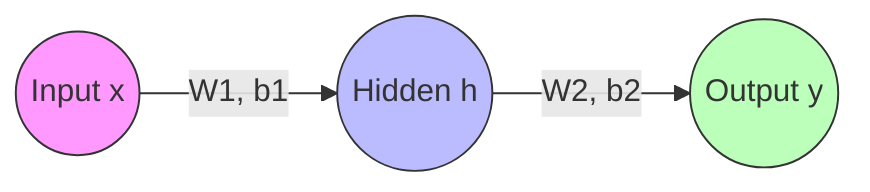
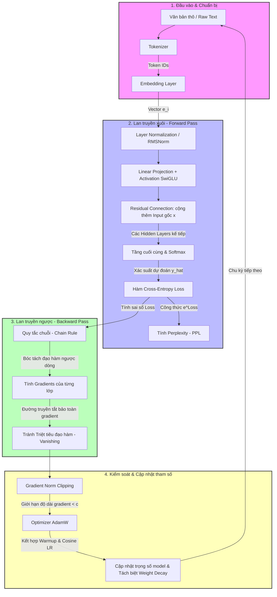

# CHƯƠNG 2: DEEP LEARNING CỐT LÕI - TỪ NỀN TẢNG ĐẾN HUẤN LUYỆN LLM

Chào mừng bạn đến với bài giảng chi tiết về **Deep Learning Cốt Lõi**. Trong bài học này, chúng ta sẽ đi sâu vào bản chất toán học, trực giác vật lý và cơ chế hoạt động thực tế của mạng nơ-ron sâu. Quan trọng hơn, chúng ta sẽ làm rõ sự kết nối trực tiếp của các khái niệm này đối với các mô hình ngôn ngữ lớn (LLM) hiện đại.

---

## 1. KIẾN TRÚC FEEDFORWARD NEURAL NETWORK (FNN) & EMBEDDING

### A. Feedforward Neural Network (FNN) - Mạng truyền thẳng
Mạng truyền thẳng là mô hình học máy cơ bản nhất mô tả cách thông tin di chuyển theo một chiều duy nhất: từ lớp đầu vào (Input), qua các lớp ẩn (Hidden), tới lớp đầu ra (Output).



#### Phép toán cốt lõi:
Tại mỗi tầng (layer), mạng thực hiện một phép biến đổi tuyến tính (Linear Transformation) theo sau bởi một hàm phi tuyến (Activation Function):

$$h = f(W \cdot x + b)$$

Trong đó:
*   $x \in \mathbb{R}^{d_{in}}$: Vector đầu vào.
*   $W \in \mathbb{R}^{d_{out} \times d_{in}}$: Ma trận trọng số (Weights). Bản chất là phép chiếu không gian từ chiều $d_{in}$ sang $d_{out}$.
*   $b \in \mathbb{R}^{d_{out}}$: Vector độ chệch (Bias) giúp dịch chuyển bề mặt quyết định.
*   $f$: Hàm kích hoạt phi tuyến tính.

### B. Embedding Layer - Bản chất của việc "Số hóa từ vựng"
Trong xử lý ngôn ngữ tự nhiên (NLP) và LLM, máy tính không hiểu chữ viết trực tiếp. Ta phải chuyển đổi chữ viết thành các con số.

#### Tại sao không dùng One-Hot Encoding?
Nếu từ vựng có $100.000$ từ, mỗi từ sẽ là một vector có chiều dài $100.000$ với duy nhất một số $1$, còn lại là số $0$.
*   **Vấn đề 1 (Bộ nhớ):** Quá thưa thớt (Sparse) và lãng phí bộ nhớ.
*   **Vấn đề 2 (Ý nghĩa):** Không có tính tương đồng ngữ nghĩa. Khoảng cách Euclid giữa hai vector One-Hot bất kỳ luôn bằng $\sqrt{2}$. Từ "hoàng đế" và "vua" hoàn toàn không có sự liên quan nào về mặt toán học.

#### Embedding Layer là gì?
Thực chất, **Embedding Layer là một bảng tra cứu (Lookup Table)** chứa các ma trận trọng số $E \in \mathbb{R}^{V \times d_{model}}$, trong đó $V$ là kích thước từ vựng (Vocabulary Size) và $d_{model}$ là chiều của vector embedding (ví dụ: $4096$ trong LLaMA-7B).

```
Token ID [3] ---> Tra cứu dòng thứ 3 trong ma trận E ---> Vector [0.12, -0.45, ..., 0.89] (chiều d_model)
```

Phép tra cứu này tương đương toán học với phép nhân ma trận giữa Vector One-Hot và ma trận Embedding $E$:

$$e_i = \text{OneHot}(i) \cdot E$$

Qua quá trình huấn luyện, mô hình sẽ tự động cập nhật ma trận $E$ sao cho các từ có ngữ nghĩa tương tự nhau sẽ nằm gần nhau trong không gian đa chiều (ví dụ: vector $\vec{\text{king}} - \vec{\text{man}} + \vec{\text{woman}} \approx \vec{\text{queen}}$).

---

## 2. HÀM KÍCH HOẠT (ACTIVATION FUNCTIONS)

Hàm kích hoạt là thành phần bắt buộc để giới thiệu tính phi tuyến tính vào mạng. Không có phi tuyến tính, nhiều lớp tuyến tính xếp chồng lên nhau cũng chỉ tương đương với một lớp tuyến tính duy nhất ($W_2 \cdot (W_1 \cdot x) = W_{new} \cdot x$).

```
Tuyến tính:   f(x) = x -------------------> Không thể học các mẫu phức tạp (non-linear)
Phi tuyến:   f(x) = max(0, x) (ReLU) ----> Cho phép mạng uốn cong không gian để phân loại dữ liệu


Trong khoa học máy tính có một định lý nổi tiếng chứng minh rằng: **Một mạng nơ-ron có ít nhất một lớp ẩn kết hợp với một hàm kích hoạt phi tuyến có thể xấp xỉ/mô phỏng BẤT KỲ hàm toán học liên tục nào trên đời**, cho dù nó phức tạp đến đâu.

Hàm kích hoạt chính là chiếc chìa khóa mở khóa sức mạnh này. Nó biến mạng nơ-ron từ một chiếc máy tính bỏ túi đơn giản (chỉ biết cộng trừ nhân chia tuyến tính) thành một bộ não có khả năng nhận diện khuôn mặt, dịch ngôn ngữ, và viết code như các LLM hiện nay.
```

### A. Sigmoid và Tanh (Thế hệ cũ)
*   **Sigmoid:** $\sigma(x) = \frac{1}{1 + e^{-x}}$ (Đưa giá trị về đoạn $[0, 1]$).
*   **Tanh:** $\tanh(x) = \frac{e^x - e^{-x}}{e^x + e^{-x}}$ (Đưa giá trị về đoạn $[-1, 1]$).
*   **Điểm yếu chí mạng:** Khi giá trị $x$ rất lớn hoặc rất nhỏ, độ dốc (đạo hàm) của hàm này tiến về $0$ ($\sigma'(x) \approx 0$). Điều này dẫn đến **triệt tiêu đạo hàm (Vanishing Gradient)** khi truyền ngược qua nhiều tầng.

### B. ReLU & GELU (Thế hệ chuyển tiếp)
![[Pasted image 20260914224132.png]]


* **ReLU (Rectified Linear Unit):** $f(x) = \max(0, x)$. Đạo hàm bằng $1$ khi $x > 0$ và bằng $0$ khi $x < 0$. ReLU giải quyết triệt để vấn đề triệt tiêu đạo hàm nhưng mắc lỗi "Dying ReLU" (nếu nơ-ron nhận giá trị âm, đạo hàm bằng $0$ và nó sẽ chết vĩnh viễn không cập nhật nữa).
*   **GELU (Gaussian Error Linear Unit):**
    
    $$\text{GELU}(x) = x \cdot \Phi(x)$$
    
    Trong đó $\Phi(x)$ là hàm phân phối tích lũy của phân phối chuẩn chuẩn tắc. GELU làm mượt ReLU tại điểm $0$ và cho phép một lượng nhỏ giá trị âm đi qua, giúp gradient chạy mượt mà hơn. Đây là hàm kích hoạt mặc định của BERT, GPT-3.

### C. SwiGLU - Chuẩn mực của LLM hiện đại (LLaMA, Qwen, Gemma)
SwiGLU là sự kết hợp giữa kiến trúc Gated Linear Unit (GLU) và hàm kích hoạt Swish (một phiên bản tối ưu của Sigmoid).

$$\text{Swish}_\beta(x) = x \cdot \sigma(\beta x)$$

$$\text{SwiGLU}(x) = (xW \otimes \text{Swish}(xV))$$

Trong đó $\otimes$ là phép nhân từng phần tử (Hadamard product), $W$ và $V$ là hai ma trận trọng số độc lập.

**Tại sao LLM thích SwiGLU?**
1.  **Cổng thông tin động (Dynamic Gating):** Nhánh $xV$ được đi qua hàm Swish đóng vai trò như một bộ lọc (cổng) kiểm soát lượng thông tin được đi qua từ nhánh tuyến tính $xW$.
2.  **Độ dốc ổn định:** Giúp dòng đạo hàm truyền đi cực tốt trong các mô hình sâu hàng trăm lớp mà không lo triệt tiêu đạo hàm.

---

## 3. HÀM MẤT MÁT (LOSS FUNCTIONS) & CROSS-ENTROPY

Hàm mất mát đo lường mức độ "tệ" của mô hình. Trong LLM (vốn là bài toán dự đoán từ tiếp theo), hàm mất mát tiêu chuẩn là **Cross-Entropy Loss (Hàm mất mát entropy chéo)**.

### A. Bản chất toán học của Cross-Entropy Loss
Giả sử tại một bước dự đoán, mô hình cần chọn từ tiếp theo trong bộ từ vựng kích thích $V$.
*   Nhãn thực tế (Ground Truth) là phân phối One-hot $y$ (từ đúng có xác suất bằng $1$, các từ khác bằng $0$).
*   Dự đoán của mô hình là phân phối xác suất $\hat{y}$ (sau khi đi qua hàm Softmax).

Công thức Cross-Entropy cho một Token:

$$\mathcal{L} = -\sum_{i=1}^{V} y_i \log(\hat{y}_i) = -\log(\hat{y}_{\text{target}})$$

Trong đó $\hat{y}_{\text{target}}$ là xác suất mà mô hình dự đoán cho từ **đúng**.
*   Nếu mô hình dự đoán xác suất từ đúng là $0.99 \rightarrow \mathcal{L} = -\log(0.99) \approx 0.01$ (Loss rất nhỏ).
*   Nếu mô hình dự đoán xác suất từ đúng là $0.01 \rightarrow \mathcal{L} = -\log(0.01) \approx 4.6$ (Loss rất lớn, mô hình bị phạt nặng).

### B. Perplexity (PPL) - Thước đo độ "bối rối" của LLM
Trong thực tế, khi đánh giá LLM, người ta thường dùng chỉ số **Perplexity (PPL)**, định nghĩa bằng lũy thừa cơ số tự nhiên của Cross-Entropy Loss trung bình:

$$\text{PPL} = e^{\mathcal{L}}$$

*Ý nghĩa trực quan:* PPL đại diện cho **số lượng từ thay thế tương đương** mà mô hình đang phân vân lựa chọn.
*   Nếu $\text{PPL} = 10$, mô hình đang bối rối giống như việc phải tung một viên xúc xắc có 10 mặt để chọn từ tiếp theo.
*   PPL càng thấp, mô hình càng tự tin và dự đoán chính xác.

### C. Tại sao đã có Loss rồi nhưng vẫn cần Perplexity (PPL)?
Đây là câu hỏi kinh điển mà bất cứ ai nghiên cứu sâu về LLM cũng từng đặt ra. Tại sao chúng ta không dùng luôn giá trị Loss để đánh giá mà lại cần thêm PPL? Bản chất nằm ở các lý do sau:

#### 1. Sự trực quan hóa đối với trực giác con người (Interpretability)
*   **Cross-Entropy Loss** nằm ở thang đo logarithmic. Con người rất kém trong việc ước lượng và cảm nhận trực giác các giá trị logarit. Sự khác biệt giữa Loss = $3.0$ và Loss = $4.0$ trông có vẻ rất nhỏ (chỉ lệch $1.0$ đơn vị), nhưng thực tế nó đại diện cho một bước nhảy vọt khổng lồ về hiệu năng.
*   **PPL** đưa con số logarit này quay lại thang đo thực tế (exponential space):
    *   $\text{Loss} = 4.0 \rightarrow \text{PPL} = e^{4.0} \approx 54.6$ (mô hình đang phân vân giữa khoảng $55$ từ khả dĩ).
    *   $\text{Loss} = 3.0 \rightarrow \text{PPL} = e^{3.0} \approx 20.1$ (mô hình chỉ còn phân vân giữa khoảng $20$ từ khả dĩ).
*   Nhìn vào sự sụt giảm từ $55$ xuống $20$ từ phân vân, chúng ta lập tức cảm nhận được mô hình đã "thông minh" lên gấp gần 3 lần. Con số này trực quan hơn rất nhiều so với việc nhìn vào độ giảm từ $4.0$ xuống $3.0$.

#### 2. Phóng đại sự cải tiến ở giai đoạn cuối (Sensitivity at Convergence)
*   Khi LLM huấn luyện đến giai đoạn cuối (hội tụ), giá trị Loss giảm cực kỳ chậm (ví dụ: từ $2.0$ xuống $1.5$, chỉ giảm $0.5$). Nếu chỉ nhìn vào Loss, ta có thể nghĩ mô hình không tiến bộ nhiều.
*   Tuy nhiên, xét về PPL:
    *   $\text{Loss} = 2.0 \rightarrow \text{PPL} = e^{2.0} \approx 7.38$
    *   $\text{Loss} = 1.5 \rightarrow \text{PPL} = e^{1.5} \approx 4.48$
    *   Sự bối rối của mô hình đã giảm từ việc phân vân giữa hơn $7$ từ xuống chỉ còn hơn $4$ từ!
*   PPL khuếch đại các thay đổi nhỏ của Loss ở các bước cuối, giúp các kỹ sư nhận biết được mô hình vẫn đang tiếp tục tối ưu hóa chất lượng câu trả lời một cách rõ rệt.

#### 3. Đối sánh với kích thước từ vựng (Vocabulary Size Context)
*   Nếu từ vựng của mô hình có kích thước $V = 50.000$ từ. Một mô hình tệ nhất (chọn từ hoàn toàn ngẫu nhiên) sẽ có $\text{PPL} = 50.000$ (tương đương $\text{Loss} = \log(50.000) \approx 10.8$).
*   Nếu mô hình của bạn đạt $\text{PPL} = 15$, bạn ngay lập tức biết rằng mô hình đã lọc và thu hẹp không gian tìm kiếm từ $50.000$ từ xuống chỉ còn $15$ từ có xác suất cao nhất. Con số $15$ này mang lại một ngữ cảnh so sánh rõ ràng với tổng số $50.000$ từ của bộ từ vựng, điều mà con số Loss $2.7$ không thể tự hiển thị nếu thiếu các phép tính phụ trợ.

*note: việc ppl dùng e mũ là do khi tính loss ta dùng log e để tính do đó dùng e mũ chỉ đon giản là dịch ngược lại cái logarit thôi. còn loss dùng log e là do đạo hàm của e mũ x là bằng chinh nó -> tối ưu hóa tinh toán*


---

## 4. LAN TRUYỀN NGƯỢC (BACKPROPAGATION) & CÁC VẤN ĐỀ VỀ GRADIENT

 Bản chất của BACKPROPAGRATION là quá trình tính toán đạo hàm của loss so với từng W để biết được hướng (dấu của đạo hàm) và giá trị ( độ lớn của đạo hàm ) cho việc điều chỉnh W. Các giá trị đó về sau sẽ được đưa qua quá trình optimize để tiến hành cập nhật
 
 note:
- **Đạo hàm:** Là một **giá trị đại số** (một con số kèm dấu dương hoặc âm).
- **Gradient:** Là một **vector** (vừa có độ lớn, vừa có phương hướng)
### A. Lan truyền ngược hoạt động như thế nào?
Để cập nhật trọng số $W$, ta cần tính đạo hàm riêng của Loss $\mathcal{L}$ đối với $W$ ($\frac{\partial \mathcal{L}}{\partial W}$). Do cấu trúc nhiều tầng xếp chồng, ta sử dụng **Quy tắc chuỗi (Chain Rule)** trong giải tích:

$$\frac{\partial \mathcal{L}}{\partial W^{(1)}} = \frac{\partial \mathcal{L}}{\partial y} \cdot \frac{\partial y}{\partial h} \cdot \frac{\partial h}{\partial W^{(1)}}$$

```
Lan truyền xuôi (Forward):  X ---> H ---> Y ---> Loss
Lan truyền ngược (Backward): dW <--- dH <--- dY <--- dLoss
```

> [!NOTE]
> **💡 Trực giác về Quy tắc chuỗi (Chain Rule) - Bản chất của "Hàm lồng nhau":**
> 
> Hãy hình dung: Hàm Loss ($\mathcal{L}$) chỉ đứng ở vạch đích (layer cuối cùng) để so sánh đầu ra dự đoán ($Y$) với nhãn thực tế ($Y_{true}$). Bản thân hàm Loss hoàn toàn **"mù tịt"** về các trọng số $W_0, W_1$ hay các trạng thái ẩn (hidden layers) nằm sâu ở phía trước. Nó không biết các tham số đó đã làm gì để tạo ra sai số này.
> 
> Vì mạng nơ-ron là một tập hợp các **hàm lồng nhau** (nested functions) dạng:
> 
> $$\mathcal{L} = \text{Loss}( f_3( W_3 \cdot f_2( W_2 \cdot f_1( W_1 \cdot x ) ) ) )$$
> 
> Để tính toán được sự ảnh hưởng của một tham số nằm sâu ở layer đầu tiên (như $W_1$) đối với Loss cuối cùng, ta không thể nhảy một bước tới ngay $W_1$. Thay vào đó, ta bắt buộc phải **"bóc tách" (peel) từng lớp vỏ đạo hàm từ ngoài vào trong** giống như bóc một củ hành:
> 1. Tính xem đầu ra thay đổi thế nào đối với Loss: $\frac{\partial \mathcal{L}}{\partial Y}$
> 2. Tính xem lớp ẩn cuối thay đổi thế nào đối với đầu ra: $\frac{\partial Y}{\partial H}$
> 3. ... và cứ thế nhân ngược về trước cho tới khi chạm đến trọng số đầu tiên.
> 
> Phép bóc tách toán học lần lượt từ ngoài vào trong của các hàm lồng nhau này chính là **Quy tắc chuỗi (Chain Rule)**. Không có nó, các lớp ẩn ở sâu bên trong sẽ mãi mãi bị "mù thông tin" và không bao giờ biết cách tự sửa mình để giảm sai số chung.

### B. Vấn đề Gradient trong các mô hình cực sâu (LLM)
Khi mạng tăng từ vài lớp lên đến 80-100 lớp (như các LLM 7B+), chuỗi nhân đạo hàm trong Chain Rule trở nên cực kỳ dài.
*   **Vanishing Gradient (Triệt tiêu đạo hàm):** Nếu các đạo hàm trung gian nhỏ hơn $1$ (ví dụ: $0.9$), việc nhân liên tiếp $0.9^{80} \approx 0.0002$ sẽ khiến đạo hàm ở các tầng đầu tiên gần như bằng $0$. Mô hình ngừng học.
*   **Exploding Gradient (Bùng nổ đạo hàm):** Ngược lại, nếu các đạo hàm lớn hơn $1$ (ví dụ: $1.1$), việc nhân liên tiếp $1.1^{80} \approx 2048$ sẽ khiến trọng số thay đổi quá lớn, phá hỏng toàn bộ cấu trúc đã học (Inference trả về `NaN`).

#### Các giải pháp thực tế trong LLM:

##### 1. Residual Connection (Kết nối tắt / Mạng dư)
*   **Bản chất hoạt động:** Thay vì ép buộc thông tin đi qua một chuỗi các biến đổi phi tuyến tính phức tạp $y = F(x)$, ta tạo ra một đường truyền tắt (identity shortcut) để cộng trực tiếp đầu vào $x$ với đầu ra của nhánh biến đổi:
    
    $$y = x + F(x)$$
    
*   **Giải thích toán học về Gradient:** 
    Khi thực hiện lan truyền ngược, ta cần tính đạo hàm của đầu ra $y$ theo đầu vào $x$:
    
    $$\frac{\partial y}{\partial x} = \frac{\partial x}{\partial x} + \frac{\partial F(x)}{\partial x} = 1 + \frac{\partial F(x)}{\partial x}$$
    
    Theo Quy tắc chuỗi (Chain Rule), gradient truyền từ layer sau về layer trước ($\nabla_x \mathcal{L}$) sẽ là:
    
    $$\nabla_x \mathcal{L} = \nabla_y \mathcal{L} \cdot \frac{\partial y}{\partial x} = \nabla_y \mathcal{L} \cdot \left(1 + \frac{\partial F(x)}{\partial x}\right) = \nabla_y \mathcal{L} + \nabla_y \mathcal{L} \cdot \frac{\partial F(x)}{\partial x}$$
    
*   **Tại sao nó giải quyết Vanishing Gradient?** 
    Nhìn vào công thức trên, ngay cả khi nhánh biến đổi phức tạp bị triệt tiêu đạo hàm ($\frac{\partial F(x)}{\partial x} \approx 0$), lượng gradient được truyền ngược về lớp phía trước **vẫn giữ lại được tối thiểu là $\nabla_y \mathcal{L}$** nhờ vào con số $1$ của nhánh truyền thẳng. Số $1$ này đóng vai trò như một **"đường cao tốc siêu dẫn" (gradient highway)**, cho phép tín hiệu sửa lỗi chạy thẳng từ lớp cuối cùng về lớp đầu tiên mà không bị suy hao.

##### 2. Gradient Clipping (Cắt ngắn Gradient)
*   **Bản chất hoạt động:** Đây là kỹ thuật chuyên biệt để đối phó với **Exploding Gradient** (bùng nổ đạo hàm). Khi mô hình thực hiện huấn luyện qua các vùng loss có vách núi dựng đứng, gradient có thể tăng vọt lên hàng nghìn lần, khiến bước cập nhật trọng số bay quá xa khỏi vùng tối ưu và làm mô hình bị lỗi `NaN` (Not a Number).
*   **Cách thực hiện (Gradient Norm Clipping):** 
    Ta tính độ dài (L2 Norm) của toàn bộ vector gradient $g$ của mô hình:
    
    $$\|g\|_2 = \sqrt{\sum_i g_i^2}$$
    
    Nếu độ dài này vượt quá một ngưỡng cực đại $c$ (threshold) cho trước (thường đặt là $1.0$ trong huấn luyện LLM), ta sẽ thu nhỏ vector gradient theo tỷ lệ:
    
    $$g \leftarrow g \cdot \frac{c}{\|g\|_2}$$
    
*   **Trực quan trực giác:** 
    Hãy tưởng tượng gradient là lực đẩy mô hình xuống thung lũng của hàm loss. Nếu lực đẩy quá mạnh, nó sẽ bắn mô hình văng sang sườn núi bên kia. Gradient Clipping đóng vai trò như **bộ giới hạn tốc độ**, giữ nguyên hướng đi của vector lực nhưng giới hạn độ dài tối đa của nó chỉ là $c$, giúp mô hình tiến từng bước ổn định mà không lo phá hỏng hệ thống trọng số.

---

## 5. BẢN CHẤT CỦA TỐI ƯU HÓA (OPTIMIZERS) & GRADIENT DESCENT

Sau khi đã có được gradient từ bước backpropagration, bước optimize sẽ tiếp tục tiến hành quá trình cập nhật trọng số
Trọng số được cập nhật theo hướng ngược chiều gradient:
		***$W_{new} = W_{old} - \eta \cdot \nabla \mathcal{L}$**,*                trong đó $\eta$ là Learning Rate (Tốc độ học).


### A. Từ SGD đến AdamW
*   **Stochastic Gradient Descent (SGD):** Cập nhật trọng số dựa trên gradient của một batch nhỏ thay vì toàn bộ như gradient descent. Khuyết điểm: Dễ bị kẹt ở các điểm cực tiểu cục bộ (local minima, nơi hệ thống nhầm tưởng là gradient = 0) hoặc điểm yên ngựa (saddle points) và dao động cực mạnh do chỉ nhìn vào mini batch thay vì toàn cục nên có thể sẽ ziczac, không trơn tru
*   **Adam (Adaptive Moment Estimation):** Tự động điều chỉnh tốc độ học cho từng tham số dựa trên việc ước lượng:
    *   Momentum bậc 1 ($m_t$): Trung bình trượt của gradient (hướng đi tiếp theo). -> Momentum lưu lại trung bình trượt của các hướng đi trước đó ($m_t$). Nhờ vậy, các dao động trái/phải sẽ triệt tiêu lẫn nhau, còn hướng đi thẳng xuống đáy được cộng dồn lại -> giải quyết vấn đề ziczac.
    *   Momentum bậc 2 ($v_t$): Trung bình trượt của bình phương gradient (độ lớn dao động). -> điều chỉnh tốc độ học cho từng tham số riêng biệt
    
    Vấn để của Adam: Dù Adam rất mạnh, nhưng khi áp dụng vào các mô hình khổng lồ, người ta phát hiện ra nó không hoạt động tốt với **L2 Regularization (Weight Decay)**.

Weight Decay là một kỹ thuật ép các trọng số $W$ phải giữ ở mức nhỏ, nhằm giúp mô hình bớt phức tạp và chống học vẹt (overfitting). Trong các thuật toán cũ như SGD, người ta chỉ cần cộng thêm một lượng phạt vào hàm Loss.
*   **AdamW (Adam với Weight Decay phân rã):** 
    *   Trong Adam gốc, việc kết hợp L2 Regularization trực tiếp vào Loss Function làm biến dạng toán học khi chia cho $v_t$, khiến việc phạt các trọng số lớn không còn hiệu quả.
    *   AdamW khắc phục bằng cách **tách biệt hoàn toàn phần Weight Decay** ra khỏi phép toán tính Gradient và trừ trực tiếp vào trọng số cuối cùng:
        
        $$W_{t+1} = W_t - \eta \cdot \text{Adam\_Update}(g_t) - \eta \cdot \lambda \cdot W_t$$
        
    *   *Đây là Optimizer tiêu chuẩn được dùng để train hầu như toàn bộ LLM hiện nay.*

### B. Learning Rate Schedulers: Warmup & Cosine Decay
Tốc độ học không nên giữ cố định mà cần thay đổi theo thời gian thực tế huấn luyện:

```
Learning Rate (LR)
 ^
 |      /\
 |     /  \
 |    /    \____
 |   /          \____
 |  /                \____
 +--------------------------> Steps
   <Warmup>  <Cosine Decay>
```

1.  **Learning Rate Warmup:** Ở một vài nghìn bước đầu tiên (ví dụ: 2000 steps), ta tăng dần LR từ $0$ lên giá trị max.
    *   *Bản chất:* Tránh việc mô hình bị shock trọng số ở thời điểm ban đầu do các gradient ban đầu rất hỗn loạn và chưa ổn định.
2.  **Cosine Annealing (Cosine Decay):** Giảm dần LR theo đường cong hàm Cosine về tiệm cận $0$ ở cuối quá trình huấn luyện.
    *   *Bản chất:* Giúp mô hình hội tụ nhẹ nhàng vào các hố loss sâu và phẳng hơn, tối ưu hóa tối đa độ chính xác của mô hình.

---

## 6. KIỂM SOÁT QUÁ KHỚP (OVERFITTING) & REGULARIZATION TRONG KỶ NGUYÊN LLM

### A. Overfitting & Underfitting
*   **Underfitting:** Mô hình chưa học đủ sâu, loss trên cả tập train và validation đều cao.
*   **Overfitting:** Mô hình học vẹt dữ liệu train, loss tập train rất thấp nhưng loss tập validation lại rất cao.

### B. Bản chất của Overfitting đối với LLM
*   **Trong giai đoạn Pre-training (Tiền huấn luyện):** Hầu như **không xảy ra overfitting**. Vì dữ liệu pre-train lên tới hàng nghìn tỷ tokens (Trillions), mô hình chỉ được đi qua dữ liệu đúng 1 epoch (1 lần duy nhất).
*   **Trong giai đoạn Fine-tuning (Huấn luyện tinh chỉnh/SFT):** Nguy cơ **overfitting cực kỳ cao**. Tập dữ liệu lúc này rất nhỏ (chỉ vài nghìn đến vài chục nghìn ví dụ chất lượng cao), trong khi mô hình có đến hàng tỷ tham số. Nếu không kiểm soát, LLM sẽ chỉ lặp lại y hệt câu trả lời mẫu trong tập train.

### C. Các kỹ thuật Regularization (kĩ thuật tránh overfit)
1.  **Weight Decay (L2):** Phạt các trọng số có giá trị quá lớn bằng cách cộng thêm bình phương độ lớn trọng số vào loss. Giúp hàm dự đoán mượt mà hơn, tránh phụ thuộc thái quá vào một vài đặc trưng riêng biệt.
2.  **Dropout:** Ngẫu nhiên tắt đi một tỷ lệ nơ-ron (ví dụ: $10\%$) ở mỗi bước huấn luyện. Điều này ép buộc mô hình không được tin cậy hoàn toàn vào một đường truyền dẫn thông tin cụ thể, mà phải học các cách biểu diễn độc lập hơn.
    *   *Lưu ý:* Khi Pre-train LLM lớn, người ta thường đặt `dropout = 0` để khai thác tối đa dung lượng bộ nhớ của mô hình, nhưng sẽ bật lại `dropout = 0.1` khi thực hiện SFT để tránh overfitting.

---

## 7. KỸ THUẬT CHUẨN HÓA (NORMALIZATION)

Khi dữ liệu đi qua nhiều tầng của mạng nơ-ron, phân phối của các giá trị kích hoạt sẽ bị thay đổi (Hiện tượng Covariate Shift), khiến việc học ở các lớp sau trở nên khó khăn. Chuẩn hóa là việc ép phân phối dữ liệu về dạng chuẩn (trung bình $\approx 0$, phương sai $\approx 1$).

### A. Batch Normalization (BN) - Tại sao thất bại với LLM?
*   BN chuẩn hóa dữ liệu theo chiều dọc (Dọc theo Batch Size).
*   **Điểm yếu:** LLM xử lý dữ liệu dạng chuỗi có độ dài thay đổi liên tục (Variable sequence length). Việc tính toán trung bình và phương sai trên một Batch có độ dài câu khác nhau khiến các số liệu thống kê bị nhiễu nghiêm trọng. Đồng thời, BN không thể song song hóa hiệu quả trên các hệ thống phân tán lớn.

### B. Layer Normalization (LN) - Sự thay thế hoàn hảo cho Transformer
*   LN chuẩn hóa dữ liệu theo chiều ngang (Dọc theo chiều các đặc trưng - Features của từng Token độc lập). Không phụ thuộc vào Batch Size hay độ dài câu.

```
Batch Normalization (BN): Chuẩn hóa trên toàn bộ mẫu trong batch tại 1 đặc trưng cụ thể.
Layer Normalization (LN): Chuẩn hóa trên toàn bộ đặc trưng của chỉ 1 mẫu duy nhất.
```

#### Công thức toán học của Layer Normalization:
Với vector đặc trưng của token $x \in \mathbb{R}^D$:

$$\mu = \frac{1}{D} \sum_{i=1}^D x_i, \quad \sigma^2 = \frac{1}{D} \sum_{i=1}^D (x_i - \mu)^2$$

$$\hat{x}_i = \frac{x_i - \mu}{\sqrt{\sigma^2 + \epsilon}} \cdot \gamma_i + \beta_i$$

Trong đó $\gamma, \beta$ là các tham số có thể học (Learnable scale & shift parameter).

#### Vị trí đặt LayerNorm: Pre-LN vs Post-LN
*   **Post-LN (Thiết kế Transformer 2017 gốc):** LN đặt sau nhánh cộng Residual: $x_{l+1} = \text{LN}(x_l + \text{SubLayer}(x_l))$. Mô hình này dễ bị mất ổn định khi tăng độ sâu (cần Warmup cực kỳ cẩn thận).
*   **Pre-LN (LLM hiện đại dùng):** LN đặt trước SubLayer: $x_{l+1} = x_l + \text{SubLayer}(\text{LN}(x_l))$. Gradient có thể chảy trực tiếp qua nhánh cộng mà không bị cản trở bởi LN, giúp huấn luyện mô hình siêu lớn ổn định tuyệt đối.

### C. RMSNorm (Root Mean Square Normalization) - Tiêu chuẩn của các LLM mới nhất
RMSNorm là một cải tiến tối ưu dựa trên nhận định: *Sự ổn định của LayerNorm đến từ việc chia cho độ lệch chuẩn ($\sigma$), chứ không phải ở việc trừ đi trung bình ($\mu$).*

RMSNorm bỏ hoàn toàn việc tính toán giá trị trung bình $\mu$, chỉ chia cho giá trị căn bậc hai trung bình bình phương (Root Mean Square):

$$\text{RMS}(x) = \sqrt{\frac{1}{D} \sum_{i=1}^D x_i^2}$$

$$\bar{x}_i = \frac{x_i}{\text{RMS}(x) + \epsilon} \cdot \gamma_i$$

**Ưu điểm vượt trội:**
*   Tiết kiệm từ $10\%$ đến $50\%$ thời gian tính toán chuẩn hóa trên GPU do cấu trúc toán học đơn giản hơn nhiều (ít thao tác đọc/ghi bộ nhớ hơn).
*   Đảm bảo độ ổn định huấn luyện tương đương LayerNorm đầy đủ.
*   *Được áp dụng trong LLaMA, Mistral, Gemma, Qwen.*

---

## 📝 TỔNG KẾT BÀI HỌC

| Khái niệm | Vai trò truyền thống (Deep Learning) | Vai trò đặc thù trong LLM |
| :--- | :--- | :--- |
| **Embedding** | Biến đổi đặc trưng chiều cao về chiều thấp | Bản chất của việc số hóa từ vựng (Tra bảng) |
| **SwiGLU** | Hàm kích hoạt kết hợp cổng (Gating) | Tránh triệt tiêu đạo hàm, tối ưu hóa khả năng học ngữ cảnh |
| **Cross-Entropy** | Đánh giá phân loại nhiều lớp | Đo lường độ bối rối (Perplexity) khi đoán từ tiếp theo |
| **AdamW** | Thuật toán tối ưu hóa cải tiến | Tách rời Weight Decay giúp ổn định hóa việc hội tụ LLM |
| **Cosine Warmup** | Chiến lược thay đổi tốc độ học | Tránh phá hủy trọng số ban đầu, giúp hội tụ sâu |
| **Overfitting** | Xử lý bằng cách tăng dữ liệu/Dropout | Rủi ro rất cao ở pha SFT, cần kết hợp Dropout/Early Stopping |
| **RMSNorm** | Chuẩn hóa tầng mạng | Thay thế LayerNorm, tăng tốc độ huấn luyện 10-50% |

Hy vọng bài giảng này đã giúp bạn nắm giữ vững vàng bản chất toán học cũng như kỹ thuật của Deep Learning để tự tin bước tiếp vào cấu trúc phức tạp hơn: **Kiến trúc Transformer**!

---

## 🔄 SƠ ĐỒ TỔNG KẾT: QUY TRÌNH HUẤN LUYỆN END-TO-END (END-TO-END TRAINING LOOP)

Để khép lại Chương 2, sơ đồ dưới đây xâu chuỗi toàn bộ các khái niệm đã học (từ Embedding, Activation, Loss, Chain Rule đến Optimizer) thành một chu trình huấn luyện khép kín hoàn chỉnh của một mô hình:



### 📋 Tóm tắt 4 bước của một chu kỳ huấn luyện (1 Iteration):

1.  **Bước 1: Forward Pass (Lan truyền xuôi)**
    *   Văn bản thô được băm thành các **Token IDs** rồi tra bảng **Embedding** để lấy vector đặc trưng biểu diễn ngữ nghĩa.
    *   Các vector này đi qua các lớp ẩn, được chuẩn hóa bởi **RMSNorm/LayerNorm**, biến đổi phi tuyến tính bằng **SwiGLU**, và được bảo vệ thông tin bởi các kết nối tắt **Residual Connection**.
    *   Tầng cuối cùng xuất ra phân phối xác suất dự đoán của từ tiếp theo ($\hat{y}$).
2.  **Bước 2: Calculate Loss & PPL (Tính sai số)**
    *   Đo lường độ lệch giữa dự đoán và nhãn thực tế bằng **Cross-Entropy Loss**.
    *   Đồng thời chuyển đổi sang chỉ số **Perplexity (PPL)** để con người theo dõi trực quan độ bối rối của mô hình.
3.  **Bước 3: Backward Pass (Lan truyền ngược)**
    *   Sử dụng **Quy tắc chuỗi (Chain Rule)** thực hiện bóc tách hàm lồng nhau từ ngoài vào trong để tính đạo hàm riêng (Gradients) của tất cả trọng số ở các layer trước đó.
    *   Các đường tắt **Residual Connection** đóng vai trò là "đường cao tốc" siêu dẫn bảo toàn dòng gradient chảy về không bị triệt tiêu (Vanishing).
4.  **Bước 4: Gradient Clipping & Optimizer Step (Cập nhật)**
    *   Thực hiện **Gradient Norm Clipping** để co ngắn vector gradient nếu nó quá lớn, ngăn ngừa bùng nổ gradient gây lỗi `NaN`.
    *   Bộ tối ưu hóa **AdamW** tính toán lượng cập nhật dựa trên động lượng lịch sử, điều phối tốc độ học qua **Learning Rate Scheduler** (Warmup tăng dần rồi Cosine giảm dần), và tiến hành trừ trực tiếp phần **Weight Decay** để tránh overfitting. Trọng số mới được thiết lập và mô hình bước vào chu kỳ huấn luyện tiếp theo với mẻ dữ liệu mới (Mini-batch).
