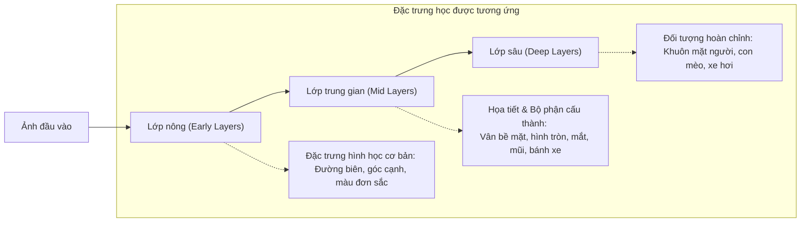
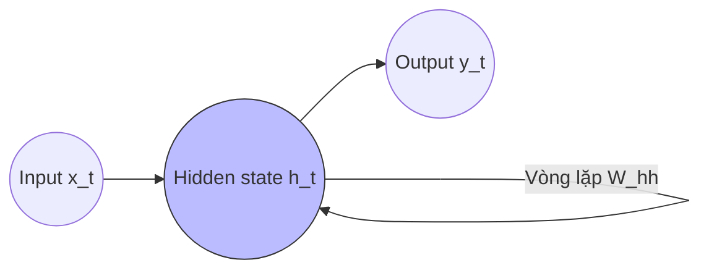
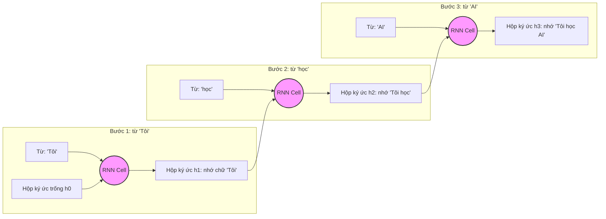
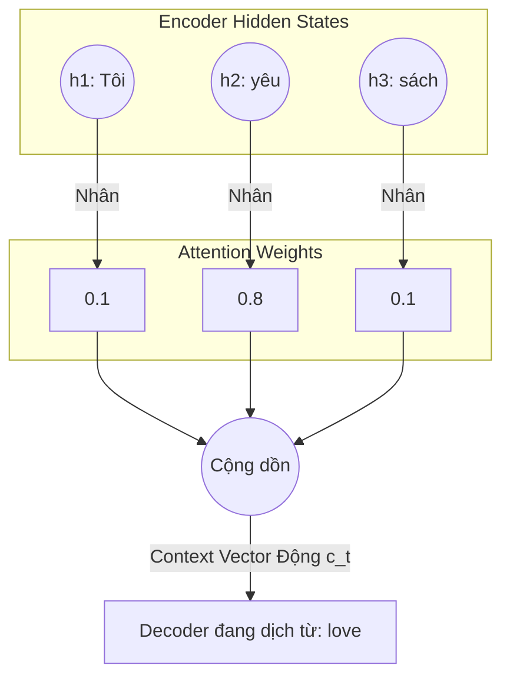
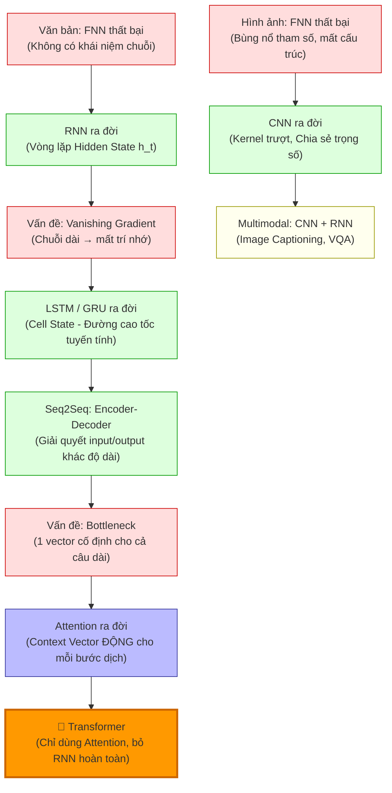

# CHƯƠNG 3: TỪ CNN, RNN ĐẾN CƠ CHẾ ATTENTION NGUYÊN BẢN

Bước vào những năm 2010, kỷ nguyên Học sâu (Deep Learning) chính thức bùng nổ, nhưng đồng thời cũng vấp phải những rào cản công nghệ cực kỳ lớn. Các mô hình mạng nơ-ron truyền thống thời bấy giờ (như mạng truyền thẳng Multilayer Perceptron - MLP) tuy mạnh mẽ về mặt lý thuyết toán học nhưng lại hoàn toàn "bất lực" khi đối mặt với các dạng dữ liệu phức tạp trong thế giới thực: dữ liệu không gian 2D (hình ảnh) và dữ liệu tuần tự theo chuỗi thời gian (văn bản, âm thanh).

Bài học này sẽ đưa bạn đi qua lịch sử tiến hóa của các kiến trúc mạng nơ-ron cốt lõi trước kỷ nguyên Transformer. Hiểu rõ các mô hình này giúp bạn nhận diện được bài toán gốc, các giới hạn công nghệ mà các kỹ sư AI trước đây đối mặt, và lý do tại sao sự ra đời của **Attention** lại là một bước ngoặt tất yếu và vĩ đại làm thay đổi hoàn toàn bộ mặt của trí tuệ nhân tạo.

---

## 1. CNN (CONVOLUTIONAL NEURAL NETWORKS) - CÚ HÍCH CÁCH MẠNG CHO THỊ GIÁC MÁY TÍNH

### A. Bối cảnh ra đời và Sự đột phá mang tính lịch sử của CNN
Trước khi CNN trở nên phổ biến, lĩnh vực Thị giác máy tính (Computer Vision) là một vùng đất vô cùng gian nan. Để nhận diện một vật thể (ví dụ: con mèo hay khuôn mặt người), các nhà khoa học phải thiết kế thủ công các bộ lọc đặc trưng (Feature Engineering) như thuật toán SIFT, HOG để dò tìm các đường cạnh, góc xoay. Quy trình này đòi hỏi kiến thức chuyên môn cực kỳ sâu sắc, mất nhiều năm nghiên cứu thử nghiệm bằng tay nhưng mô hình lại rất kém linh hoạt — chỉ cần góc chụp thay đổi, ánh sáng khác đi hoặc vật thể bị che khuất một chút là thuật toán sẽ thất bại.

Sự xuất hiện của **CNN** đã tạo nên một cuộc cách mạng thay đổi hoàn toàn cuộc chơi nhờ hai yếu tố đột phá:
1.  **Học biểu diễn từ đầu đến cuối (End-to-End Representation Learning):** CNN loại bỏ việc thiết kế bộ lọc thủ công. Giờ đây, các bộ lọc (Kernels) tự động học cách phát hiện các đặc trưng tối ưu nhất trực tiếp từ dữ liệu pixel thô thông qua quá trình lan truyền ngược (backpropagation). Máy tính tự học cách "nhìn" dưới sự hướng dẫn của dữ liệu.
2.  **Cột mốc AlexNet (2012):** Tại cuộc thi nhận diện ảnh ImageNet danh giá năm 2012, mô hình Deep CNN mang tên AlexNet đã đánh bại hoàn toàn các phương pháp truyền thống với tỷ lệ lỗi thấp hơn tới 10.8% so với đội đứng nhì. Sự kiện chấn động này đã chứng minh sức mạnh áp đảo của mạng nơ-ron tích chập và chính thức châm ngòi cho làn sóng bùng nổ của Deep Learning trên toàn cầu.

### B. Giải quyết điểm yếu chí mạng của FNN (Mạng truyền thẳng)
Mạng truyền thẳng (FNN) gặp phải hai giới hạn vật lý nghiêm trọng khi xử lý dữ liệu dạng lưới như hình ảnh:
*   **Sự bùng nổ tham số:** Nếu trải phẳng một bức ảnh nhỏ kích thước $224 \times 224$ pixels thành một vector 1D ($50.176$ phần tử), chỉ một layer ẩn duy nhất có $1000$ nơ-ron đã tiêu tốn tới hơn $50$ triệu tham số ($50.176 \times 1000$). Khi mạng sâu hơn, việc tính toán trở nên bất khả thi và cực kỳ dễ bị overfitting.
*   **Mất cấu trúc không gian:** Việc trải phẳng ảnh biến các pixel đứng cạnh nhau (ví dụ: mắt nằm cạnh mũi) thành các điểm rời rạc trên một đường thẳng, cắt đứt hoàn toàn mối liên hệ hình học cục bộ.

CNN giải quyết triệt để hai vấn đề này bằng cách giữ nguyên dạng lưới 2D của ảnh và áp dụng cơ chế **Liên kết cục bộ (Local Connectivity)** kết hợp **Chia sẻ trọng số (Weight Sharing)** thông qua phép tích chập.

```
FNN (Trải phẳng ảnh): [x1, x2, ..., x50176] ---> Mất đi mối quan hệ lân cận giữa các điểm ảnh
CNN (Giữ nguyên lưới): Trượt bộ lọc (Kernel) ---> Giữ nguyên cấu trúc không gian 2D của ảnh
```

### C. Phép tích chập (Convolution) & Vai trò của các bộ lọc (Kernels)
Trọng tâm của CNN là phép nhân chập. Thay vì kết nối mọi pixel tới mọi nơ-ron, ta sử dụng các ma trận nhỏ chứa các tham số học được gọi là **Kernel (hoặc Filter - Bộ lọc)**. Kernel sẽ trượt (stride) qua bức ảnh đầu vào, thực hiện nhân từng phần tử tương ứng rồi cộng lại để tạo thành **Feature Map (Bản đồ đặc trưng)**.

#### 1. Mỗi lớp CNN có bao nhiêu Kernel?
Trong thực tế, **một lớp CNN không chỉ dùng 1 bộ lọc duy nhất**. Để trích xuất được nhiều kiểu thông tin phong phú của bức ảnh, một lớp tích chập thường sử dụng một tập hợp gồm **nhiều bộ lọc song song (phổ biến là 32, 64, 128 hoặc nhiều hơn)**.
*   Nếu lớp tích chập sử dụng 64 kernels, nó sẽ trích xuất ra 64 Feature Maps khác nhau.
*   Độ sâu (depth) hay số kênh (channels) của đầu ra từ lớp này sẽ đúng bằng số lượng kernels được sử dụng ở lớp đó.

#### 2. Mỗi Kernel học một đặc trưng riêng biệt (Feature)
Trong quá trình huấn luyện bằng thuật toán lan truyền ngược (backpropagation), các trọng số của từng kernel sẽ tự động cập nhật để nhạy bén với một kiểu cấu trúc hoặc họa tiết cụ thể:
*   **Kernel 1:** Học cách nhận diện các đường biên nằm ngang.
*   **Kernel 2:** Học cách nhận diện các đường biên thẳng đứng.
*   **Kernel 3:** Học cách phát hiện các góc chéo 45 độ.
*   **Kernel 4:** Học cách phát hiện sự thay đổi đột ngột về độ sáng (tương phản màu sắc).

Nhờ việc mỗi kernel đảm nhận học một đặc trưng riêng biệt, mô hình có thể quét qua bức ảnh và nhận diện đồng thời hàng chục đặc trưng khác nhau ở các vị trí khác nhau.

#### Ví dụ minh họa phép nhân chập của 1 Kernel:
Giả sử ta có ảnh đầu vào kích thước $3 \times 3$ và một Kernel kích thước $2 \times 2$ (giả định kernel này đã học được cách phát hiện một góc chéo cụ thể):

$$\text{Ảnh } X = \begin{bmatrix} 1 & 0 & 2 \\ 5 & 1 & 0 \\ 0 & 2 & 1 \end{bmatrix}, \quad \text{Kernel } K = \begin{bmatrix} 1 & 0 \\ 2 & 1 \end{bmatrix}$$

Phép tính tại vị trí đầu tiên (góc trên bên trái):

$$\text{Giá trị} = (1 \times 1) + (0 \times 0) + (5 \times 2) + (1 \times 1) = 1 + 0 + 10 + 1 = 12$$

Sau khi trượt qua toàn bộ ảnh, ta thu được một Feature Map thu nhỏ chứa các thông tin đặc trưng được kích hoạt bởi chính kernel đó.

---

### D. Tại sao cần làm "Deep" (Nhiều lớp xếp chồng) và công dụng của nó?
Thay vì chỉ dùng một lớp CNN duy nhất với hàng ngàn bộ lọc, việc xếp chồng nhiều lớp CNN nối tiếp nhau để tạo thành một mạng nơ-ron sâu (Deep CNN) mang lại sức mạnh vượt trội nhờ khả năng học **biểu diễn đặc trưng phân cấp (Hierarchical Features)** từ đơn giản đến phức tạp:



#### Công dụng cụ thể của việc làm Deep:
1.  **Học phân cấp ngữ nghĩa (Hierarchical Representation):** Lớp sau nhận đầu vào là các Feature Maps của lớp trước. Bằng cách tích hợp thông tin từ các đặc trưng cục bộ cực kỳ đơn giản (như nét vẽ đơn), các lớp sâu hơn có thể kết hợp chúng lại thành các cấu trúc phức tạp hơn (ví dụ: ghép các nét thẳng và nét cong thành hình dáng mắt hoặc bánh xe), và cuối cùng là đối tượng hoàn chỉnh ở lớp sâu nhất.
2.  **Mở rộng Trường thụ cảm (Receptive Field):** Càng đi sâu vào các lớp sau (đặc biệt khi kết hợp với các lớp Pooling), một pixel trên Feature Map mới sẽ đại diện cho một vùng không gian (Context) lớn hơn nhiều trên bức ảnh gốc. Điều này giúp mạng có thể nhìn nhận mối quan hệ tổng thể (Global context) của các đối tượng thay vì chỉ tập trung vào các nét vẽ rời rạc.
3.  **Tối ưu hóa số lượng tham số:** Việc xếp chồng nhiều bộ lọc nhỏ (ví dụ kích thước $3 \times 3$) đi kèm hàm kích hoạt phi tuyến giữa các lớp cho phép mạng học được các hàm biểu diễn vô cùng phức tạp với lượng tham số ít hơn rất nhiều so với việc sử dụng một bộ lọc khổng lồ ngay từ lớp đầu tiên.

---

### E. Pooling (Gộp)
Sau lớp tích chập, lớp Gộp (Pooling) thường được sử dụng để giảm chiều không gian (chiều rộng và chiều cao) của Feature Map nhằm:
*   Giảm số lượng tham số tính toán cho các lớp sau, hạn chế overfitting.
*   Tạo tính bất biến đối với những thay đổi nhỏ về vị trí của vật thể trong ảnh.
*   **Max Pooling:** Lấy giá trị lớn nhất trong vùng cửa sổ trượt (phổ biến nhất vì giữ lại kích hoạt mạnh nhất).
*   **Average Pooling:** Lấy giá trị trung bình trong vùng cửa sổ.

```
Max Pooling (2x2, Stride 2):
[ 1  3 ]  --> Max là 3
[ 2  0 ]
```

### E. Tóm tắt bản chất của CNN (Toán học & Trực giác)

Mặc dù nghe có vẻ phức tạp, bản chất của CNN vẫn tuân theo luồng hoạt động cơ bản của một mạng nơ-ron nhân tạo thông thường (vẫn có lan truyền xuôi - feedforward, lan truyền ngược - backpropagation, hàm mất mát - loss function, và cập nhật trọng số). Sự khác biệt lớn nhất nằm ở cấu trúc bên trong của lớp tích chập.

#### 1. Bản chất toán học
Về mặt toán học, một lớp CNN thực chất là một mạng truyền thẳng (FNN) thông thường nhưng có ma trận trọng số cực kỳ đặc biệt:
*   **Ma trận trọng số thưa và tuần hoàn (Toeplitz Matrix):** Thay vì một ma trận trọng số đầy đủ ($W$ đặc) kết nối mọi pixel đến mọi nơ-ron, phép tích chập biểu diễn trọng số dưới dạng một ma trận $W_{conv}$ **cực kỳ thưa (sparse)**.
    *   **Liên kết cục bộ** làm cho hầu hết các phần tử trong ma trận $W_{conv}$ bằng $0$.
    *   **Chia sẻ trọng số** làm cho các tham số của cùng một bộ lọc (kernel) được lặp đi lặp lại tuần hoàn tại các vị trí chéo của ma trận.
*   **Công thức tổng quát:**
    $$y = \sigma(W_{conv} \cdot x + b)$$
    *(Trong đó $W_{conv}$ đại diện cho toàn bộ hệ thống các kernel được trải phẳng dưới dạng ma trận thưa, $x$ là input, $b$ là bias và $\sigma$ là hàm kích hoạt phi tuyến).*
*   **Tối ưu hóa tham số:** Khi thực hiện lan truyền ngược (backpropagation) để tối ưu hóa mô hình, thay vì phải tính toán hàng triệu đạo hàm riêng biệt cho mọi liên kết, ta chỉ cần tính đạo hàm và cập nhật cho một số lượng rất nhỏ các trọng số thực tế nằm trong các kernel (ví dụ: mỗi lớp chỉ có $64 \times (3 \times 3)$ trọng số cần học). Trọng số tại các vùng chia sẻ sẽ được cộng dồn gradient để cập nhật đồng thời.

#### 2. Bản chất trực giác
*   **Hình tượng chiếc "kính lúp di động":** Thay vì bắt mạng nơ-ron nhìn chằm chằm vào toàn bộ bức ảnh khổng lồ một cách thụ động, CNN tạo ra các "kính lúp" nhỏ (chính là các bộ lọc - kernels). Mỗi kính lúp này sẽ trượt tuần tự trên bức ảnh để dò tìm một đặc trưng cụ thể.
*   **Quá trình tự mài giũa bộ lọc (Self-sharpening filters):** Ở những lượt huấn luyện đầu tiên, các kính lúp này chỉ là các thấu kính mờ với các thông số ngẫu nhiên (chưa nhìn thấy gì rõ ràng). Khi Loss giảm dần thông qua lan truyền ngược, các thông số này tự động tinh chỉnh để biến các thấu kính mờ thành các bộ lọc tinh vi: kính lọc đường chéo, kính lọc vân tròn, kính lọc mắt xích...
*   **Ý nghĩa của việc học:** Cập nhật trọng số của kernel thực chất là quá trình "mài giũa" các kính lọc để chúng trở nên thông minh và nhạy bén hơn, giúp mô hình trích xuất được những đặc trưng đắt giá nhất của dữ liệu hình ảnh.
### F. Mối liên hệ của CNN đối với LLM
Mặc dù CNN chủ yếu dùng cho thị giác máy tính (Computer Vision), ý tưởng này từng được áp dụng để xử lý văn bản (1D CNN cho NLP) bằng cách coi mỗi từ là một vector và trượt bộ lọc dọc theo chiều dài câu để tìm kiếm các cụm từ quan trọng (N-grams).
Hiện nay, trong các **Multimodal LLM** (như GPT-4o, Claude 3.5 Sonnet, LLaVA), các bộ mã hóa hình ảnh dựa trên CNN (hoặc Vision Transformer - ViT) được dùng để chuyển đổi hình ảnh đầu vào thành các vector embedding tương thích trước khi đưa vào các lớp Transformer để xử lý cùng với văn bản.


Tham khảo:
https://youtu.be/QzY57FaENXg?si=Hgn-shPwm-BCA8xw


---

## 2. RNN (RECURRENT NEURAL NETWORKS) - MẠNG HỒI QUY

Văn bản và ngôn ngữ tự nhiên có hai đặc trưng lớn: **Độ dài chuỗi thay đổi linh hoạt** và **Trình tự từ mang ngữ nghĩa** ("Tôi yêu bạn" khác hoàn toàn với "Bạn yêu tôi"). CNN và FNN không xử lý tốt tính phụ thuộc tuần tự này. RNN ra đời với thiết kế có một "vòng lặp" để lưu trữ thông tin của các bước trước đó.



  Hãy tưởng tượng bạn có câu: "Tôi học AI".
  Mạng RNN sẽ xử lý câu này theo từng bước thời gian (time step t) như sau:




Note: Thứ thực sự lặp ở đây chính là trọng số  Wxh và Whh, lặp đ lặp lại 1 hành động đó là cập nhật và ghi nhớ các từ lần lượt truyền qua
### A. Phép toán cốt lõi của RNN truyền thống
Tại mỗi bước thời gian $t$ (time-step):
1.  Mô hình nhận đầu vào hiện tại $x_t$ (ví dụ: embedding của từ thứ $t$) và trạng thái ẩn của bước trước đó $h_{t-1}$.
2.  Tính toán trạng thái ẩn mới $h_t$ (đóng vai trò là "bộ nhớ" chứa thông tin từ đầu chuỗi đến thời điểm hiện tại):
    
    $$h_t = \tanh(W_{hh} h_{t-1} + W_{xh} x_t + b_h)$$
    
3.  Tính đầu ra tại bước $t$: $y_t = \text{Softmax}(W_{hy} h_t + b_y)$.

Note: có thể xem hiddent state (ht) như 1 chiếc hộp nén, nó sẽ liên tục bỏ vào các từ vào trong để đảm bảo ký ức, vậy vấn đề ở đây là nếu input là 1 câu cực dài thì việc nhớ toàn bộ các từ trước đó sẽ vô cùng tốn kém hơn nữa khi quá trình backpropagration sẽ gây nến hiện tượng nghiêm trọng mà ta sẽ tìm hiểu tiêp theo.
### B. Vấn đề chí mạng: Vanishing Gradient qua thời gian (BPTT)
Khi huấn luyện RNN trên các câu dài (ví dụ: 50-100 từ), ta sử dụng thuật toán lan truyền ngược qua thời gian (Backpropagation Through Time - BPTT). Lúc này, đạo hàm của Loss đối với trạng thái ẩn thuở ban đầu $h_0$ chứa chuỗi nhân liên tiếp của ma trận trọng số hồi quy $W_{hh}$:

$$\frac{\partial \mathcal{L}}{\partial h_0} \propto \prod_{j=1}^{t} W_{hh}^T$$

*   Nếu các giá trị của $W_{hh}$ nhỏ hơn $1$, việc nhân liên tiếp nhiều lần sẽ khiến gradient suy giảm cực nhanh về $0$ (**Vanishing Gradient**).
*   Hậu quả: Mô hình bị mất hoàn toàn khả năng nhớ các thông tin ở xa (Trí nhớ siêu ngắn hạn). Nó không thể liên kết chủ ngữ ở đầu câu dài với động từ ở cuối câu.

### C. LSTM & GRU - Giải pháp bộ nhớ dài hạn
Để giải quyết triệt để vấn đề mất trí nhớ của RNN, LSTM (Long Short-Term Memory) giới thiệu một thiết kế đột phá: **Cell State (Trạng thái ô - $C_t$)** chạy xuyên suốt chiều dài chuỗi giống như một đường cao tốc tuyến tính giúp gradient truyền thẳng mà không bị nhân dồn dập bởi các ma trận phi tuyến tính.

![[Pasted image 20260914233537.png]]


#### 1. Bản chất cốt lõi: Tại sao LSTM giải quyết được Vanishing Gradient?

Trong khi mạng RNN truyền thống chỉ có một trạng thái ẩn (Hidden State - $h_t$) đóng vai trò vừa là bộ nhớ vừa là đầu ra, LSTM đề xuất việc tách biệt thông tin làm hai luồng riêng biệt:
*   **Cell State ($C_t$):** Được ví như **"Đường cao tốc thông tin"** (băng chuyền tuyến tính). Nó chạy thẳng xuyên suốt chuỗi dữ liệu với rất ít tương tác phi tuyến tính. Gradient có thể dễ dàng "trôi" ngược dòng thời gian về quá khứ qua đường này mà không bị tiêu hao.
*   **Hidden State ($h_t$):** Là trạng thái ẩn ngắn hạn, đóng vai trò đầu ra cục bộ của bước thời gian hiện tại và được dùng để tính toán các cổng quyết định.

**Giải thích toán học về dòng chảy Gradient:**
Trong RNN thông thường, ta tính gradient qua chuỗi nhân ma trận:
$$\frac{\partial h_T}{\partial h_t} = \prod_{k=t+1}^{T} \text{diag}(1 - \tanh^2(...)) \cdot W_{hh}^T$$
Các giá trị đạo hàm của hàm $\tanh$ luôn $\le 1$ kết hợp với phép nhân lũy thừa ma trận $W_{hh}^T$ khiến gradient nhanh chóng triệt tiêu về $0$.

Trong LSTM, sự cập nhật của Cell State tuân theo phương trình cộng tuyến tính:
$$C_t = f_t \odot C_{t-1} + i_t \odot \tilde{C}_t$$
Đạo hàm trực tiếp của trạng thái hiện tại đối với trạng thái trước đó là:
$$\frac{\partial C_t}{\partial C_{t-1}} = f_t$$
Khi lan truyền ngược qua thời gian, gradient sẽ chảy dọc theo xa lộ Cell State:
$$\frac{\partial C_T}{\partial C_t} = \prod_{k=t+1}^{T} f_k$$
Nếu mô hình học được cách thiết lập cổng quên $f_k \approx 1$ (tức là giữ lại thông tin dài hạn), đạo hàm $\frac{\partial C_T}{\partial C_t}$ sẽ xấp xỉ bằng $1$. Hệ thống hoàn toàn không bị ảnh hưởng bởi hiện tượng triệt tiêu gradient (Vanishing Gradient), cho phép ký ức truyền xa hàng trăm bước thời gian.

#### 2. Phân tích chi tiết hệ thống các cổng (Gates) của LSTM

Các cổng thực chất là các lớp nơ-ron nhỏ đi qua hàm kích hoạt **Sigmoid** để tạo ra các giá trị từ $0$ (quên hoàn toàn) đến $1$ (nhớ hoàn toàn). Chúng đóng vai trò điều phối dòng chảy thông tin trên Cell State.

*   **Forget Gate (Cổng Quên - $f_t$): "Xóa thông tin cũ không còn giá trị"**
    *   **Công thức:** $f_t = \sigma(W_f \cdot [h_{t-1}, x_t] + b_f)$
    *   **Trực giác:** Nhìn vào ký ức ngắn hạn $h_{t-1}$ và đầu vào mới $x_t$ để quyết định xem có nên xóa bỏ thông tin nào trong Cell State cũ ($C_{t-1}$) hay không.
    *   *Ví dụ:* Khi đọc một câu văn, nếu phát hiện chủ ngữ thay đổi từ số ít sang số nhiều, cổng quên sẽ xóa đi thông tin ngữ pháp về số ít cũ.
    
*   **Input Gate (Cổng Nhập - $i_t$) & Candidate State (Trạng thái ứng viên - $\tilde{C}_t$): "Ghi nhận thông tin mới bổ ích"**
    *   **Công thức:**
        *   Mức độ ghi nhận: $i_t = \sigma(W_i \cdot [h_{t-1}, x_t] + b_i)$
        *   Nội dung đề xuất ghi: $\tilde{C}_t = \tanh(W_c \cdot [h_{t-1}, x_t] + b_c)$
    *   **Trực giác:** Cổng $i_t$ quyết định *bao nhiêu* phần trăm thông tin mới sẽ được nạp vào, còn $\tilde{C}_t$ đề xuất *nội dung* thông tin mới đó là gì.
    *   *Ví dụ:* Khi gặp một tên riêng mới xuất hiện, mô hình sẽ quyết định lưu tên này vào sổ tay bộ nhớ.
    
*   **Cập nhật Cell State ($C_t$): "Thực thi ghi chép"**
    *   **Công thức:** $C_t = f_t \odot C_{t-1} + i_t \odot \tilde{C}_t$
    *   **Trực giác:** Cổng quên thực hiện xóa thông tin cũ ($f_t \odot C_{t-1}$), cổng nhập thực hiện thêm thông tin mới ($i_t \odot \tilde{C}_t$). Đây là phép toán cộng trực tiếp, tạo nên tính chất tuyến tính của đường truyền gradient.

*   **Output Gate (Cổng Xuất - $o_t$) & Hidden State ($h_t$): "Trích xuất thông tin làm đầu ra"**
    *   **Công thức:**
        *   Mức độ xuất dữ liệu: $o_t = \sigma(W_o \cdot [h_{t-1}, x_t] + b_o)$
        *   Trạng thái ẩn đầu ra: $h_t = o_t \odot \tanh(C_t)$
    *   **Trực giác:** Cổng $o_t$ quyết định phần nào của Cell State sẽ được xuất ra ngoài. Ta lọc Cell State qua hàm $\tanh$ (để đưa giá trị về khoảng $[-1, 1]$) rồi nhân với mức độ lọc $o_t$ để tạo thành Hidden State $h_t$ mới.

#### 💡 3. Phép ẩn dụ thực tế: Học sinh đọc sách và Cuốn sổ tay
Để hình dung rõ nhất sự khác biệt giữa RNN và LSTM, hãy tưởng tượng một học sinh đang đọc một cuốn tiểu thuyết dài 100 trang:
*   **RNN thông thường:** Giống như người học sinh cố gắng ghi nhớ mọi thứ **chỉ bằng đầu óc của mình** (Hidden State $h_t$). Khi đọc tới trang 50, bộ não quá tải, thông tin mới đè lên thông tin cũ, học sinh quên mất ai đã xuất hiện ở trang 1 (Vanishing Gradient).
*   **LSTM:** Giống như người học sinh đọc sách đi kèm với **một cuốn sổ tay ghi chép** (Cell State $C_t$) và một cây bút:
    *   **Forget Gate:** Khi đọc đến đoạn một nhân vật phụ qua đời, học sinh lấy tẩy xóa tên nhân vật đó khỏi sổ tay.
    *   **Input Gate:** Khi gặp một thông tin quan trọng về thủ phạm, học sinh dùng bút ghi chép lại thông tin đó vào sổ tay.
    *   **Output Gate:** Khi có ai đó hỏi về tình tiết vụ án ở trang hiện tại, học sinh mở sổ tay ra, chỉ chọn lọc phần thông tin liên quan nhất để trả lời (Hidden State $h_t$).

#### 4. GRU (Gated Recurrent Unit) - Phiên bản tối giản tinh gọn
Được giới thiệu vào năm 2014 bởi Kyunghyun Cho et al., GRU ra đời với mục đích đơn giản hóa cấu trúc của LSTM để tăng tốc độ tính toán nhưng vẫn giữ nguyên khả năng giải quyết Vanishing Gradient.
*   **Sự khác biệt cốt lõi:** GRU gộp **Cell State** và **Hidden State** lại làm một ($h_t$). Nó loại bỏ đường truyền riêng lẻ của Cell State.
*   **Hệ thống cổng rút gọn:** Chỉ còn 2 cổng thay vì 3:
    1.  **Update Gate (Cổng cập nhật - $z_t$):** Gộp chung nhiệm vụ của cả Cổng Quên ($f_t$) và Cổng Nhập ($i_t$). Nó quyết định sẽ giữ lại bao nhiêu thông tin cũ và nhận thêm bao nhiêu thông tin mới cùng một lúc theo công thức nội suy tuyến tính: $h_t = (1 - z_t) \odot h_{t-1} + z_t \odot \tilde{h}_t$.
    2.  **Reset Gate (Cổng tái thiết - $r_t$):** Quyết định xem sẽ kết hợp thông tin quá khứ $h_{t-1}$ với đầu vào hiện tại $x_t$ ở mức độ nào để tạo ra ứng viên trạng thái ẩn mới $\tilde{h}_t$.
*   **Ưu điểm:** Có ít tham số hơn LSTM khoảng 33% giúp huấn luyện nhanh hơn và ít tốn tài nguyên phần cứng hơn, trong khi vẫn đạt hiệu năng tương đương trên nhiều bài toán thực tế.


### D. Bi-directional RNN (Bi-LSTM / Bi-GRU) - Mạng hồi quy hai chiều
*Đọc câu văn theo cả hai hướng để hiểu trọn vẹn ngữ cảnh.*
*   **Điểm yếu của RNN một chiều:** Một RNN thông thường (như ta đã học) chỉ đọc chuỗi từ trái sang phải. Tại từ thứ $t$, trạng thái ẩn $h_t$ chỉ chứa thông tin của các từ *đã xuất hiện trước đó* (bên trái $t$). Nó hoàn toàn "mù tịt" về ngữ cảnh tương lai (bên phải $t$). Điều này không tối ưu vì trong nhiều ngôn ngữ, nghĩa của một từ phụ thuộc rất nhiều vào các từ đứng sau nó.
*   **Cơ chế hoạt động:** Bi-directional RNN sử dụng **hai mạng hồi quy độc lập** chạy song song:
    1.  **Chiều xuôi (Forward RNN):** Đọc chuỗi từ trái sang phải, tạo ra trạng thái ẩn chiều xuôi: $\overrightarrow{h}_t$.
    2.  **Chiều ngược (Backward RNN):** Đọc chuỗi từ phải sang trái (bắt đầu từ cuối câu về đầu câu), tạo ra trạng thái ẩn chiều ngược: $\overleftarrow{h}_t$.
*   **Ghép trạng thái (Concatenation):** Tại mỗi bước $t$, ta ghép hai vector này lại để tạo ra vector ẩn hoàn chỉnh chứa thông tin của cả quá khứ và tương lai:
    
    $$h_t = \left[ \overrightarrow{h}_t ; \overleftarrow{h}_t \right]$$

*   **Tầm quan trọng đối với Attention:** Đây là chi tiết cực kỳ quan trọng: **Cơ chế Attention nguyên bản của Bahdanau hoạt động dựa trên các trạng thái ẩn được tạo ra bởi Bi-directional RNN của Encoder.** Nếu không đọc hai chiều, Attention sẽ chỉ có thể gióng hàng dựa trên ngữ cảnh một nửa câu, làm giảm đi đáng kể độ chính xác của mối tương quan ngữ nghĩa.

---

## 2.5. SỰ KẾT HỢP ĐA PHƯƠNG THỨC (MULTIMODAL): CNN + RNN
*Mô hình lai phối hợp giữa đặc trưng không gian (ảnh) và đặc trưng thời gian (văn bản).*

Khi đã hiểu riêng rẽ CNN (mạnh về hình ảnh) và RNN/LSTM (mạnh về ngôn ngữ tuần tự), chúng ta có thể phối hợp chúng lại để giải quyết bài toán đa phương thức (Multimodal). Điển hình như **Image Captioning (Mô tả hình ảnh tự động)** hoặc **Visual Question Answering (VQA - Hỏi đáp trên ảnh)**.

### Cơ chế hoạt động của hệ thống lai CNN-RNN:
1.  **Trích xuất đặc trưng ảnh (CNN):** Bức ảnh đầu vào được đưa qua một mạng CNN (ví dụ: ResNet). Thay vì dùng lớp phân loại cuối cùng, ta lấy vector đặc trưng (Feature Vector) $v_{img}$ ở tầng sát cuối. Vector này là bản tóm tắt mật độ thông tin không gian của toàn bộ bức ảnh.
2.  **Truyền dẫn thông tin sang RNN:** Vector $v_{img}$ được dùng làm **Trạng thái ẩn ban đầu ($h_0$)** cho mạng RNN/LSTM:
    
    $$h_0 = W_{img} \cdot v_{img}$$
    
    (Trong đó $W_{img}$ là ma trận chiếu để đưa chiều dài vector ảnh về khớp với chiều dài trạng thái ẩn của RNN).
3.  **Sinh văn bản (RNN):** RNN bắt đầu tự động sinh ra mô tả ảnh từng từ một, bắt đầu bằng token khởi tạo `<SOS>`:
    
    ```
    [Ảnh đầu vào] ---> CNN ---> [Feature Vector v_img]
                                         |
                                         v (Khởi tạo h_0)
    [<SOS>] -------------> LSTM Layer (h_1) -------------> [Từ: "Một"]
    [Từ: "Một"] ----------> LSTM Layer (h_2) -------------> [Từ: "con"]
    [Từ: "con"] ----------> LSTM Layer (h_3) -------------> [Từ: "mèo"]
    ...
    ```

Sự kết hợp này là nền tảng sơ khai của Trí tuệ nhân tạo đa phương thức, chứng minh rằng các dạng dữ liệu khác nhau (ảnh, chữ) hoàn toàn có thể "giao tiếp" với nhau khi được đưa về chung một không gian vector đại số (Vector Space).

---

## 3. MÔ HÌNH SEQ2SEQ (ENCODER - DECODER)

Seq2Seq (Sequence-to-Sequence) ra đời năm 2014 nhằm giải quyết bài toán dịch máy: nhận một chuỗi đầu vào (câu tiếng Anh) và sinh ra chuỗi đầu ra có độ dài khác biệt (câu tiếng Việt).

```
Encoder:   Tôi -> yêu -> sách   =======> [ Context Vector ] (Nén thông tin)
                                                ||
Decoder:                                        v   =======> I -> love -> books
```

### A. Cơ chế hoạt động của Seq2Seq:
*   **Encoder (Bộ mã hóa):** Đọc lần lượt từng từ của câu đầu vào. Trạng thái ẩn cuối cùng của Encoder sau khi đọc xong từ cuối cùng được gọi là **Context Vector (Vector ngữ cảnh - $v$)**. Vector này được coi là bản tóm tắt toàn bộ ý nghĩa của câu đầu vào.
*   **Decoder (Bộ giải mã):** Nhận Context Vector $v$ làm trạng thái ẩn ban đầu ($s_0$). Nó bắt đầu dự đoán từ đầu tiên bằng cách kết hợp $s_0$ và token đặc biệt `<SOS>` (Start of Sentence). Sau đó, từ vừa được Decoder sinh ra sẽ được đưa ngược lại làm đầu vào cho bước tiếp theo, cho đến khi Decoder sinh ra token kết thúc `<EOS>` (End of Sentence).

### B. Điểm nghẽn cổ chai (The Bottleneck Problem)
Đây là giới hạn lớn nhất của Seq2Seq truyền thống:
*   Bất kể câu đầu vào dài bao nhiêu (10 từ hay 100 từ), toàn bộ thông tin bắt buộc phải được nén chặt vào **một vector ngữ cảnh duy nhất có kích thước cố định** (ví dụ: 512 chiều).
*   Điều này giống như việc bạn cố gắng đọc một chương sách dài 10 trang rồi ép bản thân chỉ được nhớ duy nhất một câu tóm tắt 10 từ trước khi đi viết lại chương sách đó.
*   Hậu quả: Hiệu năng của mô hình Seq2Seq sụt giảm thê thảm khi độ dài của câu đầu vào tăng lên vượt quá 20 từ.

---

## 4. CƠ CHẾ ATTENTION NGUYÊN BẢN (ATTENTION MECHANISM)

Để phá vỡ điểm nghẽn cổ chai của Seq2Seq, cơ chế **Attention (Sự chú ý)** ra đời với một triết lý đơn giản nhưng thay đổi hoàn toàn cuộc chơi: *Khi dịch một từ ở đầu ra, thay vì chỉ dựa vào một vector nén cố định, Decoder được quyền truy cập lại toàn bộ các trạng thái ẩn trung gian của Encoder và chọn lọc "chú ý" vào những từ có liên quan nhất ở đầu vào.*



### A. Cơ chế hoạt động chi tiết (Bahdanau Attention / Additive Attention)
Giả sử Decoder đang ở bước thời gian $t$, cần sinh ra từ tiếp theo. Trạng thái ẩn hiện tại của Decoder là $s_{t-1}$. Phía Encoder có các trạng thái ẩn là $h_1, h_2, ..., h_{T_x}$.

#### Bước 1: Tính điểm liên quan (Alignment Score - Điểm gióng hàng)
Điểm gióng hàng ($e_{t, i}$) đo lường mức độ tương quan hay "độ liên quan" giữa từ thứ $t$ đang được dịch ở Decoder và từ thứ $i$ ở đầu vào của Encoder. 

*   **Bản chất toán học:** Điểm gióng hàng thực chất là kết quả của việc so sánh hai vector trạng thái ẩn ($s_{t-1}$ của Decoder và $h_i$ của Encoder). 
*   **Cách tính (Bahdanau / Additive Attention):** Bahdanau sử dụng một mạng nơ-ron truyền thẳng nhỏ (Feed-forward layer) có một lớp ẩn, học đồng thời cùng với mô hình:
    
    $$e_{t, i} = \text{score}(s_{t-1}, h_i) = v_a^T \tanh(W_a s_{t-1} + U_a h_i)$$
    
    Trong đó $W_a$ và $U_a$ là các ma trận chiếu để đưa hai vector về cùng kích thước, cộng chúng lại (tính cộng - additive), đi qua hàm kích hoạt $\tanh$ rồi nhân với vector trọng số $v_a$ để ra một con số vô hướng.

> [!IMPORTANT]
> **🔑 Nút thắt kết nối sang Transformer: Khái niệm Query, K, Value**ey
> Để dễ dàng tiếp cận chương tiếp theo về Transformer, bạn hãy ghi nhớ sự quy đổi bản chất sau:
> *   **Query (Câu hỏi - $Q$):** Là trạng thái ẩn của Decoder ($s_{t-1}$). Nó đại diện cho: *"Từ tôi đang dịch cần tìm thông tin gì?"*
> *   **Key (Mã khóa - $K$):** Là các trạng thái ẩn của Encoder ($h_i$). Nó đại diện cho: *"Mỗi từ ở đầu vào chứa thông tin đặc trưng nào để đối chiếu?"*
> *   **Value (Giá trị thông tin - $V$):** Cũng chính là các trạng thái ẩn của Encoder ($h_i$). Nó đại diện cho: *"Nếu từ đầu vào này có liên quan, thông tin thực tế tôi cần trích xuất từ nó là gì?"*
> 
> Bản chất của **Alignment Score** chính là phép so sánh toán học giữa **Query** ($s_{t-1}$) và **Key** ($h_i$) để tìm ra trọng số chú ý $\alpha_{t, i}$. Sau đó, ta lấy trọng số này nhân với **Value** ($h_i$) để tạo ra vector ngữ cảnh động.

#### Bước 2: Chuẩn hóa điểm số (Attention Weights)
Sử dụng hàm Softmax để chuyển đổi các điểm số $e_{t, i}$ thành phân phối xác suất $\alpha_{t, i}$ nằm trong khoảng $[0, 1]$ và có tổng bằng 1. Đây chính là tỷ lệ phân bổ sự chú ý của Decoder đối với các từ đầu vào.

$$\alpha_{t, i} = \frac{\exp(e_{t, i})}{\sum_{j=1}^{T_x} \exp(e_{t, j})}$$

#### Bước 3: Tạo Context Vector động ($c_t$)
Tính trung bình có trọng số của các trạng thái ẩn Encoder dựa trên trọng số chú ý vừa tìm được:

$$c_t = \sum_{i=1}^{T_x} \alpha_{t, i} h_i$$

$c_t$ lúc này là một vector ngữ cảnh được tùy biến riêng cho bước dịch $t$. Ví dụ, khi Decoder cần dịch từ "love", $c_t$ sẽ chứa nhiều thông tin của trạng thái ẩn ứng với từ "yêu" ở đầu vào nhất.

#### Bước 4: Sinh từ
Kết hợp $c_t$ và $s_{t-1}$ để tính toán trạng thái ẩn mới của Decoder $s_t$, từ đó dự đoán xác suất của từ tiếp theo.

### B. Luong Attention (Multiplicative/Dot-Product Attention)
Năm 2015, Luong đề xuất một phiên bản đơn giản và hiệu quả hơn Bahdanau Attention. Điểm khác biệt lớn nhất nằm ở cách tính điểm tương đồng (Alignment Score):

$$\text{score}(s_t, h_i) = s_t^T W h_i$$

Phép toán nhân chập (Dot product) với ma trận $W$ ở giữa giúp tính toán nhanh hơn nhiều so với việc đi qua hàm phi tuyến $\tanh$ của Bahdanau.
*Ý nghĩa lịch sử:* Luong Attention chính là tiền thân trực tiếp của cơ chế **Scaled Dot-Product Attention** - xương sống của toàn bộ kiến trúc Transformer và LLM hiện nay.

### C. So sánh toàn diện: Bahdanau vs Luong Attention

| Tiêu chí | Bahdanau Attention (2015) | Luong Attention (2015) |
| :--- | :--- | :--- |
| **Tên gọi khác** | Additive Attention | Multiplicative / Dot-Product Attention |
| **Công thức score** | $v_a^T \tanh(W_a s_{t-1} + U_a h_i)$ | $s_t^T W h_i$ (general) hoặc $s_t^T h_i$ (dot) |
| **Vị trí tính Attention** | Trước khi sinh từ (dùng $s_{t-1}$) | Sau khi sinh trạng thái ẩn (dùng $s_t$) |
| **Phi tuyến tính** | Có ($\tanh$) → chính xác hơn trên một số tác vụ | Không → đơn giản, tốc độ cao hơn |
| **Số tham số học** | Nhiều hơn ($W_a$, $U_a$, $v_a$) | Ít hơn (1 ma trận $W$ hoặc không cần tham số) |
| **Phổ biến hơn trong** | Bài toán dịch ngôn ngữ kinh điển | Tiền thân trực tiếp của **Transformer** |

> [!NOTE]
> **Điểm mấu chốt:** Trong Transformer (Chương 4), **Scaled Dot-Product Attention** chính là phiên bản hiệu chỉnh của Luong Attention (thêm bước chia cho $\sqrt{d_k}$ để ổn định gradient khi chiều vector lớn), đồng thời tách $K$ và $V$ làm hai ma trận riêng biệt để tăng khả năng biểu diễn.

---

## 🔄 BỨC TRANH TIẾN HÓA CỦA CÁC KIẾN TRÚC

Bảng dưới đây so sánh sự khác biệt cốt lõi về cấu trúc xử lý thông tin giữa các thế hệ mạng nơ-ron:

| Kiến trúc | Cách xử lý thông tin chuỗi | Khả năng song song hóa (Parallelization) | Giới hạn lớn nhất |
| :--- | :--- | :--- | :--- |
| **CNN** | Xử lý cục bộ qua các cửa sổ trượt (Kernel) | **Tốt** (Có thể chạy tích chập song song trên toàn bộ ảnh/văn bản) | Khó liên kết thông tin ở quá xa nhau vượt quá kích thước Kernel. |
| **RNN / LSTM** | Xử lý tuần tự từng bước một (Step-by-step) | **Rất kém** (Bước $t$ phải đợi bước $t-1$ tính xong, không tận dụng được GPU) | Vanishing Gradient khiến mất trí nhớ dài hạn (đã được cải thiện một phần nhờ LSTM). |
| **Seq2Seq** | Nén chuỗi thành 1 vector duy nhất | **Kém** (Kế thừa tính tuần tự từ RNN) | Điểm nghẽn cổ chai nén thông tin làm giảm chất lượng khi chuỗi dài. |
| **Seq2Seq + Attention** | Truy cập toàn bộ trạng thái cũ qua trọng số chú ý | **Kém** (Vẫn phải chạy tuần tự do nền tảng RNN) | Tốn bộ nhớ tính toán ma trận Attention khi chuỗi cực dài. |

---

## 📌 KEY TAKEAWAYS - NHỮNG ĐIỀU CỐT LÕI CẦN GHI NHỚ

> [!IMPORTANT]
> **5 luận điểm cốt lõi bạn phải thuộc lòng sau bài học này:**
>
> 1. **CNN** giải quyết bài toán không gian 2D (ảnh) bằng cách chia sẻ trọng số (Weight Sharing) và liên kết cục bộ (Local Connectivity), cho phép học biểu diễn phân cấp từ đường nét → bộ phận → đối tượng.
>
> 2. **RNN** là câu trả lời cho dữ liệu tuần tự, nhưng bị chết bởi **Vanishing Gradient** khi chuỗi dài — trọng số $W_{hh}$ bị nhân liên tiếp làm gradient về $0$.
>
> 3. **LSTM** khắc phục Vanishing Gradient bằng **Cell State** — một đường truyền tuyến tính đặc biệt $C_t = f_t \odot C_{t-1} + i_t \odot \tilde{C}_t$ cho phép gradient "chảy thẳng" mà không bị triệt tiêu.
>
> 4. **Seq2Seq** giải quyết bài toán "chuỗi sang chuỗi có độ dài khác nhau", nhưng tạo ra **Bottleneck**: nén cả câu dài vào 1 vector cố định → chất lượng dịch tệ khi câu dài hơn 20 từ.
>
> 5. **Attention** phá vỡ Bottleneck bằng cách tạo **Context Vector động** cho từng bước dịch. Đây là mầm mống của Transformer — chỉ cần loại bỏ RNN, giữ lại Attention và chạy song song hoàn toàn.

---

## 🧠 BẢN ĐỒ TƯ DUY: HÀNH TRÌNH TIẾN HÓA



---

## ❓ CÂU HỎI ÔN TẬP - TỰ KIỂM TRA HIỂU BIẾT

Sau khi học xong Chương 3, hãy tự trả lời các câu hỏi sau (không nhìn tài liệu):

**Phần CNN:**
1. Tại sao FNN (mạng truyền thẳng) lại thất bại thảm hại khi xử lý dữ liệu ảnh? Hãy nêu hai lý do cụ thể.
2. Cơ chế **Weight Sharing** trong CNN có ý nghĩa gì về mặt tính toán và về mặt học biểu diễn?
3. Tại sao cần xếp chồng nhiều lớp CNN (Deep CNN) thay vì chỉ dùng một lớp với nhiều bộ lọc?
4. Max Pooling và Average Pooling khác nhau như thế nào? Tại sao Max Pooling phổ biến hơn?

**Phần RNN & LSTM:**
5. Hãy viết lại công thức cập nhật hidden state của RNN và giải thích tại sao nó dẫn đến Vanishing Gradient khi dùng BPTT.
6. LSTM giải quyết Vanishing Gradient bằng cơ chế gì? Tại sao phép tính $C_t = f_t \odot C_{t-1} + i_t \odot \tilde{C}_t$ lại có lợi thế hơn phép nhân ma trận tuần tự của RNN?
7. Ba cổng của LSTM (Forget, Input, Output) đảm nhận vai trò gì? Hãy dùng phép ẩn dụ "học sinh đọc sách" để giải thích.
8. GRU khác LSTM ở điểm gì? Khi nào nên chọn GRU thay vì LSTM?

**Phần Seq2Seq & Attention:**
9. "Bottleneck Problem" của Seq2Seq là gì? Tại sao độ dài câu lại ảnh hưởng nghiêm trọng đến chất lượng dịch?
10. Hãy mô tả 4 bước hoạt động của cơ chế Bahdanau Attention. Alignment Score được tính như thế nào?
11. Giải thích sự tương đồng giữa cặp (Query, Key, Value) trong Attention với cặp (Decoder State $s_{t-1}$, Encoder State $h_i$).
12. Sự khác biệt cốt lõi giữa Bahdanau Attention và Luong Attention là gì? Cái nào là tiền thân của Transformer?

> [!TIP]
> **Gợi ý học tập:** Nếu bạn không trả lời được câu hỏi nào, hãy quay lại đọc lại phần tương ứng trong bài. Mục tiêu không phải là ghi nhớ công thức mà là **hiểu được trực giác** đằng sau mỗi cơ chế.

---

## 🌟 CẦU NỐI SANG CHƯƠNG 4: TRANSFORMER

Khi kết thúc Chương 3, ta đã có đầy đủ mảnh ghép để hiểu tại sao Transformer là một bước cách mạng không thể tránh khỏi:

| Vấn đề còn tồn đọng | Giải pháp của Transformer |
| :--- | :--- |
| Attention vẫn phải chạy tuần tự vì nền tảng RNN | **Self-Attention**: Loại bỏ hoàn toàn RNN, tính Attention song song $100\%$ trên GPU |
| Attention chỉ áp dụng giữa Encoder và Decoder | **Self-Attention**: Mỗi token "chú ý" vào TẤT CẢ các token khác trong cùng chuỗi |
| Một chiều Attention duy nhất | **Multi-Head Attention**: Chạy nhiều chiều Attention song song để học các mối quan hệ đa dạng |
| Không có thông tin vị trí (vì bỏ RNN) | **Positional Encoding**: Mã hóa vị trí bằng hàm sin/cos hoặc RoPE |
| Khó huấn luyện ổn định khi mạng sâu | **Pre-Layer Normalization (Pre-LN)** + **Residual Connections** |

> [!IMPORTANT]
> **Câu hỏi cốt lõi dẫn vào Chương 4:** Nếu **Attention** là thứ thực sự tạo ra sức mạnh — khả năng liên kết thông tin ở xa — thì tại sao ta không bỏ hoàn toàn RNN/LSTM và **chỉ dùng Attention**? Đây chính xác là ý tưởng của bài báo **"Attention Is All You Need" (Vaswani et al., 2017)** — một trong những bài báo ảnh hưởng nhất trong lịch sử Trí tuệ nhân tạo.

---

*Tham khảo thêm:*
- [The Illustrated Seq2Seq with Attention - Jay Alammar](https://jalammar.github.io/visualizing-neural-machine-translation-mechanics-of-seq2seq-models-with-attention/)
- [Understanding LSTM Networks - Colah's Blog](https://colah.github.io/posts/2015-08-Understanding-LSTMs/)
- [CS231n: Convolutional Neural Networks for Visual Recognition - Stanford](http://cs231n.stanford.edu/)

