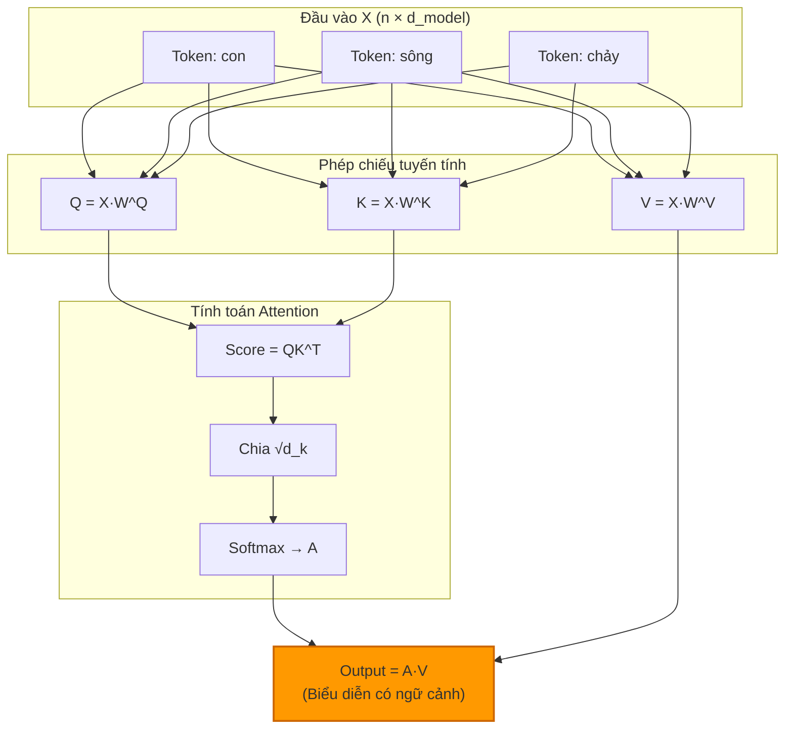
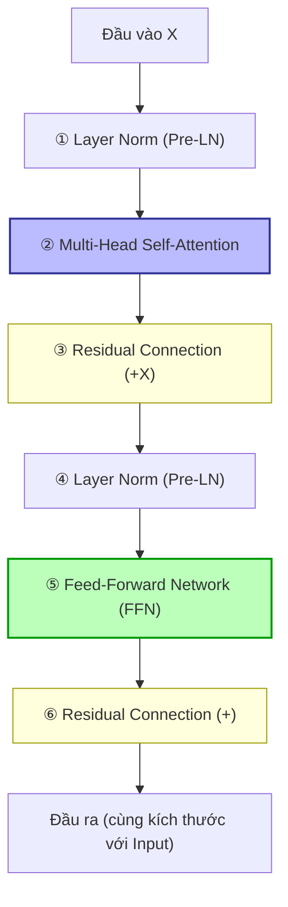
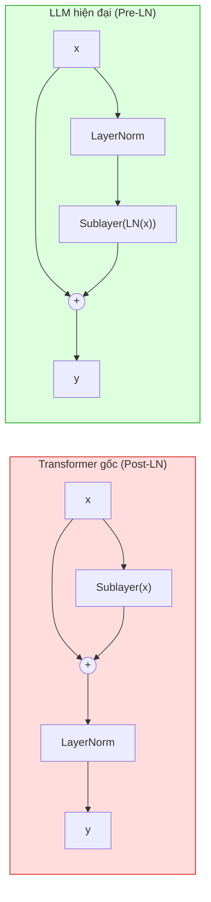
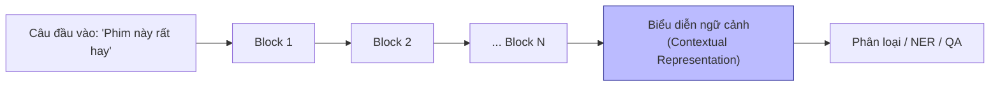
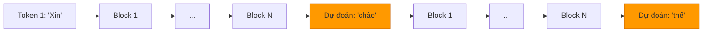
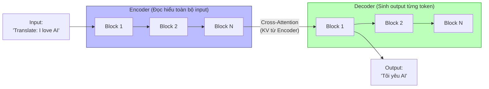
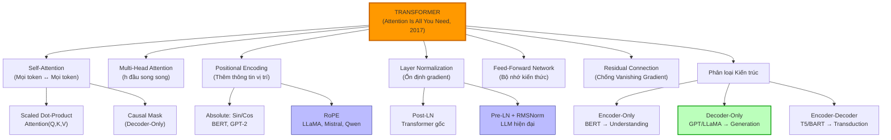

# CHƯƠNG 4: CUỘC CÁCH MẠNG TRANSFORMER — KIẾN TRÚC THAY ĐỔI MỌI THỨ

Nếu có một bài báo khoa học duy nhất thay đổi hoàn toàn bộ mặt của Trí tuệ nhân tạo trong vòng chưa đầy một thập kỷ, đó chính là **"Attention Is All You Need"** — được công bố bởi nhóm nghiên cứu tại Google Brain vào năm 2017. Tám tác giả. Mười hai trang. Và một ý tưởng đơn giản đến kinh ngạc: **Bỏ hoàn toàn RNN. Chỉ dùng Attention.**

Trong Chương 3, chúng ta đã chứng kiến hành trình tiến hóa gian nan từ CNN, RNN, đến cơ chế Attention nguyên bản. Ta biết rằng Attention là thứ thực sự tạo ra sức mạnh — khả năng liên kết thông tin ở xa mà không bị lãng quên. Nhưng nó vẫn bị xích vào RNN chạy tuần tự, chậm chạp, không thể tận dụng được sức mạnh song song của GPU hiện đại.

Câu hỏi đặt ra vào năm 2017 là: *Nếu Attention là đủ — tại sao ta phải mang theo cái vali nặng nề của RNN?*

Bài học này sẽ giải phẫu từng chi tiết của kiến trúc Transformer — cơ sở hạ tầng đứng sau mọi mô hình AI tạo sinh vĩ đại của thời đại: GPT-4, Claude, Gemini, LLaMA, Mistral.

---

## 1. BỐI CẢNH LỊCH SỬ: TẠI SAO TRANSFORMER RA ĐỜI LÀ TẤT YẾU?

### A. Ba rào cản không thể vượt qua của RNN/LSTM

Đến năm 2016, cộng đồng AI đang đứng trước một nghịch lý:

*   **Attention đã giải quyết Bottleneck** — Seq2Seq + Attention cho kết quả dịch máy vượt trội hẳn.
*   **Nhưng nền tảng RNN vẫn là nút thắt cổ chai** về tốc độ và hiệu suất.

Cụ thể, ba vấn đề mà không ai tìm được cách giải quyết triệt để trong khuôn khổ RNN:

**① Không thể song song hóa (No Parallelization):** Để tính $h_t$, bắt buộc phải có $h_{t-1}$. Điều này tạo ra một chuỗi phụ thuộc tuần tự không thể phá vỡ. Khi huấn luyện một mô hình trên câu có 1.000 từ, GPU phải thực hiện 1.000 bước tuần tự — trong khi hàng nghìn lõi CUDA của nó đứng không. Lãng phí khổng lồ.

**② Trí nhớ vẫn suy giảm theo khoảng cách:** Dù LSTM cải thiện đáng kể, hidden state $h_t$ vẫn là một vector có kích thước cố định (ví dụ 512 chiều). Khi chuỗi dài tới 500 từ, các thông tin từ phần đầu câu vẫn bị "pha loãng" dần qua hàng trăm bước cập nhật.

**③ Attention phải tính lại từng bước:** Mỗi bước sinh từ của Decoder, ta phải duyệt lại toàn bộ $T_x$ trạng thái ẩn của Encoder để tính Attention Weight. Không có cách nào tái sử dụng phép tính này.

### B. Ý tưởng đột phá của Transformer

Vaswani et al. (2017) đặt ra một câu hỏi triệt để hơn bao giờ hết:

> **"Liệu một mô hình chỉ dựa hoàn toàn vào Attention, không có bất kỳ phép toán hồi quy hay tích chập nào, có thể đạt được kết quả tốt trong bài toán dịch máy không?"**

Câu trả lời không chỉ là **"Có"** — mà là **"Tốt hơn mọi thứ đã từng tồn tại trước đó, và nhanh hơn 10 lần khi huấn luyện."**

Điểm đột phá cốt lõi nằm ở một thay đổi tư duy: Thay vì để mỗi token "ngó" vào các token khác theo thứ tự thời gian (như RNN), Transformer cho phép **mọi token chú ý đến mọi token khác trong cùng một lần tính toán duy nhất** — đây là **Self-Attention**.

---

## 2. SELF-ATTENTION (TỰ CHÚ Ý) — TRÁI TIM CỦA TRANSFORMER

### A. Vấn đề Self-Attention giải quyết: Ngữ cảnh phụ thuộc vào vị trí

Hãy xét câu tiếng Việt:
> *"Con sông chảy qua thành phố. **Nó** rất dài và uốn khúc."*

Khi đọc đến chữ **"Nó"** — làm thế nào mô hình biết "Nó" đề cập đến "con sông" chứ không phải "thành phố"?

Trong RNN, để liên kết "Nó" với "con sông", thông tin về "con sông" phải được ép qua nhiều bước hidden state rồi mới đến được vị trí của "Nó". Mỗi bước là một cơ hội bị pha loãng.

**Self-Attention giải quyết triệt để bằng cách:** Khi xử lý token "Nó", mô hình tính toán **trực tiếp** mức độ liên quan của "Nó" với **mọi từ khác** trong đoạn văn — không qua trung gian, không phụ thuộc vào khoảng cách. "Con sông" sẽ nhận điểm Attention cao nhất và đóng góp nhiều nhất vào biểu diễn của "Nó".

### B. Cơ chế hoạt động: Query, Key, Value

Transformer kế thừa khái niệm Q, K, V từ Attention nguyên bản (Chương 3), nhưng nâng cấp lên một tầm hoàn toàn mới: thay vì Q là Decoder state và K/V là Encoder states, trong Self-Attention **tất cả Q, K, V đều được tạo ra từ cùng một chuỗi đầu vào**.

#### Phép ẩn dụ: Hệ thống thư viện tra cứu

Hãy tưởng tượng bạn vào một thư viện khổng lồ để tra cứu:
*   **Query ($Q$) — "Phiếu yêu cầu":** Bạn viết phiếu yêu cầu mô tả thứ bạn cần tìm. *("Tôi cần sách về lịch sử Việt Nam thế kỷ 20")*
*   **Key ($K$) — "Nhãn danh mục trên kệ sách":** Mỗi cuốn sách trên kệ đều có nhãn mô tả nội dung của nó. *("Lịch sử VN 1900-2000", "Khoa học máy tính", "Tiểu thuyết tình cảm"...)*
*   **Value ($V$) — "Nội dung thực sự của cuốn sách":** Khi bạn chọn được cuốn sách phù hợp, bạn lấy **nội dung** thực sự của nó về đọc.

**Quy trình Self-Attention:** Bạn so sánh phiếu yêu cầu $Q$ với **tất cả** nhãn danh mục $K$ trên kệ. Cuốn sách nào có nhãn khớp nhất sẽ được chọn (điểm cao nhất). Sau đó, bạn tổng hợp nội dung $V$ từ các cuốn sách được chọn theo tỷ lệ độ khớp đó.

#### Cách tạo ra Q, K, V từ đầu vào

Cho một chuỗi đầu vào $X \in \mathbb{R}^{n \times d_{model}}$ (gồm $n$ token, mỗi token là vector $d_{model}$ chiều), ba phép chiếu tuyến tính (3 ma trận trọng số) được học để tạo ra:

$$Q = X W^Q, \quad K = X W^K, \quad V = X W^V$$

Trong đó $W^Q, W^K, W^V \in \mathbb{R}^{d_{model} \times d_k}$ là các ma trận trọng số được học từ dữ liệu.

```
Token "con":   x_1 --[W^Q]--> q_1    x_1 --[W^K]--> k_1    x_1 --[W^V]--> v_1
Token "sông":  x_2 --[W^Q]--> q_2    x_2 --[W^K]--> k_2    x_2 --[W^V]--> v_2
Token "chảy": x_3 --[W^Q]--> q_3    x_3 --[W^K]--> k_3    x_3 --[W^V]--> v_3
```

### C. Công thức Scaled Dot-Product Attention

Đây là công thức cốt lõi của toàn bộ kiến trúc Transformer:

$$\text{Attention}(Q, K, V) = \text{softmax}\left(\frac{QK^T}{\sqrt{d_k}}\right) V$$

Hãy phân tích từng thành phần:

#### Bước 1: Tính ma trận điểm số (Score Matrix) — $QK^T$

Phép nhân ma trận $QK^T \in \mathbb{R}^{n \times n}$ tính tích chấm giữa **mọi cặp** query-key trong chuỗi:

$$\text{Score}_{ij} = q_i \cdot k_j^T$$

$\text{Score}_{ij}$ đo lường: *"Token thứ $i$ quan tâm đến Token thứ $j$ ở mức độ nào?"*

```
              k_con  k_sông  k_chảy  k_qua ...
q_con     [  8.2    1.1     0.3     -0.5  ]
q_sông    [  1.1    9.5     2.1      0.8  ]
q_chảy    [  0.3    2.1     7.8      3.2  ]
...

(Số lớn = Token đang hỏi rất quan tâm đến token đó)
```

#### Bước 2: Chia cho $\sqrt{d_k}$ — Tại sao?

> [!IMPORTANT]
> **Lý do chia cho $\sqrt{d_k}$:** Khi chiều của vector $d_k$ lớn (ví dụ: 512 hoặc 1024 chiều), tích chấm $q \cdot k^T$ có xu hướng tạo ra các giá trị **rất lớn về độ lớn tuyệt đối**. Điều này khiến hàm **Softmax bị "bão hòa"** — tức là nó sẽ đẩy một giá trị về gần $1$ còn tất cả các giá trị còn lại tiến về gần $0$. Hậu quả là **gradient truyền ngược qua Softmax gần như bằng 0** (vì đạo hàm của Softmax ở vùng bão hòa ≈ 0), gây ra Vanishing Gradient cục bộ và mô hình học cực kỳ chậm.
>
> Chia cho $\sqrt{d_k}$ đưa các giá trị điểm số về vùng có phân phối phương sai $\approx 1$, giữ cho Softmax hoạt động trong vùng gradient dốc và ổn định.

#### Bước 3: Softmax — Chuẩn hóa thành phân phối xác suất

$$A_{ij} = \frac{\exp(\text{Score}_{ij} / \sqrt{d_k})}{\sum_j \exp(\text{Score}_{ij} / \sqrt{d_k})}$$

Mỗi hàng của ma trận $A \in \mathbb{R}^{n \times n}$ là một phân phối xác suất cho biết token thứ $i$ phân bổ sự chú ý như thế nào đến các token khác.

#### Bước 4: Nhân với Value — Tạo biểu diễn ngữ cảnh

$$\text{Output} = A \cdot V$$

Vector đầu ra của mỗi token là **tổng có trọng số** của tất cả các Value vector, trong đó trọng số chính là điểm Attention vừa tính. Token nào được "chú ý" nhiều sẽ đóng góp nhiều vào biểu diễn cuối.



### D. Causal Masking (Che mặt nhân quả) — Dành cho mô hình sinh văn bản

Trong kiến trúc **Decoder-Only** (như GPT, LLaMA), khi sinh từ thứ $t$, mô hình **không được phép "nhìn trộm" vào các từ tương lai** (thứ $t+1, t+2,...$). Nếu không, mô hình sẽ học cách "cheat" trong quá trình training.

Giải pháp là áp dụng **Causal Mask (Mặt nạ nhân quả)**: Trước khi đưa vào Softmax, các ô tương ứng với vị trí tương lai được thiết lập về $-\infty$:

$$\text{Score}_{ij} = -\infty \quad \text{nếu } j > i$$

Khi đi qua Softmax, $e^{-\infty} = 0$ → Token $i$ hoàn toàn không chú ý đến bất kỳ token nào đứng sau nó.

```
Ma trận Attention sau Causal Mask (tam giác dưới):

        con   sông  chảy  qua
con   [ 1.0   0.0   0.0   0.0 ]   (chỉ nhìn chính nó)
sông  [ 0.3   0.7   0.0   0.0 ]   (nhìn "con" và chính nó)
chảy  [ 0.1   0.6   0.3   0.0 ]   (nhìn "con", "sông", và chính nó)
qua   [ 0.05  0.4   0.4   0.15]   (nhìn tất cả trước đó)
```

---

## 3. MULTI-HEAD ATTENTION — NHÌN TỪ NHIỀU GÓC ĐỘ

### A. Giới hạn của Single-Head Attention

Một đầu Attention duy nhất chỉ học được **một kiểu quan hệ** giữa các token trong mỗi lần tính toán. Nhưng ngôn ngữ phức tạp hơn nhiều: trong câu "Con mèo mà tôi nuôi thích ăn cá", từ "nuôi" có thể đồng thời liên quan đến "tôi" (ai nuôi?), "mèo" (nuôi cái gì?), và "ăn" (hành động tiếp theo). Một đầu Attention khó có thể học tất cả những quan hệ đa chiều này cùng một lúc.

### B. Giải pháp Multi-Head Attention

Thay vì một đầu Attention với $d_{model}$ chiều, ta chạy **$h$ đầu Attention song song**, mỗi đầu có chiều $d_k = d_{model} / h$:

$$\text{MultiHead}(Q, K, V) = \text{Concat}(\text{head}_1, \text{head}_2, ..., \text{head}_h) W^O$$

$$\text{head}_i = \text{Attention}(Q W_i^Q, K W_i^K, V W_i^V)$$

Trong đó $W^O \in \mathbb{R}^{hd_v \times d_{model}}$ là ma trận chiếu đầu ra.

#### Phân tích chi tiết từng đầu:

Mỗi đầu $i$ có bộ ma trận trọng số riêng $(W_i^Q, W_i^K, W_i^V)$. Khi huấn luyện, mỗi đầu sẽ **tự học** để chuyên biệt hóa vào một loại quan hệ ngữ nghĩa khác nhau:

```
Head 1: Học quan hệ cú pháp (chủ ngữ - động từ)
        "Tôi" ←→ "ăn"   |   "Con mèo" ←→ "ngủ"

Head 2: Học quan hệ đồng tham chiếu (Coreference)
        "Nó" ←→ "con sông"   |   "Anh ấy" ←→ "Minh"

Head 3: Học quan hệ lân cận (Locality)
        Tập trung vào các từ đứng ngay cạnh nhau

Head 4: Học quan hệ ngữ nghĩa xa (Long-range dependency)
        "mặc dù" ←→ "nhưng"   |   "if" ←→ "then"
```

#### So sánh tham số: Single-Head vs Multi-Head

| | Single-Head Attention | Multi-Head Attention (h=8) |
| :--- | :--- | :--- |
| **Chiều mỗi đầu** | $d_k = d_{model}$ | $d_k = d_{model} / 8$ |
| **Số phép tính Attention** | 1 | 8 song song |
| **Tổng tham số Q, K, V** | $3 \times d_{model}^2$ | $3 \times d_{model}^2$ (tương đương!) |
| **Biểu diễn đa dạng** | 1 góc nhìn | 8 góc nhìn đa dạng |

> [!TIP]
> **Chi phí tính toán không tăng!** Mặc dù có $h$ đầu, tổng số tham số Q, K, V tương đương với Single-Head vì mỗi đầu có chiều nhỏ hơn $h$ lần. Lợi ích là *miễn phí* về mặt chi phí.

---

## 4. POSITIONAL ENCODING — MÃ HÓA VỊ TRÍ

### A. Vấn đề: Transformer "mù" về thứ tự

Đây là điểm khác biệt cốt lõi nhất giữa Transformer và RNN. RNN tự nhiên có khái niệm "thứ tự" vì nó xử lý từng token một theo trình tự. Transformer thì không — nó xử lý tất cả token **đồng thời và song song**.

Điều đó có nghĩa là nếu không có thêm thông tin nào, Transformer coi câu "Tôi yêu bạn" và "Bạn yêu tôi" là **giống hệt nhau** (vì tập token giống nhau, chỉ khác thứ tự). Đây là vấn đề chết người.

Giải pháp: Trước khi đưa vào Transformer, ta **cộng thêm một vector mã hóa vị trí** vào mỗi embedding token:

$$\text{Input thực sự} = \text{Token Embedding} + \text{Positional Encoding}$$

### B. Absolute Positional Encoding (Bài báo gốc 2017)

Trong bài báo "Attention Is All You Need" gốc, Vaswani et al. dùng hàm sin/cos để mã hóa vị trí theo công thức:

$$PE_{(pos, 2i)} = \sin\left(\frac{pos}{10000^{2i/d_{model}}}\right)$$

$$PE_{(pos, 2i+1)} = \cos\left(\frac{pos}{10000^{2i/d_{model}}}\right)$$

Trong đó $pos$ là vị trí của token trong chuỗi, và $i$ là chiều của vector.

**Tại sao dùng sin/cos?**
1.  **Duy nhất:** Mỗi vị trí $pos$ tạo ra một vector độc nhất.
2.  **Ngoại suy:** Mô hình có thể xử lý chuỗi dài hơn so với khi training (lý thuyết).
3.  **Quan hệ tương đối:** $PE_{pos+k}$ có thể được biểu diễn như tổ hợp tuyến tính của $PE_{pos}$, giúp mô hình học được khoảng cách tương đối giữa các token.

```
Vị trí 0:  [0.00, 1.00, 0.00, 1.00, 0.00, ...]  (sin(0), cos(0), sin(0), cos(0), ...)
Vị trí 1:  [0.84, 0.54, 0.01, 1.00, 0.00, ...]  (sin(1), cos(1), sin(0.01), ...)
Vị trí 2:  [0.91,-0.42, 0.02, 1.00, 0.00, ...]
...
```

### C. Học tham số vị trí (Learnable Positional Embedding)

BERT và GPT-2 thay thế hàm sin/cos bằng **bảng embedding vị trí được học từ dữ liệu** — tương tự như Token Embedding nhưng đánh chỉ số theo vị trí thay vì token ID.

**Ưu điểm:** Linh hoạt hơn, tự tìm ra cách mã hóa tốt nhất cho từng bài toán.
**Nhược điểm:** Không thể xử lý chuỗi dài hơn độ dài tối đa đã thấy khi training.

### D. RoPE (Rotary Positional Embedding) — Tiêu chuẩn LLM hiện đại

RoPE được đề xuất bởi Su et al. (2021) và hiện là tiêu chuẩn vàng trong hầu hết LLM hiện đại (LLaMA, Mistral, Qwen, Gemma). Thay vì **cộng** vector vị trí vào embedding, RoPE mã hóa thông tin vị trí bằng cách **xoay** các vector Query và Key theo một góc phụ thuộc vào vị trí trong không gian phức.

**Ý tưởng trực quan:** Nếu ta xoay $Q$ tại vị trí $m$ một góc $m\theta$ và xoay $K$ tại vị trí $n$ một góc $n\theta$, thì tích chấm $Q_m \cdot K_n$ sẽ tự động phụ thuộc vào **khoảng cách tương đối** $(m - n)$:

$$q_m^T k_n = f(q, k, m-n)$$

**Hai ưu điểm quan trọng của RoPE so với Absolute PE:**

| Tiêu chí | Absolute PE (sin/cos, Learnable) | RoPE |
| :--- | :--- | :--- |
| **Mã hóa vị trí** | Vị trí tuyệt đối | Khoảng cách tương đối (m-n) |
| **Ngoại suy (Extrapolation)** | Kém khi vượt quá max_length training | Tốt hơn nhờ tính chất xoay |
| **Tính toán** | Cộng vào Embedding | Xoay Q và K trước khi tính Attention |
| **LLM sử dụng** | BERT, GPT-2, GPT-3 | LLaMA 1/2/3, Mistral, Qwen, Gemma |

> [!NOTE]
> **Tại sao "tương đối" tốt hơn "tuyệt đối"?** Trong ngôn ngữ, ý nghĩa của một từ thường phụ thuộc vào khoảng cách đến từ liên quan, không phải vị trí tuyệt đối trong câu. "Con mèo ngủ" — "mèo" và "ngủ" quan trọng vì chúng đứng cạnh nhau, không phải vì chúng ở vị trí thứ 2 và 3 trong chuỗi 512 token.

---

## 5. KIẾN TRÚC TRANSFORMER ĐẦY ĐỦ

### A. Khối Transformer (Transformer Block) — Đơn vị cơ bản

Mỗi lớp Transformer là sự kết hợp của bốn thành phần xếp chồng nhau:



### B. Feed-Forward Network (FFN) — Bộ nhớ kiến thức

Sau Multi-Head Attention, mỗi token được xử lý độc lập qua một mạng truyền thẳng hai lớp:

$$\text{FFN}(x) = \text{SwiGLU}(xW_1 + b_1) W_2 + b_2$$

Trong đó $W_1 \in \mathbb{R}^{d_{model} \times d_{ff}}$ thường có $d_{ff} = 4 \times d_{model}$ (mở rộng 4 lần).

> [!NOTE]
> **FFN là gì về mặt chức năng?** Các nghiên cứu gần đây (Geva et al., 2021 — "Transformer Feed-Forward Layers Are Key-Value Memories") chứng minh rằng **FFN hoạt động như bộ nhớ kiến thức** của mô hình. Multi-Head Attention xử lý "quan hệ ngữ cảnh" (token nào liên quan đến token nào), còn FFN "tra cứu và áp dụng kiến thức thực tế" được lưu trong trọng số (ví dụ: Paris là thủ đô của France, H2O là công thức hóa học của nước). Đây là lý do tại sao số tham số FFN thường chiếm tới ~2/3 tổng tham số của mô hình.

### C. Residual Connection — Kết nối tắt chống Vanishing Gradient

Trong các mạng rất sâu (Transformer có thể có 32, 80, hay thậm chí 128 lớp), Vanishing Gradient là vấn đề nghiêm trọng. **Residual Connection** (He et al., 2016 — ResNet) giải quyết bằng cách cộng đầu vào thẳng vào đầu ra:

$$\text{Output} = \text{SubLayer}(x) + x$$

**Tại sao điều này quan trọng?** Khi lan truyền ngược, đạo hàm chảy qua **cả hai con đường**: qua SubLayer (tích chập của nhiều Jacobian) **và** qua đường tắt $+x$ (gradient = 1, không mất mát). Điều này đảm bảo gradient luôn có ít nhất một con đường "sạch" để truyền về lớp đầu, dù mạng sâu đến đâu.

---

## 6. LAYER NORMALIZATION — ỔN ĐỊNH HÓA QUÁ TRÌNH HUẤN LUYỆN

### A. Tại sao cần Normalization?

Khi dữ liệu đi qua nhiều lớp biến đổi, phân phối của các activation có xu hướng dịch chuyển (Internal Covariate Shift). Điều này khiến các lớp sau luôn phải "thích nghi" với phân phối mới của lớp trước, làm chậm và mất ổn định quá trình học.

### B. Batch Norm vs Layer Norm

| | Batch Normalization (BN) | Layer Normalization (LN) |
| :--- | :--- | :--- |
| **Chuẩn hóa theo** | Chiều Batch (mỗi feature qua N samples) | Chiều Feature (mỗi token qua d_model) |
| **Phụ thuộc Batch size** | Có (cần batch lớn) | Không (độc lập per-token) |
| **Phù hợp với** | CNN (ảnh, kích thước cố định) | RNN, Transformer (chuỗi độ dài thay đổi) |
| **Hoạt động tốt trong** | Inference độc lập | Cả training và inference |

**Tại sao BN thất bại trong Transformer?** Mỗi câu trong NLP có độ dài khác nhau. Việc tính giá trị trung bình và phương sai theo chiều Batch (qua nhiều câu có độ dài khác nhau) không có ý nghĩa vật lý — ta đang so sánh token thứ 5 của câu ngắn với token thứ 5 của câu dài mà nội dung hoàn toàn khác nhau.

**Layer Norm** tính toán riêng cho từng token — tính trung bình $\mu$ và phương sai $\sigma$ qua $d_{model}$ chiều của token đó:

$$\text{LN}(x) = \frac{x - \mu}{\sigma + \epsilon} \cdot \gamma + \beta$$

Trong đó $\gamma$ và $\beta$ là các tham số học được (scale và shift).

### C. Post-LN vs Pre-LN: Vị trí của Layer Norm quan trọng hơn bạn nghĩ

#### Transformer gốc (Post-LN):
$$\text{Output} = \text{LN}(\text{SubLayer}(x) + x)$$

Layer Norm được áp dụng **sau** Residual Connection. Vấn đề: Khi mạng rất sâu, đầu ra của SubLayer có thể có giá trị rất lớn trước khi được chuẩn hóa, gây ra gradient bất ổn trong các lớp đầu tiên. Post-LN thường yêu cầu Learning Rate rất nhỏ và kỹ thuật Warmup đặc biệt để training ổn định.

#### LLM hiện đại (Pre-LN):
$$\text{Output} = \text{SubLayer}(\text{LN}(x)) + x$$

Layer Norm được áp dụng **trước** SubLayer. Ưu điểm lớn: Gradient truyền qua đường tắt Residual ($+x$) luôn sạch vì không đi qua LN. Huấn luyện ổn định hơn nhiều dù không có Warmup. Đây là lý do **Pre-LN được dùng trong hầu hết LLM từ GPT-2 trở đi**.



### D. RMSNorm — Tối ưu hóa Layer Norm cho LLM

RMSNorm (Root Mean Square Normalization) do Zhang & Sennrich (2019) đề xuất, đơn giản hóa Layer Norm bằng cách bỏ qua bước **căn chỉnh trung bình (mean centering)**:

$$\text{RMSNorm}(x) = \frac{x}{\sqrt{\frac{1}{d} \sum_{i=1}^{d} x_i^2 + \epsilon}} \cdot \gamma$$

So với Layer Norm, RMSNorm:
*   Bỏ đi phép tính $\mu$ (trung bình).
*   Bỏ đi tham số $\beta$ (shift).
*   Chỉ giữ lại phép tính RMS và tham số $\gamma$ (scale).

**Kết quả thực nghiệm:** RMSNorm nhanh hơn LayerNorm **10-50%** về tốc độ tính toán, trong khi hiệu năng mô hình không giảm đáng kể (trên một số tác vụ còn tốt hơn). Đây là lý do **RMSNorm là tiêu chuẩn trong LLaMA, Mistral, Qwen và Gemma**.

---

## 7. PHÂN LOẠI KIẾN TRÚC TRANSFORMER

Từ khối Transformer cơ bản, người ta đã phát triển ba nhánh kiến trúc chính, phù hợp với các bài toán khác nhau:

### A. Encoder-Only (Chỉ Bộ Mã Hóa)



**Cách hoạt động:** Mỗi token "chú ý" đến tất cả token khác trong chuỗi (không có Causal Mask). Đầu ra là tập hợp các biểu diễn vector giàu ngữ cảnh.

**Objective huấn luyện:** **Masked Language Modeling (MLM)** — che ngẫu nhiên 15% token và yêu cầu mô hình đoán lại từ bị che dựa trên ngữ cảnh từ cả hai phía.

**Đại diện tiêu biểu:** **BERT**, RoBERTa, DeBERTa.

**Ứng dụng phù hợp:**
*   Phân loại văn bản (Sentiment Analysis, Topic Classification).
*   Nhận dạng thực thể có tên (Named Entity Recognition - NER).
*   Trả lời câu hỏi đọc hiểu (Extractive QA).
*   Biểu diễn câu cho Embedding (dùng trong RAG).

**Không phù hợp cho:** Sinh văn bản (vì cần đọc cả hai chiều, không thể sinh từng từ một).

### B. Decoder-Only (Chỉ Bộ Giải Mã)



**Cách hoạt động:** Áp dụng **Causal Mask** — mỗi token chỉ chú ý đến các token đứng trước nó. Sinh văn bản **tự hồi quy** (autoregressive): mỗi lần sinh ra một token, token đó được đưa vào làm đầu vào cho lần tiếp theo.

**Objective huấn luyện:** **Causal Language Modeling (CLM)** (hay Next Token Prediction) — dự đoán token tiếp theo dựa trên toàn bộ lịch sử phía trước.

**Đại diện tiêu biểu:** **GPT-2, GPT-3, GPT-4, LLaMA 1/2/3, Mistral, Qwen, Gemma, Claude**.

**Ứng dụng phù hợp:**
*   **Mọi tác vụ sinh văn bản:** Chatbot, viết nội dung, viết code.
*   Instruction Following (sau khi Fine-tune SFT).
*   Lý luận đa bước (Chain-of-Thought).
*   **Kiến trúc nền tảng của hầu hết các LLM thế hệ mới.**

### C. Encoder-Decoder (Bộ Mã Hóa — Bộ Giải Mã đầy đủ)



**Cách hoạt động:** Encoder xử lý toàn bộ câu đầu vào và tạo ra biểu diễn phong phú. Decoder sinh đầu ra từng bước, trong đó mỗi lớp Decoder có thêm **Cross-Attention** — cho phép Decoder "chú ý" vào các biểu diễn của Encoder (K và V đến từ Encoder, Q đến từ Decoder).

**Objective huấn luyện:** **Span Corruption (T5)** — che các đoạn liên tiếp và tái tạo chúng, hoặc **Denoising**.

**Đại diện tiêu biểu:** **T5, BART, mBART**.

**Ứng dụng phù hợp:**
*   Dịch máy (Machine Translation): Input ngôn ngữ A → Output ngôn ngữ B.
*   Tóm tắt văn bản (Abstractive Summarization).
*   Hỏi đáp dạng tổng hợp (Abstractive QA).

### D. Bảng so sánh tổng hợp ba kiến trúc

| Tiêu chí | Encoder-Only | Decoder-Only | Encoder-Decoder |
| :--- | :--- | :--- | :--- |
| **Attention Mask** | Không mask (bidirectional) | Causal Mask (unidirectional) | Encoder: không mask; Decoder: Causal + Cross |
| **Objective training** | Masked LM (MLM) | Next Token Prediction (CLM) | Seq2Seq (Span Corruption) |
| **Thế mạnh** | Hiểu văn bản (Understanding) | Sinh văn bản (Generation) | Biến đổi chuỗi (Transduction) |
| **Đại diện** | BERT, RoBERTa | GPT, LLaMA, Mistral | T5, BART |
| **Ứng dụng cốt lõi** | Classification, NER, Embedding | Chatbot, Code, Reasoning | Dịch thuật, Tóm tắt |
| **Xu hướng hiện tại** | Ít phổ biến hơn cho LLM lớn | **Thống trị thị trường LLM** | Vẫn mạnh cho bài toán chuyên biệt |

> [!NOTE]
> **Xu hướng thực tế:** Kể từ GPT-3 (2020), cộng đồng AI có xu hướng mạnh về Decoder-Only vì một lý do bất ngờ: **Các mô hình Decoder-Only lớn đủ có thể làm tốt mọi thứ** — kể cả Classification và NER (chỉ cần Prompt đúng cách). Đây là hiện tượng "**emergent abilities**" (khả năng nổi lên bất ngờ) khi scale lên đủ lớn.

---

## 8. KIẾN TRÚC TRANSFORMER HIỆN ĐẠI: LLAMA LÀM VÍ DỤ

Để cụ thể hóa, ta xem kiến trúc của **LLaMA-3 (Meta AI, 2024)** — một trong những LLM mã nguồn mở phổ biến nhất. Đây là kiến trúc Decoder-Only với các cải tiến so với Transformer gốc:

| Thành phần | Transformer Gốc (2017) | LLaMA-3 (2024) | Lý do thay đổi |
| :--- | :--- | :--- | :--- |
| **Positional Encoding** | Absolute Sin/Cos | **RoPE** | Ngoại suy chuỗi dài tốt hơn |
| **Normalization** | Post-LN (LayerNorm) | **Pre-RMSNorm** | Ổn định hơn, nhanh hơn 10-50% |
| **Activation FFN** | ReLU | **SwiGLU** | Gradient mượt, hiệu năng cao hơn |
| **Attention** | Multi-Head Attention | **Grouped-Query Attention (GQA)** | Giảm VRAM cho KV Cache khi inference |
| **Kiến trúc** | Encoder-Decoder | **Decoder-Only** | Thống nhất kiến trúc, scale tốt hơn |

### Grouped-Query Attention (GQA) — Cải tiến thực tế quan trọng

GQA là một kỹ thuật quan trọng trong LLM hiện đại để giảm bộ nhớ KV Cache. Thay vì mỗi head có bộ K, V riêng, GQA chia các Query heads thành các nhóm và mỗi nhóm chia sẻ chung một cặp K, V:

```
Multi-Head Attention (MHA):   Q1,K1,V1 | Q2,K2,V2 | Q3,K3,V3 | Q4,K4,V4
Grouped-Query Attention (GQA): Q1,Q2,K1,V1       | Q3,Q4,K2,V2
                                (2 heads dùng chung K1,V1)
Multi-Query Attention (MQA):  Q1,Q2,Q3,Q4 đều dùng K1,V1 (cực đoan nhất)
```

**Tại sao quan trọng?** KV Cache là bộ nhớ lưu K và V đã tính toán để tránh tính lại khi sinh token mới. Với chuỗi dài, KV Cache tiêu thụ rất nhiều VRAM. GQA giảm kích thước KV Cache đáng kể mà hầu như không làm giảm chất lượng.

---

## 📌 KEY TAKEAWAYS — NHỮNG ĐIỀU CỐT LÕI CẦN GHI NHỚ

> [!IMPORTANT]
> **6 luận điểm cốt lõi của Chương 4:**
>
> 1. **Self-Attention** cho phép mọi token chú ý đến mọi token khác trong một lần tính toán song song — đây là đột phá cho phép loại bỏ RNN.
>
> 2. **Scaled Dot-Product Attention**: $\text{Attention}(Q,K,V) = \text{softmax}(QK^T/\sqrt{d_k})V$. Chia $\sqrt{d_k}$ để tránh Softmax bão hòa và Vanishing Gradient.
>
> 3. **Multi-Head Attention** cho phép mô hình học nhiều loại quan hệ ngữ nghĩa đồng thời (cú pháp, đồng tham chiếu, khoảng cách xa...) với chi phí tính toán tương đương Single-Head.
>
> 4. **Positional Encoding** là bắt buộc vì Transformer không có khái niệm thứ tự. RoPE là tiêu chuẩn hiện đại vì mã hóa khoảng cách tương đối, hỗ trợ ngoại suy chuỗi dài.
>
> 5. **Pre-LN và RMSNorm** là lựa chọn tiêu chuẩn của LLM hiện đại — ổn định huấn luyện tốt hơn Post-LN và nhanh hơn LayerNorm.
>
> 6. **Decoder-Only** đang thống trị kỷ nguyên LLM vì với đủ scale, một kiến trúc đơn giản có thể xử lý mọi bài toán ngôn ngữ.

---

## 🧠 BẢN ĐỒ TƯ DUY: TOÀN CẢNH TRANSFORMER



---

## ❓ CÂU HỎI ÔN TẬP — TỰ KIỂM TRA HIỂU BIẾT

**Phần Self-Attention:**
1. Tại sao Transformer có thể chạy song song 100% trên GPU trong khi RNN thì không?
2. Trong Self-Attention, Q, K, V được tạo ra từ đâu? Tại sao cần ba phép chiếu riêng biệt?
3. Tại sao lại chia cho $\sqrt{d_k}$ trong công thức Attention? Điều gì xảy ra nếu không chia?
4. Causal Mask là gì? Tại sao kiến trúc Decoder-Only bắt buộc phải có Causal Mask?

**Phần Multi-Head Attention:**
5. Multi-Head Attention có tốn nhiều tham số hơn Single-Head Attention không? Tại sao không?
6. Các "head" khác nhau trong Multi-Head Attention học được những loại quan hệ gì?

**Phần Positional Encoding:**
7. Tại sao Transformer cần Positional Encoding trong khi RNN thì không?
8. So sánh ưu/nhược điểm của Absolute PE (sin/cos) và RoPE. Tại sao LLM hiện đại chọn RoPE?

**Phần Layer Norm:**
9. Tại sao Batch Normalization thất bại trong Transformer nhưng hoạt động tốt trong CNN?
10. Pre-LN khác Post-LN ở điểm gì? Ưu điểm của Pre-LN trong việc huấn luyện mạng sâu là gì?
11. RMSNorm tiết kiệm được gì so với LayerNorm? Tại sao nó vẫn hiệu quả dù đơn giản hơn?

**Phần Kiến trúc:**
12. Kể tên ba nhánh kiến trúc Transformer và ứng dụng phù hợp của mỗi loại.
13. Tại sao Decoder-Only lại thống trị thị trường LLM hiện nay, kể cả cho các tác vụ không phải sinh văn bản?
14. FFN trong Transformer đóng vai trò gì khác với Multi-Head Attention?

> [!TIP]
> **Gợi ý học tập:** Hãy vẽ lại sơ đồ một Transformer Block hoàn chỉnh (Pre-LN → MHA → Residual → Pre-LN → FFN → Residual) ra giấy từ trí nhớ. Đây là bài kiểm tra hiểu bài tốt nhất.

---

## 🌟 CẦU NỐI SANG CHƯƠNG 5: LLM NÂNG CAO

Sau khi đã hiểu sâu kiến trúc Transformer, ta sẵn sàng bước vào kỷ nguyên LLM thực sự. Chương 5 sẽ trả lời các câu hỏi còn để ngỏ:

| Câu hỏi | Chủ đề Chương 5 |
| :--- | :--- |
| Máy tính "đọc" chữ như thế nào? Tại sao cùng từ lại được chia thành các mảnh khác nhau? | **Tokenization: BPE, WordPiece, SentencePiece** |
| GPT-4 được huấn luyện như thế nào trên toàn bộ Internet mà không bị overfit? | **Pre-training Objectives: CLM vs MLM** |
| Tại sao GPT-3 (175B tham số) đột ngột "thông minh" hơn GPT-2 (1.5B) theo cấp độ phi tuyến? | **Scaling Laws: Tham số × Dữ liệu × Compute** |
| Tại sao chatbot có thể trả lời liên tục mà không bị chậm đi khi câu dài hơn? | **KV Cache: Cơ chế tái sử dụng tính toán** |

> [!IMPORTANT]
> **Nhận thức quan trọng:** Khi bạn hiểu Transformer ở mức độ này, bạn đã hiểu nền tảng của **mọi mô hình AI tạo sinh đang thống trị thế giới hiện nay** — GPT-4, Claude, Gemini, LLaMA. Sự khác biệt giữa chúng phần lớn nằm ở: quy mô (scale), dữ liệu huấn luyện, và các kỹ thuật fine-tuning và alignment (RLHF, DPO) mà ta sẽ học ở các chương sau.

---

*Tham khảo thêm:*
- [The Illustrated Transformer - Jay Alammar](https://jalammar.github.io/illustrated-transformer/) *(Bắt buộc đọc — trực quan hóa tốt nhất về Transformer)*
- [Attention Is All You Need — Bài báo gốc (2017)](https://arxiv.org/abs/1706.03762)
- [The Annotated Transformer - Harvard NLP](http://nlp.seas.harvard.edu/annotated-transformer/)
- [RoPE: Rotary Position Embedding (2021)](https://arxiv.org/abs/2104.09864)
- [LLaMA 3: Meta AI (2024)](https://ai.meta.com/blog/meta-llama-3/)
