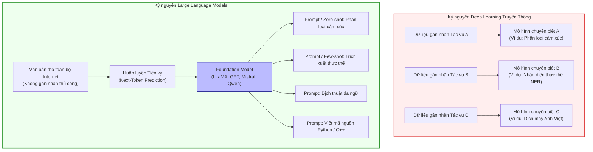
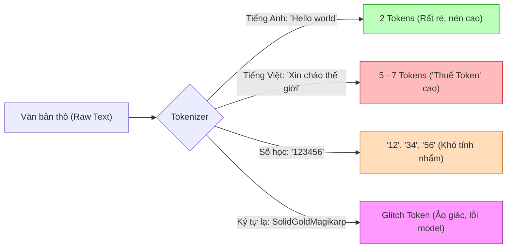
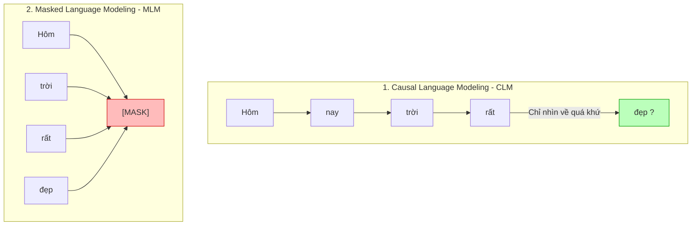
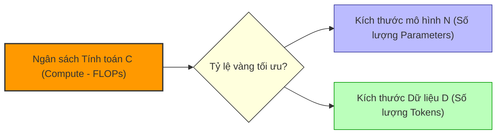
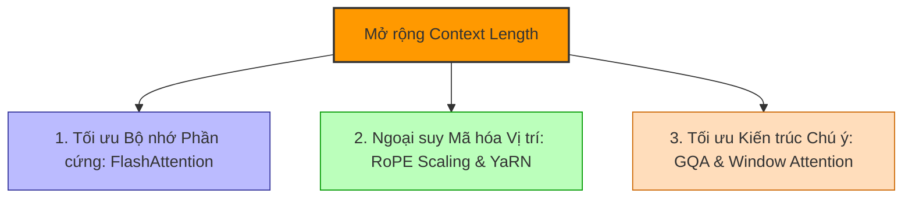
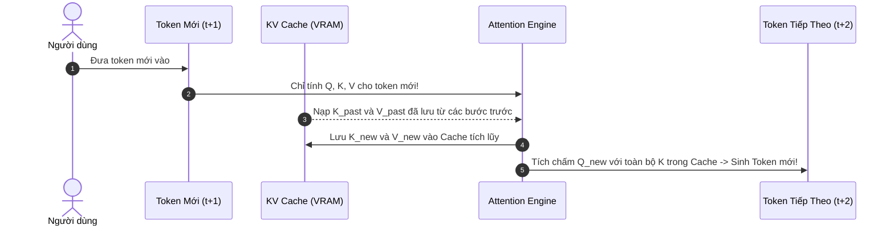
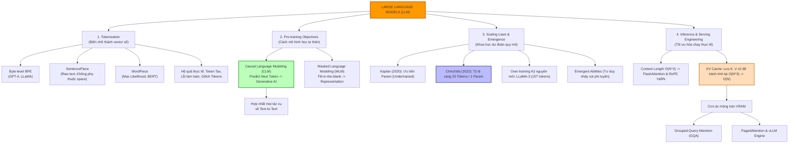

# CHƯƠNG 5: LARGE LANGUAGE MODELS (LLM) NÂNG CAO — BƯỚC NHẢY VỌT KỶ NGUYÊN

Trong [Chương 4](file:///home/huudang/Documents/AI_in_the_nutshell/Chương%204.md), chúng ta đã giải phẫu từng tế bào của kiến trúc Transformer — cỗ máy tính toán song song hoàn hảo đã giải phóng trí tuệ nhân tạo khỏi sự chậm chạp của RNN. Tuy nhiên, kiến trúc chỉ là cái khung xương. Một mô hình Transformer 65 triệu tham số dịch từ tiếng Anh sang tiếng Đức của năm 2017 vẫn còn một khoảng cách thăm thẳm để trở thành một hệ thống thông minh đa năng như GPT-4 hay LLaMA-3.

Làm thế nào một kiến trúc ban đầu vốn chỉ dùng để dịch thuật lại có thể tiến hóa thành "bộ não" có khả năng viết code, giải toán, suy luận logic và hội thoại tự nhiên với con người?

Chương 5 chính là chiếc cầu nối quyết định: **bước chuyển mình từ Deep Learning truyền thống sang kỷ nguyên Mô hình Ngôn ngữ Lớn (Large Language Models - LLMs)**. Chúng ta sẽ khám phá cách máy tính băm nhỏ và "cảm thụ" chữ viết (Tokenization), mục tiêu học tự thân biến toàn bộ kho tàng tri thức nhân loại thành bài tập về nhà (Pre-training Objectives), những quy luật toán học kiểm soát kích thước mô hình (Scaling Laws), và kỹ thuật then chốt giữ cho cỗ máy sinh từ với tốc độ cực nhanh trong bộ nhớ GPU thực tế (KV Cache).

---

## 1. TỪ DEEP LEARNING TRUYỀN THỐNG ĐẾN KỶ NGUYÊN FOUNDATION MODEL

Trước khi đi sâu vào chi tiết kỹ thuật, ta cần hiểu sự chuyển dịch tư duy mang tính kiến tạo giữa hai thời kỳ:



*   **Deep Learning truyền thống:** Mô hình được thiết kế cho từng tác vụ riêng rẽ (Task-specific). Nếu muốn nhận diện cảm xúc, bạn phải thu thập hàng chục nghìn bình luận gán nhãn thủ công "Tích cực / Tiêu cực" và train một mô hình riêng. Mỗi mô hình là một hòn đảo biệt lập.
*   **Kỷ nguyên LLM (Foundation Models):** Chỉ **một mô hình duy nhất** được huấn luyện trên khối lượng văn bản khổng lồ không gán nhãn (Unsupervised / Self-supervised). Bằng cách học cách dự đoán từ tiếp theo từ hàng nghìn tỷ từ ngữ, mô hình hấp thụ luôn cú pháp, ngữ nghĩa, tri thức thế giới và khả năng lập luận. Sau đó, nó có thể giải quyết hầu hết mọi bài toán ngôn ngữ chỉ thông qua chỉ dẫn (Prompting) hoặc tinh chỉnh nhẹ (Fine-tuning).

---

## 2. TOKENIZATION — NGHỆ THUẬT VÀ TOÁN HỌC CỦA VIỆC "ĐỌC CHỮ"

Máy tính và mạng nơ-ron hoàn toàn không thể trực tiếp xử lý các chuỗi ký tự như `"AI"` hay `"Transformer"`. Chúng chỉ làm việc với các ma trận số. Do đó, bước chân đầu tiên của mọi văn bản khi đi vào LLM là phải đi qua **Tokenizer**.

### A. Ba cấp độ phân rã văn bản: Đánh đổi lớn

Để biến văn bản thành các con số đại diện, ta có 3 hướng tiếp cận kinh điển:

```
Văn bản gốc: "unbelievable"
1. Cấp độ Từ (Word):         ["unbelievable"]
2. Cấp độ Ký tự (Character):  ["u", "n", "b", "e", "l", "i", "e", "v", "a", "b", "l", "e"]
3. Cấp độ Từ con (Subword):   ["un", "believ", "able"]
```

| Tiêu chí | Cấp độ Từ (Word-level) | Cấp độ Ký tự (Char-level) | Cấp độ Từ con (Subword-level) |
| :--- | :--- | :--- | :--- |
| **Kích thước từ vựng ($V$)** | Cực lớn (hàng triệu từ) | Cực nhỏ (~256 ký tự ASCII/Unicode) | Tối ưu (~32.000 đến 128.000 tokens) |
| **Độ dài chuỗi ($N$)** | Ngắn nhất | Rất dài (gấp 4-6 lần) | Vừa phải |
| **Vấn đề từ chưa biết (OOV)** | Rất nghiêm trọng (thay bằng `[UNK]`) | Không bao giờ bị OOV | Không bao giờ bị OOV |
| **Ngữ nghĩa của đơn vị** | Rất cao (mỗi từ mang ý nghĩa) | Rất thấp (chữ "u" đứng một mình vô nghĩa) | Cân bằng hoàn hảo giữa ngữ nghĩa và cấu trúc |
| **Chi phí tính toán ($O(N^2)$)** | Thấp nhất | Khủng khiếp nhất (do $N$ quá lớn) | Tối ưu hóa dung hòa |

> [!NOTE]
> **Kết luận của ngành AI:** Cấp độ **Subword (Từ con)** là tiêu chuẩn vàng của toàn bộ LLM hiện đại. Nó cho phép ghép các tiền tố (prefix), gốc từ (root) và hậu tố (suffix) một cách linh hoạt, vừa giữ được ngữ nghĩa của từ vựng phổ biến, vừa phân rã được bất kỳ từ hiếm, từ ghép hoặc lỗi chính tả nào thành các mảnh nhỏ hơn mà không bao giờ gặp lỗi `[UNK]` (Out-Of-Vocabulary).

---

### B. Byte-Pair Encoding (BPE) — Thuật toán nén trở thành nền tảng LLM

**Byte-Pair Encoding (BPE)** vốn là một thuật toán nén dữ liệu cổ điển được Philip Gage phát minh vào năm 1994. Đến năm 2016, Rico Sennrich và cộng sự đã khéo léo áp dụng nó vào NLP để giải quyết bài toán dịch từ hiếm, mở đường cho GPT-2, GPT-3, GPT-4 và dòng họ LLaMA.

#### 1. Nguyên lý hoạt động từng bước của BPE

*   **Bước 1 (Khởi tạo):** Bắt đầu với tập từ vựng cơ sở gồm toàn bộ các ký tự đơn lẻ xuất hiện trong tập văn bản (corpus). Mỗi từ trong dữ liệu được tách thành các ký tự riêng rẽ, kết thúc bằng một ký tự đặc biệt (ví dụ: `</w>`).
*   **Bước 2 (Đếm tần suất):** Đếm tần suất xuất hiện của tất cả các cặp ký tự/token đứng cạnh nhau trong toàn bộ corpus.
*   **Bước 3 (Hợp nhất - Merge):** Chọn cặp token xuất hiện nhiều nhất và hợp nhất chúng thành một token mới. Thêm token mới này vào tập từ vựng ($V$).
*   **Bước 4 (Lặp lại):** Lặp lại Bước 2 và Bước 3 cho đến khi tập từ vựng đạt kích thước mong muốn ($V_{\text{target}}$) hoặc số lần merge đạt giới hạn.

#### Ví dụ trực quan:
Giả sử corpus của bạn có các từ với tần suất:
*   `"low": 5`
*   `"lower": 2`
*   `"newest": 6`
*   `"widest": 3`

Phân tách ban đầu:
*   `l o w </w>` : 5
*   `l o w e r </w>` : 2
*   `n e w e s t </w>` : 6
*   `w i d e s t </w>` : 3

**Vòng lặp 1:** Cặp `(e, s)` xuất hiện: $6 + 3 = 9$ lần (nhiều nhất).
$\rightarrow$ Hợp nhất thành `es`. Dữ liệu trở thành: `... n e w es t </w> ... w i d es t </w>`.

**Vòng lặp 2:** Cặp `(es, t)` xuất hiện: $6 + 3 = 9$ lần.
$\rightarrow$ Hợp nhất thành `est`.

**Vòng lặp 3:** Cặp `(est, </w>)` xuất hiện: 9 lần.
$\rightarrow$ Hợp nhất thành `est</w>`.

**Vòng lặp 4:** Cặp `(l, o)` xuất hiện: $5 + 2 = 7$ lần.
$\rightarrow$ Hợp nhất thành `lo`. Tiếp tục `(lo, w)` thành `low`.

Sau quá trình này, các từ phổ biến như `"low"` sẽ trở thành 1 token duy nhất. Từ mới chưa từng thấy như `"lowest"` sẽ tự động được phân tích thành: `["low", "est</w>"]` — hoàn toàn không bị OOV!

---

### C. Byte-level BPE (BBPE) — Tuyệt kỹ của GPT-2 và LLaMA

Nếu chỉ dùng BPE ở mức ký tự Unicode, bạn vẫn có thể gặp rắc rối vì bảng mã Unicode có hơn 149.000 ký tự (chữ Hán, Emoji, ký tự toán học, chữ Ả Rập...). Bộ từ vựng khởi tạo ban đầu sẽ rất cồng kềnh.

**Đột phá của GPT-2 (Radford et al., 2019):** Chuyển việc phân rã xuống mức **Byte (Byte-level)**:
*   Một byte có đúng $2^8 = 256$ giá trị khả dĩ (từ `0x00` đến `0xFF`).
*   Bất kỳ chuỗi văn bản UTF-8 nào trên Trái Đất (từ tiếng Anh, tiếng Việt `"xin chào"`, tiếng Trung `"你好"`, cho đến cả các biểu tượng cảm xúc `🤖`) đều quy về một chuỗi các byte.
*   Tập từ vựng cơ sở chỉ cần đúng **256 bytes**. Không có một chuỗi văn bản nào trên thế giới có thể làm khó Byte-level BPE. Khái niệm `[UNK]` chính thức bị xóa sổ hoàn toàn khỏi từ điển của LLM hiện đại!

```
Văn bản: "Phở" (UTF-8 bytes)
- 'P': 0x50 (1 byte)
- 'h': 0x68 (1 byte)
- 'ở': 0xE1 0xBB 0x9F (3 bytes)
-> Chuỗi byte: [0x50, 0x68, 0xE1, 0xBB, 0x9F]
-> BBPE sẽ tiến hành ghép cặp trên chuỗi các byte này!
```

---

### D. WordPiece và SentencePiece

Ngoài BPE, bạn sẽ gặp hai họ Tokenizer phổ biến khác:

#### 1. WordPiece (Dùng trong BERT, DistilBERT)
*   Tương tự như BPE về mặt chia nhỏ từ, nhưng điểm khác biệt nằm ở **tiêu chí chọn cặp để hợp nhất**.
*   BPE chọn cặp có **tần suất xuất hiện (frequency)** cao nhất.
*   WordPiece chọn cặp làm **tăng xác suất hợp lý tối đa (Maximum Likelihood)** của mô hình ngôn ngữ unigram trên dữ liệu huấn luyện. Cụ thể, nó ưu tiên cặp $(A, B)$ có tỷ lệ $\frac{P(AB)}{P(A)P(B)}$ cao nhất (tương tự như Mutual Information - thông tin tương hỗ, đo lường xem việc ghép $AB$ có mang lại giá trị thống kê bất thường so với việc để $A$ và $B$ đứng rời nhau hay không).
*   WordPiece dùng tiền tố `##` để biểu thị mảnh ghép phía sau (ví dụ: `playing` $\rightarrow$ `["play", "##ing"]`).

#### 2. SentencePiece (Kudo & Richardson, Google, 2018)
*   **Vấn đề của BPE/WordPiece đời đầu:** Chúng phụ thuộc vào việc tách từ dựa trên khoảng trắng (space-delimited pre-tokenization). Điều này hoạt động tốt với tiếng Anh, nhưng hoàn toàn sụp đổ đối với các ngôn ngữ không dùng khoảng cách giữa các từ như **tiếng Trung, tiếng Nhật, tiếng Thái**.
*   **Giải pháp của SentencePiece:** Coi văn bản đầu vào chỉ là một **dòng ký tự liên tục thô (Raw Stream)**. Khoảng trắng được coi như một ký tự bình thường (được thay bằng ký tự đặc biệt `_` - Unicode `U+2581`).
*   SentencePiece hỗ trợ cả thuật toán BPE lẫn thuật toán **Unigram Language Model** (bắt đầu từ một tập từ vựng cực lớn rồi loại bỏ dần các token ít quan trọng cho đến khi đạt kích thước mục tiêu).
*   Đây là công cụ chuẩn hóa được dùng trong **LLaMA, Mistral, Gemma, T5**.

---

### E. Tác động thực tế: Token Tax và Những kỳ dị của Tokenizer

Hiểu về Tokenizer giúp giải mã nhiều hiện tượng kỳ lạ của LLM trong thực tế:



1.  **"Thuế Token" (Token Tax) trên các ngôn ngữ thứ yếu:**
    Do các tập huấn luyện (Corpus) chủ yếu là tiếng Anh, bảng merge của BPE được tối ưu mạnh cho tiếng Anh (1 token thường đại diện cho 3-4 ký tự). Với tiếng Việt hoặc các ngôn ngữ ít tài nguyên hơn, cùng một ý nghĩa, số lượng tokens có thể tốn gấp 2 đến 3 lần. Điều này khiến người dùng ngôn ngữ phi tiếng Anh phải trả phí API đắt hơn và bị đầy cửa sổ ngữ cảnh (Context Window) nhanh hơn!
2.  **Lỗ hổng làm toán (Arithmetic Failure):**
    Khi bạn nhập số `987654321`, tokenizer có thể cắt thành `["987", "65", "4321"]`. Mô hình không nhìn thấy các chữ số theo từng hàng đơn vị, chục, trăm mà nhìn thấy các mảnh token rời rạc. Điều này giải thích tại sao LLM thường tính nhẩm các phép toán cộng trừ số lớn rất tệ nếu không có kỹ thuật Chain-of-Thought.
3.  **Glitch Tokens (Hiện tượng "SolidGoldMagikarp"):**
    Năm 2023, các nhà nghiên cứu phát hiện khi prompt các từ lạ như `"SolidGoldMagikarp"` hay `"StreamerBot"` vào GPT-3, mô hình đột ngột bị hoang tưởng, lặp từ hoặc từ chối trả lời một cách kỳ quặc. Nguyên nhân: đây là các nickname xuất hiện dày đặc trên diễn đàn Reddit trong tập dữ liệu xây dựng Tokenizer nên được gộp thành 1 token riêng, nhưng sau đó trong tập train LLM, các bài viết này đã bị lọc bỏ (cleaning). Hệ quả là ma trận trọng số Embedding của token này chưa từng được gradient chạm tới, mang giá trị rác ngẫu nhiên khiến mô hình bị mất kiểm soát khi nhìn thấy nó!

---

## 3. PRE-TRAINING OBJECTIVES — NỀN TẢNG HỌC TẬP TỰ THÂN CỦA LLM

Sau khi văn bản đã được biến thành chuỗi các Token IDs, mô hình sẽ học như thế nào? Điểm kỳ diệu của LLM là **không cần con người gán nhãn thủ công**. Bản thân dòng chảy tự nhiên của văn bản chính là người thầy vĩ đại nhất.

```
Văn bản gốc: "Hà Nội là thủ đô của Việt Nam"
- Dữ liệu đầu vào:  "Hà Nội là thủ đô của Việt"
- Nhãn cần đoán:    "Nam"
-> Dữ liệu tự giám sát (Self-Supervised Learning)!
```

Hai triết lý học tự thân chi phối toàn bộ lịch sử Transformer là **CLM** và **MLM**:



### A. Causal Language Modeling (CLM) — Mô hình ngôn ngữ nhân quả

Đây là phương thức huấn luyện đứng sau toàn bộ các mô hình Generative AI hiện đại: **GPT-1/2/3/4, LLaMA, Mistral, Falcon, Qwen, DeepSeek**.

#### 1. Bản chất toán học
Cho một chuỗi gồm $T$ tokens $X = (x_1, x_2, ..., x_T)$, mô hình tối đa hóa xác suất hợp lý cực đại (Log-Likelihood) để dự đoán chính xác token tiếp theo dựa vào toàn bộ lịch sử các token đứng trước nó:

$$\mathcal{L}_{\text{CLM}}(\theta) = -\sum_{t=1}^{T} \log P(x_t \mid x_1, x_2, ..., x_{t-1}; \theta)$$

Theo quy tắc nhân xác suất có điều kiện:

$$P(x_1, x_2, ..., x_T) = \prod_{t=1}^{T} P(x_t \mid x_{<t})$$

#### 2. Kỹ thuật hiện thực: Causal Masking (Mặt nạ nhân quả)
Trong kiến trúc Transformer Decoder, để có thể tính toán song song toàn bộ $T$ tokens trong quá trình huấn luyện mà không vi phạm nguyên tắc "nhìn trộm tương lai", ta sử dụng một ma trận tam giác dưới (Lower Triangular Mask) đặt vào trước hàm Softmax của Self-Attention:

$$\text{Mask}_{ij} = \begin{cases} 0 & \text{khi } i \ge j \quad (\text{được phép nhìn quá khứ và chính nó}) \\ -\infty & \text{khi } i < j \quad (\text{bị che, không được nhìn tương lai}) \end{cases}$$

Khi đi qua hàm $\text{softmax}$, giá trị $-\infty$ lập tức biến thành $0$, triệt tiêu hoàn toàn sự chú ý đến các token phía sau.

---

### B. Masked Language Modeling (MLM) — Mô hình ngôn ngữ ẩn

Đây là phương thức huấn luyện tiên phong của **BERT (Devlin et al., Google, 2018)** và **RoBERTa**.

#### 1. Bản chất hoạt động
Thay vì đọc tuần tự từ trái sang phải, mô hình nhận toàn bộ câu cùng lúc và giấu đi một số từ ngẫu nhiên:
*   Chọn ngẫu nhiên $15\%$ số lượng token trong câu.
*   Trong số $15\%$ đó:
    *   $80\%$ trường hợp: Thay thế bằng token đặc biệt `[MASK]`.
    *   $10\%$ trường hợp: Thay thế bằng một token ngẫu nhiên khác.
    *   $10\%$ trường hợp: Giữ nguyên token gốc.
*   Mục tiêu: Bắt mô hình dự đoán lại từ gốc nằm dưới lớp mặt nạ đó.

$$\mathcal{L}_{\text{MLM}}(\theta) = -\sum_{m \in \text{masked}} \log P(x_m \mid X_{\text{unmasked}}; \theta)$$

#### 2. Ưu và nhược điểm của MLM:
*   **Ưu điểm (Deep Bidirectional Context):** Mô hình nhìn thấy ngữ cảnh từ cả hai phía (trước và sau) cùng một lúc. Điều này cực kỳ có lợi cho các tác vụ thấu hiểu tĩnh như phân loại văn bản (Classification), gán nhãn thực thể (NER), hoặc trích xuất thông tin.
*   **Nhược điểm chí mạng (Inference Mismatch & No Generation):**
    *   Trong thực tế khi ứng dụng (Inference), văn bản đời thực không bao giờ có chứa ký tự `[MASK]`. Điều này tạo ra sự lệch phân phối dữ liệu (Train-Test Skew).
    *   Mô hình không được thiết kế để sinh văn bản dài tự nhiên theo từng bước tuần tự. Nó không thể tự sáng tác một bài văn hay viết một kịch bản từ đầu.

---

### C. So sánh CLM vs MLM: Tại sao thế giới chọn CLM?

| Đặc tính | Causal Language Modeling (CLM) | Masked Language Modeling (MLM) |
| :--- | :--- | :--- |
| **Kiến trúc tiêu biểu** | Decoder-Only (GPT, LLaMA, Qwen) | Encoder-Only (BERT, RoBERTa) |
| **Hướng đọc ngữ cảnh** | Đơn hướng (Từ trái sang phải - Causal) | Hai hướng (Bidirectional) |
| **Khả năng sinh văn bản** | Cực kỳ xuất sắc (Sinh tự do độ dài tùy ý) | Rất kém (Chỉ điền vào chỗ trống) |
| **Độ phức tạp Inference** | Tự hồi quy (Autoregressive step-by-step) | Một lần chạy (Single forward pass) |
| **Tính thống nhất (Unification)**| **Hợp nhất mọi tác vụ về dạng Text-to-Text** | Cần thêm Classification Head riêng cho từng bài toán |

> [!IMPORTANT]
> **Bài học lịch sử quan trọng:** Lý do CLM chiến thắng áp đảo và trở thành linh hồn của kỷ nguyên LLM nằm ở khả năng **thống nhất hóa mọi bài toán**. Một bài toán phân loại cảm xúc ("Câu này vui hay buồn?"), một bài toán trích xuất thực thể ("Tên người trong đoạn này là gì?"), hay một bài toán dịch thuật ("Dịch sang tiếng Pháp: ...") — tất cả đều có thể phát biểu tự nhiên dưới dạng **tiếp tục sinh chuỗi token tiếp theo**. CLM đã biến một mô hình duy nhất thành chiếc chìa khóa vạn năng.

---

## 4. SCALING LAWS — LUẬT TỶ LỆ VÀ SỰ TRỖI DẬY CỦA SỨC MẠNH TÍNH TOÁN

Một trong những phát hiện khoa học vĩ đại nhất của lĩnh vực AI trong thập kỷ qua chính là: **Hiệu năng của LLM không hề phát triển ngẫu nhiên, mà nó tuân theo các quy luật lũy thừa (Power Laws) có thể dự báo chính xác bằng toán học.**

Huấn luyện một mô hình ngôn ngữ lớn tốn hàng chục triệu đô la chi phí điện năng và máy chủ GPU. Bạn không thể "cứ train thử xem nó ra sao". Các kỹ sư cần biết chính xác: *Nếu tôi có ngân sách $C$ (tính bằng FLOPs tính toán), tôi nên chọn kích thước mô hình $N$ (Parameters) là bao nhiêu, và thu thập tập dữ liệu $D$ (Tokens) là bao nhiêu để đạt được Loss thấp nhất?*



### A. Định luật Kaplan et al. (OpenAI, 2020)

Jared Kaplan và đội ngũ nghiên cứu tại OpenAI đã công bố bài báo lịch sử: *"Scaling Laws for Neural Language Models"*. Họ phát hiện ra rằng hàm mất mát Cross-Entropy Loss ($L$) của mô hình giảm theo hàm mũ lũy thừa trơn tru khi tăng ba yếu tố:
1.  **Số lượng tham số mô hình ($N$):** Bỏ qua các tham số embedding.
2.  **Kích thước tập dữ liệu ($D$):** Tính bằng số lượng tokens.
3.  **Tổng tài nguyên tính toán ($C$):** Đo lường bằng số phép tính dấu phẩy động (FLOPs).

Công thức tổng quát:

$$L(N) \approx \left(\frac{N_c}{N}\right)^{\alpha_N}, \quad L(D) \approx \left(\frac{D_c}{D}\right)^{\alpha_D}, \quad L(C) \approx \left(\frac{C_c}{C}\right)^{\alpha_C}$$

Trong đó mối quan hệ xấp xỉ giữa Compute, Tham số và Dữ liệu là:

$$C \approx 6 N D$$

*(Một phép forward pass tốn xấp xỉ $2N$ FLOPs cho mỗi token; backward pass tốn gấp đôi là $4N$ FLOPs $\rightarrow$ Tổng cộng chu trình train tốn khoảng $6N$ FLOPs/token).*

**Sai lầm lịch sử của định luật Kaplan:**
Nghiên cứu của OpenAI kết luận rằng hệ số $\alpha_N > \alpha_D$, tức là: **việc tăng số lượng tham số mô hình $N$ mang lại hiệu quả giảm Loss mạnh hơn nhiều so với việc tăng kích thước dữ liệu $D$**.
Kết quả này đã dẫn dắt toàn bộ giới công nghệ lao vào cuộc đua tạo ra những mô hình khổng lồ nhưng "đói ăn" (Under-trained):
*   GPT-3: **175 tỷ tham số** nhưng chỉ được train trên **300 tỷ tokens**.
*   Gopher (DeepMind): **280 tỷ tham số** nhưng chỉ train trên **300 tỷ tokens**.

---

### B. Định luật Chinchilla (Hoffmann et al., DeepMind, 2022) — Cuộc đại tu tư duy

Năm 2022, Jordan Hoffmann và các nhà nghiên cứu tại DeepMind công bố bài báo làm chấn động giới AI: *"Training Compute-Optimal Large Language Models"*. Họ chỉ ra rằng thí nghiệm của Kaplan đã giữ nguyên chiến lược Learning Rate Scheduler không tối ưu khi thay đổi kích thước mô hình, dẫn đến việc đánh giá thấp tầm quan trọng của lượng dữ liệu.

DeepMind đã huấn luyện hơn 400 mô hình thử nghiệm từ 70M đến 16B tham số trên các kích thước dữ liệu khác nhau và đi đến kết luận:
> **Để tối ưu hóa chi phí tính toán (Compute-Optimal), số lượng tham số $N$ và số lượng dữ liệu $D$ phải được tăng theo tỷ lệ NGANG NHAU (Equal Scaling)!**

$$\alpha_N \approx \alpha_D \approx 0.5$$

#### Quy tắc ngón tay cái Chinchilla (The 20x Rule):
Tập dữ liệu huấn luyện tối ưu phải có số lượng token **gấp khoảng 20 lần** số lượng tham số của mô hình:

$$D_{\text{optimal}} \approx 20 \times N$$

```
Ví dụ theo chuẩn Chinchilla:
- Mô hình 7B tham số   -> Cần ít nhất: 140 Tỷ tokens (140B)
- Mô hình 70B tham số  -> Cần ít nhất: 1.4 Nghìn tỷ tokens (1.4T)
```

Để chứng minh luận điểm, DeepMind tạo ra mô hình **Chinchilla 70B** (train trên 1.4 nghìn tỷ tokens). Kết quả: Chinchilla 70B đã **đánh bại hoàn toàn** Gopher (280B), GPT-3 (175B), và Megatron-Turing NLG (530B) trên hầu hết mọi bài benchmark, dù nó nhỏ hơn các đối thủ từ 4 đến 7 lần!

---

### C. Kỷ nguyên "Over-training" cho Inference: Bài học từ LLaMA

Định luật Chinchilla chỉ nói về việc tối ưu chi phí **trong lúc huấn luyện (Training Compute)**. Nhưng trong thực tế, một mô hình sau khi train xong sẽ được đưa vào phục vụ hàng triệu người dùng (Inference) trong nhiều năm.

*   Một mô hình 70B tham số chạy inference sẽ tốn VRAM và GPU gấp 10 lần một mô hình 7B tham số.
*   Do đó, chấp nhận bỏ thêm nhiều tiền điện để **huấn luyện một mô hình nhỏ vượt xa ngưỡng Chinchilla (Over-training)** sẽ giúp tiết kiệm hàng triệu đô la chi phí hạ tầng máy chủ khi triển khai thực tế.

Đây chính là triết lý đứng sau thành công vang dội của dòng họ **LLaMA (Meta AI)**:
*   **LLaMA-1 (7B):** Train trên 1.000 tỷ tokens (~140x tham số).
*   **LLaMA-2 (7B):** Train trên 2.000 tỷ tokens (~285x tham số).
*   **LLaMA-3 (8B):** Đỉnh cao của over-training — được "nhồi" tới **15.000 tỷ tokens (15T)**! Tỷ lệ lên tới gần **1900 tokens / tham số**. Mô hình 8B nhỏ gọn này đạt hiệu năng ngang ngửa các quái vật hàng trăm tỷ tham số đời trước.

---

### D. Khả năng nổi trội (Emergent Abilities)

Một hiện tượng kỳ thú đi kèm với quá trình scale-up mô hình là **Emergent Abilities (Khả năng bộc phát / nổi trội)**:

> Một năng lực được coi là "nổi trội" (emergent) nếu nó **hoàn toàn không xuất hiện** ở các mô hình quy mô nhỏ, nhưng lại **đột ngột xuất hiện với hiệu suất vượt bậc** khi mô hình vượt qua một ngưỡng quy mô (Parameters hoặc FLOPs) nhất định.

```
Độ chính xác
100% |                                      * (Mô hình lớn > 100B)
     |                                     /
     |                                    /  <- Bước nhảy vọt phi tuyến tính (Phase transition)
     |                                   /
  0% |----*----------*----------*-------/
     +---------------------------------------> Quy mô mô hình (Compute / Params)
        1B         10B         50B    100B
```

Các năng lực nổi trội điển hình:
*   **Suy luận đa bước (Multi-step Arithmetic / Logic Reasoning).**
*   **Hiểu chỉ dẫn phức tạp theo ngữ cảnh (In-context Learning).**
*   **Khả năng giải thích trò đùa, châm biếm (Humor Explanation).**
*   **Dịch gián tiếp giữa hai ngôn ngữ hiếm không có cặp dữ liệu song ngữ trực tiếp trong tập train.**

*(Lưu ý học thuật: Năm 2023, các nhà nghiên cứu tại Stanford công bố bài báo "Are Emergent Abilities of Large Language Models a Mirage?", lập luận rằng sự đột ngột này một phần là do thước đo đánh giá discontinuous dạng 0-1 (ví dụ: đúng cả câu mới được điểm, sai một chữ số tính là 0 điểm). Tuy nhiên, không ai có thể phủ nhận rằng việc scale mô hình đã mang lại chất lượng tư duy vượt xa mọi dự đoán ban đầu).*

---

## 5. BÀI TOÁN CONTEXT LENGTH & THÁCH THỨC BẬC HAI $O(N^2)$

Trong kỷ nguyên LLM hiện đại, khả năng đọc và hiểu các văn bản dài (Long Context) — từ toàn bộ một cuốn sách, một kho mã nguồn hàng chục file, hay toàn bộ lịch sử hội thoại — là vũ khí cạnh tranh cốt tử.

### A. Nút thắt cổ chai $O(N^2)$ của Self-Attention

Hãy nhớ lại công thức Attention từ Chương 4:

$$\text{Attention}(Q, K, V) = \text{softmax}\left(\frac{QK^T}{\sqrt{d_k}}\right) V$$

Khi chuỗi đầu vào có độ dài $N$ tokens:
*   $Q \in \mathbb{R}^{N \times d_k}$
*   $K \in \mathbb{R}^{N \times d_k}$
*   Ma trận tích chấm $QK^T$ có kích thước là **$N \times N$**.

```
N = 2.048 tokens   -> Ma trận Attention = 2.048 x 2.048    = 4.194.304 phần tử (~4M)
N = 32.768 tokens  -> Ma trận Attention = 32.768 x 32.768  = 1.073.741.824 phần tử (~1 Tỷ)
N = 128.000 tokens -> Ma trận Attention = 128.000 x 128.000 = 16.384.000.000 phần tử (~16.3 Tỷ!)
```

Khi độ dài văn bản tăng 10 lần, chi phí bộ nhớ RAM và số phép tính tăng **100 lần**. Đây chính là rào cản vật lý khiến các mô hình đời đầu (như GPT-3) bị "giam lỏng" ở mức 2.048 tokens.

---

### B. Các giải pháp vượt rào cản Context Length

Để đưa Context Window lên 32k, 128k (LLaMA-3), hay 1 triệu tokens (Gemini), các nhà khoa học đã kết hợp nhiều tầng đột phá kỹ thuật:



1.  **FlashAttention (Tri Dao et al., 2022 - 2023):**
    *   *Vấn đề:* GPU hiện đại tính toán cực nhanh, nhưng việc đọc/ghi dữ liệu từ bộ nhớ chính (HBM - High Bandwidth Memory) vào bộ nhớ đệm siêu tốc (SRAM) bên trong chip GPU là nút thắt cổ chai lớn nhất (Memory-bound).
    *   *Giải pháp:* FlashAttention chia nhỏ ma trận $Q, K, V$ thành từng khối (blocks), tính toán trực tiếp trong SRAM bằng kỹ thuật Tiling và Online Softmax mà **không bao giờ phải lưu toàn bộ ma trận $N \times N$ khổng lồ vào HBM**.
    *   FlashAttention giúp tăng tốc độ tính Attention từ 2x - 4x và giảm mức tiêu thụ bộ nhớ từ $O(N^2)$ xuống $O(N)$ đối với bộ nhớ trung gian!
2.  **Mở rộng vị trí (Position Interpolation & YaRN):**
    *   Một mô hình chỉ được train với RoPE ở độ dài 4.096 tokens sẽ bị "loạn trí" khi gặp token thứ 5.000 (hiện tượng Extrapolation failure).
    *   Bằng cách nén góc quay của RoPE (Position Interpolation: co tỉ lệ vị trí $m$ thành $m \times \frac{L_{\text{old}}}{L_{\text{new}}}$) kết hợp các kỹ thuật tiên tiến như **YaRN (Yet another RoPE extensioN)**, ta có thể mở rộng cửa sổ ngữ cảnh của một mô hình đã train lên gấp 4-8 lần mà chỉ cần fine-tuning trên một lượng dữ liệu rất nhỏ.

---

## 6. KV CACHE — CHÌA KHÓA TỐC ĐỘ CỦA QUÁ TRÌNH INFERENCE

Nếu bạn từng tự hỏi: *Tại sao ChatGPT có thể gõ từng từ ra màn hình với tốc độ mượt mà, ổn định mà không bị càng gõ càng chậm dần khi câu trả lời dài ra?* — Câu trả lời chính là **KV Cache**.

Đây là một trong những thành phần kỹ thuật quan trọng nhất mà bất kỳ kỹ sư triển khai (Serving/Inference Engineer) nào cũng bắt buộc phải nắm như lòng bàn tay.

### A. Vấn đề của quá trình sinh từ ngây thơ (Naive Generation)

Hãy nhớ lại: Quá trình sinh văn bản của LLM là **tự hồi quy (Autoregressive)** — sinh từng token một:

```
Bước 1: "Con mèo"       -> Mô hình dự đoán: "trèo"
Bước 2: "Con mèo trèo"  -> Mô hình dự đoán: "lên"
Bước 3: "Con mèo trèo lên" -> Mô hình dự đoán: "cây"
```

Hãy quan sát điều gì xảy ra ở **Bước 3** trong một cài đặt ngây thơ:
*   Mô hình nhận cả 4 tokens: `["Con", "mèo", "trèo", "lên"]`.
*   Nó tính toán lại $Q, K, V$ cho `"Con"`, `"mèo"`, `"trèo"`, `"lên"`.
*   Nó tính ma trận Attention giữa cả 4 từ này.

> [!WARNING]
> **Sự lãng phí khủng khiếp:** Vector $K$ (Key) và $V$ (Value) của các từ `"Con"`, `"mèo"`, `"trèo"` **hoàn toàn không thay đổi** giữa Bước 1, Bước 2 và Bước 3! (Bởi vì trong kiến trúc Causal Mask, các từ quá khứ không được nhìn tương lai, nên biểu diễn của chúng là cố định).
> 
> Việc tính toán lại toàn bộ lịch sử từ đầu ở mỗi bước biến độ phức tạp của việc sinh $N$ tokens thành:
> 
> $$1^2 + 2^2 + 3^2 + ... + N^2 = O(N^3) \text{ phép tính!}$$
> 
> Mô hình sẽ càng sinh càng chậm như rùa bò!

---

### B. Bản chất của KV Cache: Tái sử dụng lịch sử

Cơ chế KV Cache dựa trên một nhận xét toán học sắc bén:
Khi sinh token thứ $t+1$, ta **chỉ cần duy nhất vector Query của token mới nhất ($q_{\text{new}}$)** để hỏi toàn bộ quá khứ:

$$\text{Score} = q_{\text{new}} \cdot [K_{\text{past}}, k_{\text{new}}]^T$$

$$\text{Output} = \text{softmax}(\text{Score}) \cdot [V_{\text{past}}, v_{\text{new}}]$$



*   **Bộ nhớ KV Cache:** Lưu trữ sẵn ma trận $K_{\text{past}}$ và $V_{\text{past}}$ của tất cả các layer trong bộ nhớ VRAM của GPU.
*   Tại mỗi bước sinh token mới:
    1.  Mô hình chỉ thực hiện chiếu tuyến tính (Projection) để tạo $q, k, v$ cho **duy nhất 1 token mới**.
    2.  Nối (append) $k, v$ mới vào $K_{\text{past}}$ và $V_{\text{past}}$ trong Cache.
    3.  Thực hiện nhân $q_{\text{new}}$ với toàn bộ $K_{\text{cache}}$ để lấy trọng số Attention, nhân tiếp với $V_{\text{cache}}$.
*   **Kết quả:** Độ phức tạp tính toán ở mỗi bước giảm từ $O(t^2)$ xuống chỉ còn **$O(t)$**! Tốc độ sinh từ trở nên nhanh và mượt mà.

---

### C. Cái giá phải trả: Cơn ác mộng dung lượng bộ nhớ VRAM

KV Cache cứu rỗi về tốc độ tính toán (Compute-bound $\rightarrow$ Memory-bound), nhưng nó lại tạo ra một gánh nặng khổng lồ về **bộ nhớ VRAM**.

#### Công thức tính kích thước KV Cache:
Với mỗi token được lưu trong cache, ta cần lưu 2 ma trận ($K$ và $V$), mỗi ma trận có kích thước bằng kích thước ẩn của tất cả các layer:

$$\text{Memory}_{\text{KVCache}} = 2 \times n_{\text{layers}} \times n_{\text{heads}} \times d_{\text{head}} \times \text{seq\_len} \times b \times \text{bytes\_per\_element}$$

*(Trong đó: $b$ là batch size, $n_{\text{layers}}$ là số tầng, $n_{\text{heads}} \times d_{\text{head}} = d_{\text{model}}$, định dạng 16-bit FP16/BF16 tương đương 2 bytes).*

Rút gọn:

$$\text{Memory}_{\text{KVCache}} = 4 \times n_{\text{layers}} \times d_{\text{model}} \times \text{seq\_len} \times b \quad (\text{bytes})$$

#### Bài toán tính toán thực tế với LLaMA-2-70B:
*   Số tầng: $n_{\text{layers}} = 80$
*   Kích thước ẩn: $d_{\text{model}} = 8.192$
*   Giả sử độ dài chuỗi: $\text{seq\_len} = 4.096$ tokens
*   Batch size: $b = 16$ (phục vụ 16 người dùng đồng thời)

Dung lượng KV Cache tiêu tốn:

$$\text{Memory} = 4 \times 80 \times 8.192 \times 4.096 \times 16 \approx 171.798.691.840 \text{ bytes} \approx \mathbf{171.8 \text{ GB VRAM!}}$$

> [!CAUTION]
> **Nhận thức chấn động:** Trọng số (weights) của LLaMA-2-70B ở định dạng 16-bit chiếm khoảng 140 GB VRAM. Nhưng chỉ với 16 người dùng gõ văn bản 4k tokens, **riêng bộ nhớ KV Cache đã ngốn tới 172 GB VRAM — lớn hơn cả dung lượng của chính mô hình!** Nếu không có kỹ thuật tối ưu hóa, máy chủ GPU sẽ sập vì lỗi Out-Of-Memory (OOM) ngay lập tức.

---

### D. Các giải pháp cứu rỗi KV Cache trong LLM hiện đại

Để thuần hóa "con quái vật" tiêu tốn VRAM này, các kiến trúc LLM tân tiến nhất đã áp dụng hai vũ khí chiến lược:

```
1. Multi-Head Attention (MHA):
   Head 1: [Q1] [K1] [V1]
   Head 2: [Q2] [K2] [V2]
   Head 3: [Q3] [K3] [V3]
   Head 4: [Q4] [K4] [V4]
   -> 4 cặp K, V phải lưu trong Cache!

2. Grouped-Query Attention (GQA) - Tiêu chuẩn LLaMA-3, Mistral:
   Group 1: [Q1] [Q2]  --> Dùng chung [K1] [V1]
   Group 2: [Q3] [Q4]  --> Dùng chung [K2] [V2]
   -> Chỉ cần lưu 2 cặp K, V trong Cache (Giảm 50% VRAM)!

3. Multi-Query Attention (MQA) - Cực đoan nhất:
   [Q1] [Q2] [Q3] [Q4] --> Dùng chung DUY NHẤT [K1] [V1]
   -> Giảm tới 87.5% VRAM của Cache!
```

1.  **Grouped-Query Attention (GQA):**
    Như đã giới thiệu ở Chương 4, GQA gom nhiều Query heads dùng chung một cặp Key/Value head. Ví dụ trong LLaMA-3-70B, tỷ lệ gom là 8:1 (64 Query heads nhưng chỉ có 8 KV heads). Kích thước KV Cache lập tức **giảm đi 8 lần**, cho phép phục vụ hàng chục người dùng cùng lúc trên cùng một cụm GPU mà chất lượng sinh văn bản gần như không hề suy giảm.
2.  **PagedAttention & Hệ sinh thái vLLM:**
    Trước năm 2023, các framework cấp phát bộ nhớ tĩnh cho KV Cache theo chiều dài tối đa (`max_seq_len`), gây lãng phí từ 60% đến 80% VRAM do phân mảnh bộ nhớ (Memory Fragmentation). Thuật toán **PagedAttention** (Kwon et al., UC Berkeley) lấy cảm hứng từ bộ nhớ ảo và phân trang (Paging) của Hệ điều hành, chia KV Cache thành các trang (pages) vật lý không cần nằm liên tục nhau trong VRAM. Đột phá này đã tăng thông lượng phục vụ (Serving Throughput) của các hệ thống LLM lên gấp **2x - 4x** và khai sinh ra thư viện **vLLM** đình đám.

---

## 7. CODE LAB: THỰC THI & TRỰC QUAN HÓA THUẬT TOÁN

Để hiểu sâu bản chất, không có cách nào tốt hơn việc tự tay nhìn thấy các dòng code Python và PyTorch mô phỏng các khái niệm cốt lõi.

### A. Tự xây dựng thuật toán Byte-Pair Encoding (BPE) bằng Python thuần

Đoạn code dưới đây tái hiện trực quan cơ chế đếm cặp và hợp nhất (merge) của thuật toán BPE:

```python
import re
from collections import defaultdict

def get_stats(vocab):
    """Đếm tần suất xuất hiện của tất cả các cặp token liền kề."""
    pairs = defaultdict(int)
    for word, freq in vocab.items():
        symbols = word.split()
        for i in range(len(symbols) - 1):
            pairs[(symbols[i], symbols[i + 1])] += freq
    return pairs

def merge_vocab(pair, vocab_in):
    """Hợp nhất cặp token xuất hiện nhiều nhất thành một token mới."""
    vocab_out = {}
    bigram = re.escape(' '.join(pair))
    p = re.compile(r'(?<!\S)' + bigram + r'(?!\S)')
    replacement = ''.join(pair)
    for word in vocab_in:
        word_out = p.sub(replacement, word)
        vocab_out[word_out] = vocab_in[word]
    return vocab_out

# 1. Tập dữ liệu giả định với tần suất (thêm ký tự </w> đánh dấu kết thúc từ)
corpus = {
    'l o w </w>': 5,
    'l o w e r </w>': 2,
    'n e w e s t </w>': 6,
    'w i d e s t </w>': 3
}

num_merges = 5
print(f"Từ vựng ban đầu: {corpus}\n")

for step in range(num_merges):
    pairs = get_stats(corpus)
    if not pairs:
        break
    best_pair = max(pairs, key=pairs.get)
    corpus = merge_vocab(best_pair, corpus)
    print(f"Bước {step + 1}: Hợp nhất cặp {best_pair} (Tần suất: {pairs[best_pair]})")
    print(f"-> Tập từ vựng hiện tại: {corpus}\n")
```

---

### B. Mô phỏng cơ chế Causal Self-Attention kết hợp KV Cache bằng PyTorch

Đoạn code PyTorch tinh gọn dưới đây minh họa sự khác biệt bản chất giữa việc tính Attention khi **Chưa có Cache** (giai đoạn Prefill / Prompt) và khi **Có Cache** (giai đoạn Decoding từng token):

```python
import torch
import torch.nn as nn
import torch.nn.functional as F

class MinimalKVCacheSelfAttention(nn.Module):
    def __init__(self, d_model=64, num_heads=4):
        super().__init__()
        self.d_model = d_model
        self.num_heads = num_heads
        self.d_k = d_model // num_heads

        self.W_q = nn.Linear(d_model, d_model, bias=False)
        self.W_k = nn.Linear(d_model, d_model, bias=False)
        self.W_v = nn.Linear(d_model, d_model, bias=False)
        self.W_o = nn.Linear(d_model, d_model, bias=False)

    def forward(self, x, kv_cache=None):
        """
        x: [Batch, Seq_Len, d_model]
        kv_cache: Tuple(k_past, v_past) hoặc None
        """
        B, S, D = x.shape
        
        # 1. Chiếu tuyến tính để lấy Q, K, V
        q = self.W_q(x).view(B, S, self.num_heads, self.d_k).transpose(1, 2) # [B, H, S, d_k]
        k = self.W_k(x).view(B, S, self.num_heads, self.d_k).transpose(1, 2)
        v = self.W_v(x).view(B, S, self.num_heads, self.d_k).transpose(1, 2)

        # 2. Xử lý KV Cache
        if kv_cache is not None:
            k_past, v_past = kv_cache
            # Nối Key và Value mới vào bộ nhớ lịch sử đã lưu
            k = torch.cat([k_past, k], dim=2)
            v = torch.cat([v_past, v], dim=2)
        
        new_kv_cache = (k, v) # Cập nhật cache mới để dùng cho bước kế tiếp

        # 3. Tính toán Scaled Dot-Product Attention
        # Chiều của Q là [B, H, S_new, d_k], Chiều của K là [B, H, S_total, d_k]
        scores = torch.matmul(q, k.transpose(-2, -1)) / (self.d_k ** 0.5)

        # Áp dụng Causal Mask nếu đang ở pha Prefill (S > 1)
        if S > 1:
            mask = torch.triu(torch.full((S, S), float('-inf')), diagonal=1).to(x.device)
            scores = scores + mask

        attn_weights = F.softmax(scores, dim=-1)
        out = torch.matmul(attn_weights, v) # [B, H, S, d_k]

        # Ghép các heads lại và chiếu qua W_o
        out = out.transpose(1, 2).contiguous().view(B, S, D)
        return self.W_o(out), new_kv_cache

# --- THỬ NGHIỆM THỰC TẾ ---
torch.manual_seed(42)
attn_module = MinimalKVCacheSelfAttention(d_model=16, num_heads=2)

# Pha 1: Prefill phase (Người dùng nhập Prompt 3 tokens)
prompt = torch.randn(1, 3, 16) # Batch=1, Seq_len=3, d_model=16
output_prompt, cache = attn_module(prompt, kv_cache=None)
print("=== 1. PHA PREFILL (Xử lý Prompt gốc) ===")
print(f"Output shape: {output_prompt.shape}")
print(f"Key Cache shape sau Prefill: {cache[0].shape} (Đã lưu 3 tokens)\n")

# Pha 2: Decode step 1 (Sinh token thứ 4)
# Chỉ cần truyền DUY NHẤT 1 token mới vào mô hình!
token_next = torch.randn(1, 1, 16) # Seq_len = 1
output_token1, cache = attn_module(token_next, kv_cache=cache)
print("=== 2. PHA DECODE BƯỚC 1 (Sinh 1 token mới) ===")
print(f"Output shape: {output_token1.shape} (Chỉ tính cho đúng 1 token!)")
print(f"Key Cache shape sau khi nối thêm: {cache[0].shape} (Đã tích lũy thành 4 tokens)")
```

---

## 📝 BẢNG TỔNG KẾT SO SÁNH CÁC KHÁI NIỆM TRỌNG TÂM

| Hạng mục | Khái niệm | Định nghĩa / Vai trò cốt lõi | Tác động thực tế trong LLM |
| :--- | :--- | :--- | :--- |
| **Tokenization** | **Byte-level BPE** | Ghép các cặp byte phổ biến, khởi tạo 256 bytes UTF-8 | Loại bỏ hoàn toàn lỗi OOV, chuẩn hóa cho mọi ngôn ngữ |
| **Tokenization** | **SentencePiece** | Coi khoảng trắng như ký tự `_`, xử lý raw stream | Hỗ trợ tiếng không có dấu cách (Trung, Nhật, Thái) |
| **Objective** | **Causal LM (CLM)** | Tự hồi quy: Dự đoán token tiếp theo từ quá khứ | Thống nhất mọi bài toán NLP về dạng sinh văn bản tự do |
| **Objective** | **Masked LM (MLM)** | Che 15% từ, dự đoán ngữ cảnh hai chiều | Tốt cho hiểu tĩnh (BERT), thất bại trong Generative AI |
| **Scaling** | **Kaplan Laws** | Ưu tiên scale số lượng tham số hơn dữ liệu | Khiến mô hình thời kỳ đầu bị đói dữ liệu (Undertrained) |
| **Scaling** | **Chinchilla Laws**| Tỷ lệ cân bằng: $D \approx 20 \times N$ (Equal compute) | Tạo ra Chinchilla 70B nhỏ gọn đè bẹp các mô hình 200B+ |
| **Inference** | **KV Cache** | Lưu trữ ma trận $K$ và $V$ của quá khứ trong VRAM | Giảm thời gian sinh từ $O(t^2)$ xuống $O(t)$ mỗi bước |
| **Inference** | **GQA** | Nhiều Query heads chia sẻ chung một cặp Key-Value | Cắt giảm 50% - 87.5% dung lượng VRAM của KV Cache |

---

## 🧠 BẢN ĐỒ TƯ DUY: KIẾN TRÚC & HỆ SINH THÁI LLM NÂNG CAO



---

## ❓ CÂU HỎI ÔN TẬP — THỬ THÁCH BẢN THÂN

Hãy tự trả lời các câu hỏi dưới đây mà không nhìn lại tài liệu để kiểm tra mức độ thấu suốt kiến thức của bạn:

**Chủ đề Tokenization:**
1. Tại sao các LLM hiện đại như LLaMA hay GPT-4 không dùng cấp độ Từ (Word) hay Ký tự (Character) mà bắt buộc phải dùng cấp độ Từ con (Subword)?
2. Byte-level BPE giải quyết triệt để bài toán Out-Of-Vocabulary (OOV) như thế nào so với BPE ký tự thông thường?
3. "Thuế token" (Token tax) là gì và tại sao người dùng nói tiếng Việt lại bị thiệt thòi hơn người dùng tiếng Anh khi gọi API của OpenAI?

**Chủ đề Pre-training Objectives:**
4. Trình bày sự khác biệt bản chất giữa Causal Language Modeling (CLM) và Masked Language Modeling (MLM).
5. Tại sao mô hình Decoder-Only huấn luyện bằng CLM lại chiến thắng áp đảo kiến trúc Encoder-Only (BERT) để thống trị kỷ nguyên Trí tuệ Nhân tạo Tạo sinh?
6. Làm thế nào Causal Masking cho phép Transformer Decoder huấn luyện song song toàn bộ một câu dài cùng một lúc mà không vi phạm nguyên tắc "nhìn trộm tương lai"?

**Chủ đề Scaling Laws:**
7. Điểm sai lầm căn bản trong nghiên cứu Scaling Law của Kaplan (2020) là gì và DeepMind đã sửa đổi nó như thế nào trong bài báo Chinchilla (2022)?
8. Tại sao Meta lại quyết định huấn luyện LLaMA-3 8B trên tới 15.000 tỷ tokens (vượt xa tỷ lệ tối ưu lý thuyết của Chinchilla)? Quyết định này mang lại lợi ích gì cho việc triển khai thực tế?
9. Hiện tượng "Khả năng nổi trội" (Emergent Abilities) là gì? Lấy hai ví dụ thực tế.

**Chủ đề KV Cache & Inference:**
10. Tại sao trong quá trình sinh tự hồi quy (Autoregressive decoding), chúng ta chỉ cần lưu $K$ và $V$ vào Cache mà không cần lưu $Q$?
11. Nếu không có KV Cache, độ phức tạp tính toán khi sinh $N$ tokens là bao nhiêu và nó làm suy giảm trải nghiệm người dùng như thế nào?
12. Tính toán nhanh: Tại sao KV Cache của một mô hình 70B phục vụ batch size lớn lại có thể vượt quá cả dung lượng bộ nhớ dành cho trọng số mô hình? GQA giúp giải quyết bài toán này ra sao?

---

## 🌟 CẦU NỐI SANG PHẦN 2: THỰC HÀNH & KỸ THUẬT TRIỂN KHAI THỰC TẾ

Chúc mừng bạn! Với việc hoàn thành **Chương 5**, bạn đã chính thức tốt nghiệp **Phần 1: Lý Thuyết Cốt Lõi**. 

Giờ đây, bạn không còn là một người dùng AI chỉ biết "gọi hàm màu đen" (Black-box). Bạn đã hiểu sâu sắc từ cấu trúc ma trận của nơ-ron, quy luật lan truyền ngược, bước ngoặt Self-Attention, cho đến bản chất toán học của Tokenizer, Scaling Laws và KV Cache.

Trong **[Chương 6: Làm Quen Với Framework & Hệ Sinh Thái LLM](file:///home/huudang/Documents/AI_in_the_nutshell/roadmap_dl_to_llm.md#chương-6-làm-quen-với-framework--hệ-sinh-thái-llm)**, chúng ta sẽ chính thức bước chân vào **Phần 2: Thực Hành & Triển Khai Thực Tế**. Bạn sẽ:
*   Tự tay viết mã nguồn thao tác Tensor, tính toán đạo hàm tự động `autograd` trên PyTorch.
*   Làm chủ hệ sinh thái mã nguồn mở lớn nhất hành tinh: **Hugging Face (`transformers`, `datasets`, `peft`, `trl`)**.
*   Load và chạy thử các mô hình ngôn ngữ lớn tiên tiến nhất ngay trên máy tính hoặc Google Colab của bạn!

---

*Tài liệu tham khảo chuyên sâu đề xuất:*
- [Sennrich et al. (2016) - Neural Machine Translation of Rare Words with Subword Units (BPE Paper)](https://arxiv.org/abs/1508.07909)
- [Radford et al. (2019) - Language Models are Unsupervised Multitask Learners (GPT-2 Paper / Byte-level BPE)](https://cdn.openai.com/better-language-models/language_models_are_unsupervised_multitask_learners.pdf)
- [Kaplan et al. (2020) - Scaling Laws for Neural Language Models](https://arxiv.org/abs/2001.08361)
- [Hoffmann et al. (2022) - Training Compute-Optimal Large Language Models (Chinchilla Paper)](https://arxiv.org/abs/2203.15556)
- [Tri Dao et al. (2022) - FlashAttention: Fast and Memory-Efficient Exact Attention with IO-Awareness](https://arxiv.org/abs/2205.14135)
- [Kwon et al. (2023) - Efficient Memory Management for Large Language Model Serving with PagedAttention (vLLM Paper)](https://arxiv.org/abs/2309.06180)
