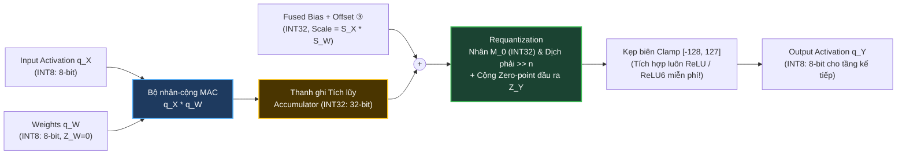
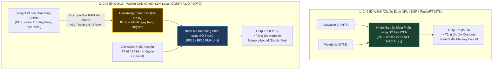
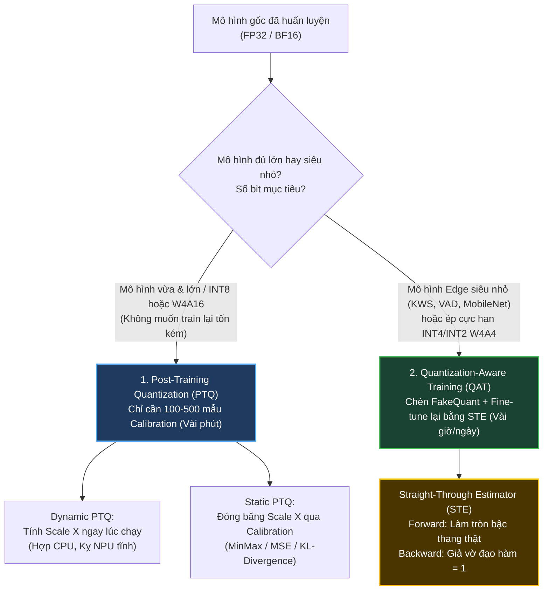
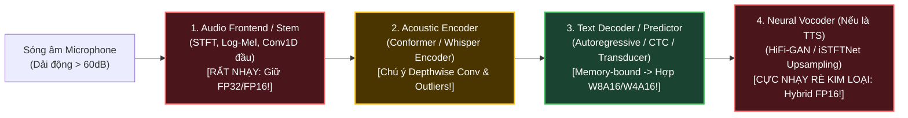

# CHUYÊN ĐỀ CHUYÊN SÂU: BẢN CHẤT & NGUYÊN LÝ LƯỢNG TỬ HÓA MÔ HÌNH AI (MODEL QUANTIZATION — TỪ VẬT LÝ BÁN DẪN ĐẾN EDGE AI & LLM)

Khi mới tiếp xúc với **Lượng tử hóa (Model Quantization)**, phần lớn tài liệu phổ thông thường giới thiệu nó bằng một câu ngắn gọn: *"Đổi số thực 32-bit sang số nguyên 8-bit hoặc 4-bit để giảm dung lượng file mô hình cho nhẹ"*. Cách hiểu đó không sai, nhưng mới chỉ chạm được **30% bề nổi của tảng băng chìm**.

Nếu chỉ để giảm kích thước file lưu trữ, tại sao ta không đơn giản là nén mô hình bằng thuật toán `.zip` rồi giải nén ra chạy? Tại sao một mô hình Whisper hay LLaMA khi chuyển sang `INT8` / `INT4` không những nhẹ đi 4–8 lần, mà tốc độ phản hồi thời gian thực (Real-time Latency) trên thiết bị biên (Edge AI) lại tăng vọt gấp 3–4 lần, nhiệt độ chip giảm hẳn và thời lượng pin kéo dài gấp bội? Và kỳ lạ hơn nữa: **Tại sao hàng tỷ con số thực vốn được tinh chỉnh tỉ mỉ tới chữ số thập phân thứ 7 trong lúc huấn luyện, khi bị "chặt cụt" thô bạo chỉ còn vỏn vẹn 16 mức giá trị (4-bit), mà mô hình vẫn không hề bị "mất trí nhớ"?**

Bài giảng chuyên sâu này sẽ đưa bạn đi xuyên qua các công thức bề mặt để chạm tới **gốc rễ vật lý bán dẫn, lý thuyết thông tin, hình học giải tích của bề mặt hàm mất mát (Hessian)**, cho đến các thuật toán tối tân nhất hiện nay (**SmoothQuant, GPTQ, AWQ, NF4, GGUF, QuaRot**) và đặc biệt là **kinh nghiệm thực chiến xương máu trên các hệ thống Edge AI / Voice AI** (ASR, TTS, VAD, Wake-word chạy trên NPU, DSP và CPU nhúng).

---

## 1. GỐC RỄ VẬT LÝ & TOÁN HỌC: TẠI SAO AI CẦN VÀ "CHỊU ĐƯỢC" LƯỢNG TỬ HÓA?

Để hiểu nguyên lý của Quantization, ta phải trả lời hai câu hỏi nền tảng nhất: **(1) Phần cứng thực sự gặp nỗi đau gì với số thực?** và **(2) Toán học nào bảo vệ mạng nơ-ron khỏi sự sụp đổ khi bị làm tròn số?**

### A. Vật lý Bán dẫn: "Bức tường Bộ nhớ" (Memory Wall) & Định luật Năng lượng Horowitz

Trong kiến trúc máy tính hiện đại (từ siêu chip NVIDIA H100 cho tới SoC di động Snapdragon, Apple Silicon hay Rockchip/ESP32 trên thiết bị Edge), **tính toán (Compute) rất rẻ và nhanh, nhưng di chuyển dữ liệu (Data Movement) lại cực kỳ đắt đỏ và chậm chạp**.

Năm 2014, Giáo sư Mark Horowitz (Đại học Stanford) đã công bố bảng đo lường năng lượng tiêu thụ cho từng phép toán cơ bản ở cấp độ cổng bán dẫn CMOS (tiến trình 45nm — tỷ lệ tương quan này vẫn giữ nguyên, thậm chí còn khắc nghiệt hơn ở tiến trình 3nm–7nm hiện nay):

```
NĂNG LƯỢNG TIÊU THỤ CHO MỘT THAO TÁC TRÊN CHIP SILICON (Đơn vị: picoJoule - pJ)

Phép cộng số nguyên INT8       : | 0.03 pJ  (Chuẩn cơ sở: 1x)
Phép nhân số nguyên INT8       : || 0.20 pJ (~6.7x)
Phép cộng số thực FP32         : ||||||||| 0.90 pJ (30x so với cộng INT8!)
Phép nhân số thực FP32         : |||||||||||||||||| 3.70 pJ (18.5x so với nhân INT8!)
Đọc 32-bit từ bộ nhớ đệm SRAM  : ||||||||||||||||||||||||| 5.00 pJ (On-chip Cache)
Đọc 32-bit từ RAM ngoài (DRAM) : |||||||||||||||||||||||||||||||||||||||||||||||||| [640.0 pJ!] (Gấp 3.200 lần nhân INT8!)
```

Nhìn vào bức tranh vật lý trên, ba sự thật chấn động lộ diện:

1.  **Tiết kiệm diện tích bóng bán dẫn (Silicon Die Area) & Năng lượng tính toán:**
    Một bộ nhân `FP32` đòi hỏi mạch cộng số mũ, mạch nhân phần định trị 24-bit, mạch dịch bit chuẩn hóa (barrel shifter) và mạch làm tròn phức tạp. Ngược lại, bộ nhân `INT8` chỉ là mạch cộng nhị phân đơn giản, tiêu tốn **ít năng lượng hơn ~18.5 lần** và chiếm **diện tích silicon nhỏ hơn ~20–30 lần**. Nhờ đó, trên cùng $1\text{ mm}^2$ diện tích chip NPU (Neural Processing Unit) hoặc Tensor Core, nhà sản xuất có thể nhồi nhét số lượng đơn vị tính toán tích chập (MAC - Multiply-Accumulate) của `INT8` nhiều gấp **4 đến 16 lần** so với `FP32`/`FP16`!
2.  **Phá vỡ "Bức tường Bộ nhớ" (The Memory Wall) qua Mô hình Mái nhà (Roofline Model):**
    Hiệu năng thực tế của một mô hình AI bị quyết định bởi chỉ số **Cường độ Số học (Arithmetic Intensity)**:

    $$\text{Arithmetic Intensity} = \frac{\text{Tổng số phép tính (OPs)}}{\text{Tổng số Bytes đọc/ghi từ RAM}}$$

breakdown : AI tức đo lường cường độ tính toán cùa máy tính, bên trên (OPs) đại diện cho mức độ tính toán và bên dưới là lượng data/ thời gian được vận chuyển vào. từ đó ta có thể hiểu nếu AI score cao -> tính nhiều trên 1 lượng data nhỏ -> tính toán liên tục diễn ra. nếu data lớn -> thời gian vận chuyển sẽ càng lâu (vì bandwith có giới hạn) -> dẫn đến tính toán không tối ưu vì gpu phải chờ data laod qua

==> đây cũng là lý do vì sao các model ngày nay lại dùng batch


![[Pasted image 20261108223017.png]]


2 khái niệm khá quan trọng khác là memory bound và compute bound
- memory bound : giới hạn về memory, đơn giản là việc truyển data đang là nút thắt cổ chay khiến cho gpu không thể tận dung được tối đa công suất
-> tăng bandwith hoặc giảm data truyển qua để giảm thời gian truyền data và gpu được tính toán liên tục
- compute bound : khi trần hệ thống nằm ở khâu tính toán, tức gpu đã có thể nhận liên tục data nhưng hiệu năng bị giới hạn bởi phần cứng tính toán
-> nâng cấp phần cứng TvT ; tối ưu thuật toán

tóm lại memory wall chính là memory bound / batch size là số sequence / sample xử ly sau 1 lần đọc weight
-

    *   Trong dự án **Edge AI / Voice AI thời gian thực**, dữ liệu âm thanh đi vào từ microphone của **1 người dùng duy nhất (`Batch Size = 1`)**. Tương tự, khi Decoder của Whisper hay LLM sinh từng từ một, mỗi trọng số $w_{ij}$ được kéo một quãng đường xa xôi từ DRAM vào chip chỉ để thực hiện đúng **1 phép nhân và 1 phép cộng** (2 OPs), rồi lại bị vứt đi!
    *   Hậu quả: Các nhân xử lý siêu mạnh của CPU/NPU/GPU phải **ngồi chơi xơi nước tới 80%–90% thời gian** chỉ để chờ dữ liệu bò qua đường ống băng thông RAM chật hẹp (**Memory-bound**).
    *   Khi lượng tử hóa trọng số từ `FP32` (32-bit) xuống `INT8` (8-bit) hoặc `INT4` (4-bit), lượng dữ liệu phải kéo qua RAM giảm ngay lập tức **4 lần đến 8 lần**. Không những tốc độ suy luận tăng vọt gần như tuyến tính (3x–4x), mà trên các thiết bị Edge, một mô hình từ chỗ phải nằm ngoài DRAM chậm chạp nay có thể **nằm gọn một phần lớn ngay trong bộ nhớ đệm L2/SRAM siêu tốc bên trong chip**, cắt giảm triệt để hiện tượng nóng máy (thermal throttling) và hao pin!

---


### B. Nghịch lý Huấn luyện vs. Suy luận: Tại sao lúc Train cần FP32/BF16, lúc Chạy chỉ cần INT8/INT4?

Một câu hỏi phản biện cực kỳ sắc bén mà người học bản chất luôn đặt ra:
> *"Nếu mạng nơ-ron chỉ cần 8-bit hay 4-bit là đủ thông minh để nhận diện giọng nói và sinh văn bản, vậy tại sao ngay từ đầu ta không huấn luyện (Train) thẳng trên INT8 cho nhanh, mà lại phải tốn kém dùng FP32/BF16?"*

Câu trả lời nằm ở **bản chất vi phân của thuật toán Gradient Descent** (đã học ở [Chương 2](file:///home/huudang/Documents/note/AI_in_the_nutshell/Chương%202.md)):

Trong quá trình huấn luyện, trọng số được cập nhật qua hàng trăm nghìn bước nhỏ li ti theo công thức:

$$W_{t+1} = W_t - \eta \cdot \nabla \mathcal{L}(W_t)$$

Hãy đặt các con số thực tế vào phương trình này:
*   Trọng số hiện tại: $W_t = 0.2500000$
*   Tốc độ học (Learning Rate) điển hình của LLM / Conformer: $\eta = 10^{-4}$
*   Độ lớn đạo hàm (Gradient) điển hình: $\nabla \mathcal{L} = 2 \times 10^{-3}$
*   $\rightarrow$ Lượng cập nhật thực tế ở một bước: $\Delta W = -10^{-4} \times (2 \times 10^{-3}) = \mathbf{-0.0000002} \; (-2 \times 10^{-7})$!

Bây giờ, giả sử bạn lưu $W_t$ ở định dạng **INT8** trên dải $[-1.0, 1.0]$. Với $2^8 = 256$ bậc thang, khoảng cách giữa hai bậc thang liên tiếp (bước nhảy lượng tử $S$) là:

$$S = \frac{2.0}{255} \approx \mathbf{0.00784}$$

Để nhảy sang bậc thang kế tiếp, lượng cập nhật $|\Delta W|$ tối thiểu phải lớn hơn một nửa bậc thang ($S/2 \approx 0.00392$). Nhưng cập nhật thực tế của chúng ta chỉ là $0.0000002$ — **nhỏ hơn bậc thang tới gần 20.000 lần**! Khi làm tròn về lưới INT8:

$$\text{round}_{\text{INT8}}(0.25 - 0.0000002) = \mathbf{0.25} \quad (\text{Không nhúc nhích dù chỉ 1 milimét!})$$

> [!IMPORTANT]
> **Nguyên lý cốt lõi (Kính hiển vi vs. Bức ảnh in):**
> *   **Huấn luyện (Training)** giống như quá trình điêu khắc vi mô: nó bắt buộc cần độ chính xác cao (`FP32` hoặc Master Weights `FP32` kết hợp `BF16`) đóng vai trò là "bể tích lũy" để cộng dồn hàng vạn bước dịch chuyển siêu nhỏ $10^{-7}$ lại thành sự thay đổi có ý nghĩa $10^{-2}$ sau hàng nghìn vòng lặp. Nếu thiếu độ phân giải này, hiện tượng **Chết đứng cập nhật (Gradient Underflow / Update Stagnation)** sẽ xảy ra ngay ở bước đầu tiên.
> *   **Suy luận (Inference)** là khi bức tượng đã tạc xong! Lúc này không còn phép trừ vi phân $\eta \nabla \mathcal{L}$ nào nữa. Ta chỉ cần giữ lại hình dáng tổng thể của bức tượng trên một lưới thô hơn mà mắt thường (đầu ra phân loại/ngữ nghĩa) hầu như không phân biệt được.

---

### C. Gốc rễ Giải tích: Tại sao Làm tròn Trọng số không Phá hủy Hàm Loss? (Khai triển Taylor & Hessian)

Hãy chứng minh bằng toán học chặt chẽ tại sao một mô hình đã hội tụ lại "trơ lì" đáng kinh ngạc trước nhiễu làm tròn của Quantization.

Khi lượng tử hóa ma trận trọng số đã huấn luyện tối ưu $W^*$ thành $\hat{W}$, về mặt toán học, ta đang **bơm một lượng nhiễu lượng tử hóa (Quantization Noise)** $\delta W = \hat{W} - W^*$ vào mô hình:

$$\hat{W} = W^* + \delta W$$

Hàm mất mát mới $\mathcal{L}(W^* + \delta W)$ bị xấu đi bao nhiêu so với hàm mất mát gốc $\mathcal{L}(W^*)$? Áp dụng **Khai triển chuỗi Taylor bậc 2** xung quanh điểm hội tụ $W^*$:

$$\mathcal{L}(W^* + \delta W) \approx \mathcal{L}(W^*) + \underbrace{\nabla \mathcal{L}(W^*)^T \cdot \delta W}_{\text{Hạng tử bậc 1}} + \underbrace{\frac{1}{2} \delta W^T \cdot H \cdot \delta W}_{\text{Hạng tử bậc 2}} + \mathcal{O}(\|\delta W\|^3)$$

Trong đó:
*   $\nabla \mathcal{L}(W^*)$ là vector Gradient bậc 1 tại điểm hội tụ.
*   $H = \nabla^2_W \mathcal{L}(W^*)$ là **Ma trận Hessian** (ma trận đạo hàm riêng bậc 2), đo lường **độ cong (curvature)** của thung lũng hàm Loss theo mọi hướng trong không gian tham số.

Hãy nhìn kỹ vào công thức trên — đây chính là phương trình nền tảng đứng sau toàn bộ ngành nghiên cứu Model Compression hiện đại:

1.  **Hạng tử bậc 1 tự động triệt tiêu ($\nabla \mathcal{L}(W^*)^T \delta W \approx 0$):**
    Vì mô hình đã được huấn luyện hội tụ về đáy thung lũng cực tiểu, đạo hàm bậc nhất tại đáy xấp xỉ bằng $0$ ($\nabla \mathcal{L}(W^*) \approx \vec{0}$)! Điều này có nghĩa là một nhiễu nhỏ $\delta W$ tác động vào mô hình đã hội tụ **không gây ra sai số bậc nhất**, mà chỉ gây ra sai số bậc hai cực nhỏ (ví dụ: nếu $\|\delta W\| \approx 0.01$, thì $\|\delta W\|^2 \approx 0.0001$)!
2.  **Hình học "Đáy thung lũng phẳng" (Flat Minima) của Mạng Nơ-ron Dư thừa Tham số:**
    Khi các nhà toán học phân tích phổ giá trị riêng (Eigenvalue Spectrum) của ma trận Hessian $H$ trên các mạng Deep Learning hiện đại (ResNet, Conformer, Transformer), họ phát hiện ra:
    *   **99% các giá trị riêng $\lambda_i$ của $H$ xấp xỉ bằng $0$:** Tức là theo hầu hết mọi chiều không gian, đáy thung lũng Loss phẳng lì như mặt hồ! Bạn có xê dịch trọng số đi một đoạn khá lớn thì Loss vẫn gần như giữ nguyên.
    *   **Chỉ có < 1% giá trị riêng $\lambda_i$ cực lớn:** Tương ứng với một vài chiều không gian có vách núi dựng đứng (Sharp Curvature). Nếu làm tròn nhầm các trọng số nằm trên những hướng nhạy cảm này, hạng tử $\frac{1}{2} \delta W^T H \delta W$ sẽ nổ tung!

```
Hàm Loss L(W)
   ^
   |  \        / <-- Thung lũng hẹp (Sharp Minimum - Mô hình siêu nhỏ hoặc Outlier channels):
   |   \      /      Chỉ lệch dW một chút là Loss vọt lên tận mây xanh! (Cần QAT / Bảo vệ riêng)
   |    \____/
   |
   |  \                  / <-- Thung lũng phẳng (Flat Minimum - Đa số trọng số mạng lớn):
   |   \________________/      Lệch từ W* sang W* + dW, độ cao đáy Loss gần như KHÔNG ĐỔI!
   +--------|----|------------> Không gian trọng số W
            W*  W*+dW
```

> [!TIP]
> **Móc xích tư duy xuyên suốt bài giảng:** Toàn bộ các thuật toán lượng tử hóa 4-bit lừng danh mà ta sẽ học ở Mục 6 (**GPTQ**, **AWQ**) thực chất đều xoay quanh phương trình Taylor bậc 2 này: **GPTQ** tính trực tiếp nghịch đảo ma trận Hessian $H^{-1}$ để bù sai số, còn **AWQ** tìm cách nhận diện đúng $<1\%$ chiều có độ cong $H$ lớn nhất thông qua biên độ kích hoạt để bảo vệ chúng!

---

### D. Sự Triệt tiêu Nhiễu Thống kê trong Tích vô hướng Đa chiều (Law of Large Numbers)

Ngoài hình học bề mặt Loss, còn một hiệu ứng thống kê kỳ diệu nữa cứu rỗi từng nơ-ron riêng lẻ. Xét phép tính cốt lõi của một nơ-ron có chiều đầu vào $d$ (ví dụ $d = 512$ trong Conformer hoặc $d = 4096$ trong LLM):

$$y = \sum_{i=1}^{d} w_i x_i \quad \xrightarrow{\text{Lượng tử hóa } \hat{w}_i = w_i + \epsilon_i} \quad \hat{y} = \sum_{i=1}^{d} (w_i + \epsilon_i) x_i = \underbrace{\sum_{i=1}^{d} w_i x_i}_{y \text{ gốc}} + \underbrace{\sum_{i=1}^{d} \epsilon_i x_i}_{\text{Tổng nhiễu } E}$$

Nếu ta sử dụng phép **Làm tròn tới số nguyên gần nhất (Round-to-Nearest-Even)**, sai số làm tròn $\epsilon_i \in [-S/2, +S/2]$ có thể coi là biến ngẫu nhiên phân phối đều độc lập với **Kỳ vọng trung bình bằng 0** ($\mathbb{E}[\epsilon_i] = 0$, phương sai $\text{Var}(\epsilon_i) = \frac{S^2}{12}$):

*   Khi cộng dồn qua $d = 4096$ phần tử, trọng số thứ 1 bị làm tròn tăng lên $+0.003$, nhưng trọng số thứ 2 lại bị làm tròn giảm đi $-0.002$, trọng số thứ 3 tăng $+0.001$, trọng số thứ 4 giảm $-0.003$... Các sai số âm và dương **tự triệt tiêu lẫn nhau một cách tự nhiên** ($\mathbb{E}[E] = 0$)!
*   Theo Định lý Giới hạn Trung tâm, độ lệch chuẩn của sai số tích lũy chỉ tăng theo căn bậc hai $\sqrt{d}$, trong khi độ lớn tín hiệu tăng lớn hơn nhiều, giúp tỷ số Tín hiệu trên Nhiễu được bảo toàn rất tốt khi chiều $d$ lớn.

> [!CAUTION]
> **Bài học sống còn khi lập trình nhúng C/C++ trên Edge/MCU:**
> Trong ngôn ngữ C, ép kiểu trực tiếp `(int)(x / S)` thực hiện phép **Cắt bỏ phần thập phân về 0 (`trunc` / `floor`)**, KHÔNG PHẢI làm tròn gần nhất (`round`)! Nếu bạn dùng `floor` (luôn làm tròn xuống), kỳ vọng sai số sẽ bị lệch âm ($\mathbb{E}[\epsilon_i] = -S/2 \neq 0$). Qua 4.096 phép cộng, sai số chệch một phía này không hề triệt tiêu mà **cộng dồn gấp 4.096 lần**, thổi bay hoàn toàn độ chính xác của mạng nơ-ron! Luôn kiểm tra kỹ chế độ làm tròn (`Round-to-Nearest-Even` / `RNE`) trên DSP/NPU của bạn.

---

## 2. GIẢI PHẪU ĐỊNH DẠNG SỐ DƯỚI LỚP VỎ NHỊ PHÂN (ANATOMY OF NUMERICAL FORMATS)

Muốn làm chủ Quantization, bạn không thể coi `FP32`, `FP16`, `BF16` hay `INT8` là những từ khóa trừu tượng. Ta phải mổ xẻ xem từng bit `0` và `1` trong thanh ghi phần cứng thực sự biểu diễn con số toán học như thế nào.

### A. Số thực Dấu phẩy động (Floating-Point — Chuẩn IEEE 754) hoạt động ra sao?

Máy tính biểu diễn một số thực nhị phân giống hệt cách viết ký hiệu khoa học $ -1.5 \times 10^4 $, nhưng ở **hệ cơ số 2**. Một số dấu phẩy động bất kỳ luôn được chia làm **3 trường bit**:

```
Cấu trúc tổng quát của số Floating-Point:
+------+--------------------+-----------------------------------+
| Sign |   Exponent (E bit) |         Mantissa (M bit)          |
| 1 bit|    (Số mũ + Bias)  |    (Phần lẻ thập phân nhị phân)   |
+------+--------------------+-----------------------------------+
```

Công thức giải mã ra giá trị thực (với các số chuẩn hóa thông thường, $0 < \text{Exp} < 2^E - 1$):

$$\text{Value} = (-1)^{\text{Sign}} \times 2^{(\text{Exponent} - \text{Bias})} \times \left(1 + \frac{\text{Mantissa}}{2^M}\right)$$

Trong đó $\text{Bias} = 2^{E-1} - 1$ (ví dụ với $E=8$ thì $\text{Bias} = 127$) là độ lệch giúp biểu diễn cả số mũ âm lẫn số mũ dương mà không cần thêm bit dấu cho số mũ, đồng thời giúp phần cứng so sánh độ lớn hai số thực nhanh như so sánh số nguyên. Số `1 + ...` trước phần Mantissa được gọi là **Implicit Leading 1 (Số 1 ẩn)** — vì trong hệ nhị phân, mọi số khác 0 khi chuẩn hóa khoa học đều bắt đầu bằng `1.xxxx`, nên chuẩn IEEE 754 "ăn gian" không lưu số `1` này để tiết kiệm miễn phí 1 bit độ chính xác!

#### Vai trò vật lý của từng thành phần:
*   **Sign (1 bit):** `0` là số dương ($+$), `1` là số âm ($-$).
*   **Exponent ($E$ bits) — Quyết định "TẦM XA" (Dynamic Range):** Cho biết chiếc kính lúp của bạn đang phóng vào hạt hạ nguyên tử ($2^{-126}$) hay đang nhìn ra khoảng cách thiên hà ($2^{+127}$). Thiếu bit Exponent $\rightarrow$ Tràn số lên vô cực (**Overflow $\rightarrow$ `Inf` / `NaN`**) hoặc tụt về `0` (**Underflow**).
*   **Mantissa / Fraction ($M$ bits) — Quyết định "ĐỘ NÉT" (Precision / Resolution):** Bên trong khoảng $[2^k, 2^{k+1}]$ mà Exponent vừa chọn, Mantissa chia khoảng đó thành đúng $2^M$ bậc thang đều nhau. Thiếu bit Mantissa $\rightarrow$ Số bị làm tròn thô hơn, nhưng **không bị nổ `NaN`**.

#### Ví dụ giải mã từng bit bằng tay: Số `-0.375` trong `FP32` (1 Sign, 8 Exp, 23 Mantissa)
1.  **Dấu:** Số âm $\rightarrow \text{Sign} = \mathbf{1}$.
2.  **Đổi trị tuyệt đối `0.375` sang phân số lũy thừa 2:**
    $0.375 = \frac{3}{8} = 0.25 + 0.125 = 2^{-2} + 2^{-3} = 2^{-2} \times (1 + 2^{-1}) = \mathbf{1.5 \times 2^{-2}}$.
3.  **Tính Exponent (có cộng $\text{Bias} = 127$):**
    Số mũ thực là $-2 \rightarrow \text{Exponent} = -2 + 127 = 125 = \mathbf{01111101_2}$.
4.  **Tính Mantissa (bỏ số `1.` ẩn phía trước):**
    Phần lẻ là $0.5 = 1 \times 2^{-1} \rightarrow$ bit đầu tiên của Mantissa là `1`, 22 bit còn lại là `0`: $\mathbf{10000000000000000000000_2}$.
5.  **Chuỗi 32-bit thực tế nằm trong RAM:**
    `1 | 01111101 | 10000000000000000000000`!

---

### B. Sự khác biệt bản chất: Lưới Phi tuyến (Floating-Point) vs. Lưới Đều (Integer)

Một đặc tính cực kỳ quan trọng mà ít người để ý:
*   **Số dấu phẩy động (FP)** có các vạch chia **cực kỳ dày đặc ở sát điểm `0`** và **càng ra xa điểm `0` thì khoảng cách giữa các vạch càng giãn rộng theo cấp số nhân**! (Trong khoảng $[1, 2]$, có $2^{23}$ số FP32; trong khoảng $[1024, 2048]$ rộng gấp 1024 lần, cũng vẫn chỉ có đúng $2^{23}$ số FP32!).
*   **Số nguyên (INT — biểu diễn Bù 2 / Two's Complement)** chỉ có một chuỗi bit nhị phân thuần túy từ $-2^{b-1}$ đến $2^{b-1}-1$. Khoảng cách giữa hai vạch liền kề luôn **bằng nhau tuyệt đối trên toàn bộ trục số** (Uniform Grid)!

```
1. Trục số Floating-Point (Logarithmic / Non-uniform spacing):
<---|-------|----|---|---|--|-|-|||||||||||||||-|-|--|---|---|----|-------|--->
  -8.0    -4.0 -2.0     -0.5    0 (Siêu dày đặc!)   +0.5     +2.0 +4.0   +8.0

2. Trục số Integer / Uniform Quantization ( Khoảng cách S đều tăm tắp mọi nơi ):
<---|---|---|---|---|---|---|---|---|---|---|---|---|---|---|---|---|---|---|->
   -9  -8  -7  -6  -5  -4  -3  -2  -1   0  +1  +2  +3  +4  +5  +6  +7  +8  +9
```

*Hệ quả trực tiếp:* Vì trọng số mạng nơ-ron tập trung dày đặc quanh `0` theo hình chuông Gauss, số Floating-Point (hoặc định dạng phi tuyến như `FP8`, `NF4`) ôm khít phân phối tự nhiên của trọng số tốt hơn ở số bit cực thấp ($\le 4$ bit). Đổi lại, số nguyên `INT8` có mạch phần cứng cộng/nhân rẻ hơn và nhanh hơn vượt trội trên mọi CPU, DSP và NPU!

---

### C. Bảng Giải phẫu & Đối sánh Toàn bộ Hệ Định dạng Số trong AI Hiện đại

```
FP32  (32 bits): [S][ E E E E E E E E ][ M M M M M M M M M M M M M M M M M M M M M M M ] (1 - 8 - 23)
FP16  (16 bits): [S][ E E E E E ][ M M M M M M M M M M ]                                 (1 - 5 - 10)
BF16  (16 bits): [S][ E E E E E E E E ][ M M M M M M M ]                                 (1 - 8 - 7 )
FP8   (E4M3)   : [S][ E E E E ][ M M M ]                                                 (1 - 4 - 3 )
FP8   (E5M2)   : [S][ E E E E E ][ M M ]                                                 (1 - 5 - 2 )
INT8  ( 8 bits): [S][ I I I I I I I ]  (Bù 2: -128 đến +127 -> 256 mức đều nhau)
INT4  ( 4 bits): [S][ I I I ]          (Bù 2:   -8 đến   +7 -> chỉ 16 mức đều nhau!)
```

| Định dạng | Cấu trúc Bit | Dải giá trị lớn nhất (Max Range) | Ưu điểm & Nhược điểm cốt tử | Vai trò chuẩn mực thực tế |
| :--- | :--- | :--- | :--- | :--- |
| **FP32** | `1 - 8 - 23` | $\pm 3.4 \times 10^{38}$ | Chính xác tuyệt đối nhưng nặng nề, ngốn băng thông RAM gấp đôi 16-bit. | Master weights khi Optimizer cập nhật; các phép tích lũy nhạy cảm (Softmax, RMSNorm, Audio STFT). |
| **FP16** | `1 - 5 - 10` | **$\pm 65.504$** | Độ nét khá tốt (10 bit lẻ), phần cứng GPU/NPU di động hỗ trợ rộng nhất. **Tử huyệt:** Dải động quá hẹp! Bất kỳ giá trị trung gian nào $> 65.504$ lập tức biến thành `Inf` $\rightarrow$ `NaN`. | Chuẩn vàng cho **Inference 16-bit trên Edge NPU / Apple CoreML / TensorRT / ONNX**. |
| **BF16** | `1 - 8 - 7` | **$\pm 3.4 \times 10^{38}$** | Hy sinh độ nét (chỉ còn 7 bit lẻ) nhưng **giữ nguyên 8 bit số mũ của FP32**! Ép kiểu từ FP32 sang BF16 chỉ là cắt bỏ 16 bit đuôi. Không bao giờ lo tràn số `Overflow`! | **Tiêu chuẩn vàng tuyệt đối để Pre-train & Fine-tune LLM/Foundation Models.** *(Lưu ý: Nhiều NPU nhúng đời cũ chưa hỗ trợ BF16).* |
| **FP8 (E4M3)**| `1 - 4 - 3` | $\pm 448$ | Giữ 3 bit lẻ cho độ chính xác tương đối tốt ở mức 8-bit dấu phẩy động. | Tăng tốc **Forward Pass** (Weights & Activations) trên GPU thế hệ mới (H100/Ada/Blackwell). |
| **FP8 (E5M2)**| `1 - 5 - 2` | $\pm 57.344$ | Hy sinh độ nét (2 bit lẻ) lấy dải động rộng ngang FP16. | Dùng cho **Backward Pass (Gradients)** trong huấn luyện FP8 vì đạo hàm dao động biên độ rất lớn. |
| **INT8** | 8-bit Bù 2 | $[-128, 127]$ | 256 mức tuyến tính. Rẻ nhất về năng lượng & silicon, được hỗ trợ bởi **100% CPU (ARM Neon, x86 AVX-VNNI), DSP (Hexagon) và NPU Edge**. | **Vua của Edge AI (W8A8):** TFLite, ONNX QDQ, RKNN, QNN, TensorRT INT8, Sherpa-ONNX. |
| **INT4 / NF4**| 4-bit | $[-8, 7]$ (16 mức) | Giảm 8x dung lượng so với FP32. Quá thô nếu áp cho Activation, nhưng cực kỳ hiệu quả cho Trọng số nếu chia theo cụm nhỏ (Group-wise). | **Vua của LLM Local & On-device (W4A16):** GGUF (`llama.cpp`), AWQ, GPTQ, QLoRA (`NF4`). |

> [!NOTE]
> **Tại sao Google phát minh ra BF16 (Brain Float 16) lại là một nét thiên tài về mặt nguyên lý?**
> Khi huấn luyện mạng sâu với `FP16`, các kỹ sư liên tục gặp cơn ác mộng Loss nổ `NaN` và phải bày ra kỹ thuật phức tạp gọi là *Dynamic Loss Scaling* (nhân Loss lên hàng nghìn lần để đẩy Gradient chui ra khỏi vùng Underflow, rồi lại chia xuống). Google Brain nhận ra bản chất từ Mục 1: **Mạng nơ-ron cực kỳ khoan dung với nhiễu làm tròn (ít bit Mantissa không sao cả), nhưng lại chết ngay lập tức nếu bị tràn dải động (thiếu bit Exponent)!** Bằng cách giữ nguyên 8 bit Exponent của `FP32` và chặt thẳng tay Mantissa từ 23 xuống 7 bit, `BF16` vận hành trơn tru y hệt `FP32` với nửa dung lượng bộ nhớ!

---

## 3. TOÁN HỌC CỐT LÕI CỦA PHÉP ÁNH XẠ LƯỢNG TỬ HÓA & BÍ MẬT PHẦN CỨNG SỐ NGUYÊN

Khi chuyển một tensor số thực $r \in [r_{\min}, r_{\max}]$ sang miền số nguyên $b$-bit $q \in [q_{\min}, q_{\max}]$ (ví dụ với `INT8` có dấu thì $[q_{\min}, q_{\max}] = [-128, 127]$, tổng độ rộng lưới là $q_{\max} - q_{\min} = 2^b - 1 = 255$), ta đang xây dựng một phép chiếu tuyến tính (Affine Mapping) giữa hai hệ tọa độ.

### A. Công thức Lượng tử hóa Tuyến tính (Scale $S$ & Zero-Point $Z$)

Mối quan hệ xấp xỉ giữa giá trị thực $r$ và giá trị nguyên $q$ được định nghĩa bởi đúng hai tham số:

$$r \approx \hat{r} = S \cdot (q - Z)$$

Từ đó suy ra hai chiều biến đổi ngược nhau:

1.  **Chiều Lượng tử hóa (Quantize: $\mathbb{R} \rightarrow \mathbb{Z}$):**

    $$q = \text{clamp}\left( \left\lfloor \frac{r}{S} \right\rceil + Z, \; q_{\min}, \; q_{\max} \right)$$

2.  **Chiều Giải lượng tử (Dequantize: $\mathbb{Z} \rightarrow \mathbb{R}$):**

    $$\hat{r} = S \cdot (q - Z)$$

Trong đó:
*   **$\lfloor \cdot \rceil$:** Phép làm tròn tới số nguyên gần nhất (`round-to-nearest-even`).
*   **$\text{clamp}(x, a, b) = \min(\max(x, a), b)$:** Hàm kẹp biên (bão hòa). Bất kỳ giá trị nào vượt quá $[r_{\min}, r_{\max}]$ sẽ bị gọt phẳng về hai đầu mút $q_{\min}$ hoặc $q_{\max}$.
*   **$S$ (Scale Factor — Hệ số tỷ lệ, lưu ở dạng `FP32`/`FP16`):** Là độ rộng thực tế của **một bậc thang lượng tử** ($S > 0$). $S$ càng nhỏ thì lưới chia càng mịn (sai số làm tròn nhỏ), nhưng dải bao phủ càng hẹp.
*   **$Z$ (Zero-Point — Điểm Không, lưu ở dạng Số nguyên cùng kiểu với $q$):** Chính là con số nguyên trên thang đo ứng với đúng giá trị thực $r = 0.0$! (Thật vậy, khi $q = Z$ thì $\hat{r} = S \cdot (Z - Z) = \mathbf{0.0}$ tuyệt đối!).

#### 🔑 Tại sao số `0.0` thực BẮT BUỘC phải ánh xạ chính xác tuyệt đối sang số nguyên $Z$?
Giả sử khi tính $Z$ từ công thức số thực ra $Z = -63.4$. Tại sao ta bắt buộc phải **làm tròn $Z$ thành số nguyên `-63`** (và điều chỉnh nhẹ biên $[r_{\min}, r_{\max}]$), chứ không bao giờ được giữ $Z$ lẻ hay để số `0.0` bị xấp xỉ lệch thành `0.002`?

1.  **Bảo vệ Zero-Padding trong Tích chập Hình ảnh & Âm thanh (Voice AI):**
    Trong CNN, Conformer hay Whisper Audio Encoder, khi trượt cửa sổ tích chập ở rìa câu nói hoặc khi chèn khoảng lặng (padding bằng các số `0.0`) để gom batch các câu có độ dài khác nhau, hàng nghìn ô viền mang giá trị đúng `0.0`. Nếu `0.0` bị lượng tử hóa lệch thành `0.002`, các bộ lọc tích chập sẽ nhân và cộng dồn con số khác không này, tự động sinh ra **tiếng nổ bụp hoặc ảo giác từ ngữ ở đầu/cuối đoạn âm thanh (Boundary Padding Artifacts)**!
2.  **Bảo toàn tính thưa (Sparsity) và ngưỡng cắt ReLU:**
    Sau hàm kích hoạt $\text{ReLU}(x) = \max(0, x)$, thường có trên 50% nơ-ron mang giá trị đúng `0.0`. Khi `0.0` ánh xạ chính xác vào số nguyên $Z$, phần cứng có thể bỏ qua phép tính hoặc bảo toàn tuyệt đối trạng thái "tắt" của nơ-ron.

---

### B. Symmetric (Đối xứng) vs. Asymmetric (Bất đối xứng) — Phân tích kèm Ví dụ Tính tay

Có hai cách đặt chiếc thước số nguyên lên trục số thực:

```
A. SYMMETRIC QUANTIZATION (Đối xứng qua điểm 0 -> Z = 0 luôn luôn!):
Trục thực r :  [-4.5 <------------ 0.0 ------------> +4.5]  (Dải âm [-4.5, 0) bị bỏ trống lãng phí
Dữ liệu ReLU:                      [0.0 ===========> +4.5]   nếu dữ liệu chỉ mang dấu dương!)
Trục nguyên q: [-127 <------------  0  ------------> +127]  (Bỏ mức -128 để đối xứng hoàn hảo)

B. ASYMMETRIC / AFFINE QUANTIZATION (Co giãn khít theo [r_min, r_max] -> Z != 0):
Dữ liệu ReLU:  [0.0 =================================> +4.5]
Trục nguyên q: [-128 (Z = -128) =====================> +127] (Tận dụng sạch 100% cả 256 mức!)
```

1.  **Lượng tử hóa Đối xứng (Symmetric Quantization — Ép $Z = 0$):**
    *   Ta lấy biên đối xứng $\alpha = \max(|r_{\min}|, |r_{\max}|)$.
    *   Để trục số nguyên đối xứng hoàn hảo quanh `0`, với `INT8` có dấu ta thường dùng dải $[-127, 127]$ (bỏ một giá trị `-128`; với `INT4` dùng $[-7, 7]$):

        $$S = \frac{\alpha}{2^{b-1} - 1}, \qquad Z = 0, \qquad q = \text{clamp}\left(\left\lfloor \frac{r}{S} \right\rceil, -(2^{b-1}-1), 2^{b-1}-1\right)$$

2.  **Lượng tử hóa Bất đối xứng (Asymmetric / Affine Quantization — $Z \neq 0$):**
    *   Đặt đúng $r_{\min}$ khớp vào $q_{\min}$ và $r_{\max}$ khớp vào $q_{\max}$ (đảm bảo $r_{\min} \le 0 \le r_{\max}$ để chứa điểm `0`):

        $$S = \frac{r_{\max} - r_{\min}}{q_{\max} - q_{\min}}, \qquad Z = \text{clamp}\left(\left\lfloor q_{\min} - \frac{r_{\min}}{S} \right\rceil, q_{\min}, q_{\max}\right)$$

#### 🧮 Ví dụ Tính tay Trực quan: Dữ liệu sau ReLU/Swish lượng tử hóa xuống 4-bit!
Giả sử đầu ra Activation của một tầng mang toàn giá trị không âm:

$$X = [0.00, \; 0.22, \; 0.58, \; 1.15, \; 2.40, \; 4.50]$$

Hãy so sánh khi lượng tử hóa xuống **4-bit** bằng hai phương pháp:

*   **Trường hợp 1 — Dùng Symmetric INT4 (dải $[-7, 7]$, $Z = 0$):**
    *   $\alpha = \max(|0.0|, |4.50|) = 4.50 \implies S_{\text{sym}} = \frac{4.50}{7} \approx \mathbf{0.6429}$.
    *   Lượng tử hóa $q = \text{round}(X / 0.6429)$:
        $q_{\text{sym}} = [0, \; 0, \; 1, \; 2, \; 4, \; 7]$ *(Toàn bộ các mức từ `-7` đến `-1` bị bỏ hoang! Giá trị `0.22` bị nghiền nát về `0`!)*.
    *   Giải lượng tử $\hat{X}_{\text{sym}} = q_{\text{sym}} \times 0.6429$:
        $\hat{X}_{\text{sym}} = [0.0000, \; \mathbf{0.0000}, \; 0.6429, \; 1.2857, \; 2.5714, \; 4.5000]$.
    *   Sai số trung bình bình phương (**MSE**): $\mathbf{0.01669}$.

*   **Trường hợp 2 — Dùng Asymmetric UINT4 (dải $[0, 15]$):**
    *   $r_{\min} = 0.00, \; r_{\max} = 4.50 \implies S_{\text{asym}} = \frac{4.50 - 0.00}{15 - 0} = \mathbf{0.3000}$, $Z = 0$.
    *   Lượng tử hóa $q = \text{round}(X / 0.30)$:
        $q_{\text{asym}} = [0, \; 1, \; 2, \; 4, \; 8, \; 15]$ *(Giá trị nhỏ `0.22` được giữ sống ở mức `1`!)*.
    *   Giải lượng tử $\hat{X}_{\text{asym}} = q_{\text{asym}} \times 0.30$:
        $\hat{X}_{\text{asym}} = [0.0000, \; \mathbf{0.3000}, \; 0.6000, \; 1.2000, \; 2.4000, \; 4.5000]$.
    *   Sai số trung bình bình phương (**MSE**): $\mathbf{0.00155}$ — **Sai số giảm hơn 10.7 lần** chỉ nhờ tận dụng trọn vẹn dải bit!

> [!TIP]
> **Thước đo Kỹ thuật Tín hiệu — Quy tắc 6.02 dB mỗi Bit (SQNR):**
> Trong xử lý tín hiệu số và âm thanh (Voice AI), người ta đo chất lượng lượng tử hóa bằng **Tỷ số Tín hiệu trên Nhiễu Lượng tử (SQNR - Signal-to-Quantization-Noise Ratio)**:
>
> $$\text{SQNR (dB)} = 10 \log_{10} \left( \frac{\mathbb{E}[x^2]}{\mathbb{E}[(x - \hat{x})^2]} \right) \approx 6.02 \cdot b + C$$
>
> **Quy luật vàng vật lý:** Cứ giảm đi **1 bit** độ rộng biểu diễn (hoặc lãng phí mất nửa trục số khi dùng Symmetric cho dữ liệu một phía $\leftrightarrow$ mất 1 bit), nhiễu nền lượng tử hóa tăng gấp 4 lần về công suất, tương đương **mất đi ~6.02 dB SQNR**! Với `INT8`, SQNR lý tưởng đạt khoảng **~48–52 dB** (rất sạch); xuống `INT4`, SQNR rớt xuống chỉ còn **~24 dB** (bắt đầu chạm ngưỡng nhạy cảm nghiêm trọng nếu không có thuật toán tối ưu).

---

### C. Bí mật Thiết kế Phần cứng: Tại sao Trọng số luôn chọn Symmetric ($Z_W = 0$), còn Activation mới dùng Asymmetric ($Z_X \neq 0$)?

Nhìn ví dụ trên, hẳn bạn sẽ thắc mắc: *"Asymmetric chính xác hơn hẳn như vậy, tại sao trong mọi framework công nghiệp (TFLite, ONNX Runtime, TensorRT, PyTorch, QNN), người ta lại ép Trọng số (Weights) phải dùng Symmetric ($Z_W = 0$)?"*

Đừng đoán mò — hãy đặt bút **khai triển đại số phép nhân hai ma trận lượng tử hóa** $\hat{Y} = \hat{X} \cdot \hat{W}$ (với chiều rút gọn là $K$):

$$\hat{Y}_{i, j} = \sum_{k=1}^{K} \hat{X}_{i, k} \cdot \hat{W}_{k, j} = \sum_{k=1}^{K} \left[ S_X (q_{X, i, k} - Z_X) \right] \cdot \left[ S_W (q_{W, k, j} - Z_W) \right]$$

Đưa hằng số $S_X S_W$ ra ngoài và nhân bung biểu thức trong ngoặc:

$$\hat{Y}_{i, j} = S_X S_W \left( \underbrace{\sum_{k=1}^{K} q_{X, i, k} q_{W, k, j}}_{\text{① Tích chập INT8 thuần}} - \underbrace{Z_W \sum_{k=1}^{K} q_{X, i, k}}_{\text{② ÁC MỘNG RUNTIME!}} - \underbrace{Z_X \sum_{k=1}^{K} q_{W, k, j}}_{\text{③ Hằng số Offline}} + \underbrace{K \cdot Z_X Z_W}_{\text{④ Hằng số Offline}} \right)$$

Hãy phân tích 4 hạng tử này dưới con mắt của một kỹ sư thiết kế chip NPU:
*   **Hạng tử ① ($\sum q_X q_W$):** Chính là phép nhân-cộng ma trận `INT8` siêu tốc chạy trực tiếp trên mảng phần cứng Systolic Array / Tensor Core / ARM Neon `SDOT`.
*   **Hạng tử ③ ($-Z_X \sum q_W$) và ④ ($+K Z_X Z_W$):** Lưu ý rằng trọng số $q_W$ đã đóng băng sau khi train, và $Z_X$ cũng đã cố định sau bước Calibration! Do đó, toàn bộ tổng này **hoàn toàn không phụ thuộc vào dữ liệu đầu vào thực tế của người dùng**. Trình biên dịch (Compiler) sẽ **tính sẵn nó một lần duy nhất lúc xuất model (Offline Pre-computation)** rồi cộng gộp thẳng vào vector `Bias` 32-bit! Tốc độ khi chạy thực tế tốn **0 nano-giây**!
*   **🔥 Hạng tử ② ($-Z_W \sum_{k=1}^K q_{X, i, k}$) — Kẻ phá bĩnh lúc Runtime:**
    Vì $q_X$ là dữ liệu âm thanh/hình ảnh biến đổi liên tục theo từng mili-giây người dùng nói vào mic, tổng $\sum_k q_{X, i, k}$ **không thể tính trước**! Nếu $Z_W \neq 0$ (tức Weight dùng Asymmetric), ở **mọi tầng mạng và mọi khung thời gian**, chip NPU bắt buộc phải chèn thêm mạch cộng ngang toàn bộ vector đầu vào $q_X$ rồi nhân với $Z_W$, làm giảm từ 15%–30% thông lượng phần cứng!

> [!IMPORTANT]
> **Quyết định Kiến trúc Kinh điển của Ngành AI:**
> *   Bản thân Trọng số $W$ của mạng nơ-ron tự nhiên luôn có phân phối hình chuông **đối xứng hoàn hảo quanh điểm `0`** (nhờ Weight Decay và khởi tạo chuẩn). Dùng Symmetric cho $W$ hầu như không mất mát độ chính xác nào, nhưng việc ép **$Z_W = 0$ lập tức triệt tiêu cả Hạng tử ② lẫn Hạng tử ④ về `0`**!
> *   Trong khi đó, Activation $X$ (thường bị lệch hẳn sang một phía do ReLU, GELU, SwiGLU hoặc Log-Mel Spectrogram) vẫn thoải mái dùng **Asymmetric ($Z_X \neq 0$)** vì Hạng tử ③ đã được giấu miễn phí vào `Bias` lúc compile! Đây là sự kết hợp hoàn mỹ giữa Toán học và Phần cứng.

---

### D. Luồng Thực thi Số nguyên 100% trên Chip Edge (Integer-Only Inference & Requantization)

Trên các vi điều khiển nhúng (MCU như Cortex-M) hoặc các lõi NPU/DSP chuyên dụng cho Edge AI, toàn bộ một tầng mạng chạy khép kín từ đầu vào `INT8` ra đầu ra `INT8` tiếp theo mà không hề chạm tới `FP32` theo sơ đồ chuẩn mực sau (được khai sinh bởi bài báo kinh điển *Jacob et al., Google, CVPR 2018*):



Giải mã 3 mắt xích kỹ thuật quan trọng nhất trong sơ đồ trên:
1.  **Tại sao Thanh ghi Tích lũy (Accumulator) BẮT BUỘC phải là `INT32` (32-bit)?**
    Một tích `INT8` $\times$ `INT8` tạo ra kết quả 16-bit (`-127 * -127 = 16.129`). Nếu cộng dồn qua $K = 1024$ kênh trong thanh ghi 16-bit (max `32.767`), thanh ghi sẽ **tràn số (Integer Overflow)** chỉ sau đúng 2 phép cộng, biến số dương lớn thành số âm rác! Thanh ghi `INT32` có sức chứa tới $\pm 2.14 \times 10^9$, cho phép cộng dồn an toàn hàng trăm nghìn phần tử không bao giờ tràn. *(Cảnh báo: Một số tập lệnh SIMD cũ trên x86 như `PMADDUBSW` dùng thanh ghi trung gian `INT16` rất dễ bị lỗi tràn bão hòa `VPMADDUBSW Saturation Bug` nếu không giới hạn trọng số về 7-bit!).*
2.  **Làm sao đổi từ `INT32` về lại `INT8` cho tầng tiếp theo mà KHÔNG DÙNG phép nhân dấu phẩy động?**
    Để đưa tổng `INT32` (đang mang tỷ lệ $S_X S_W$) sang thang đo đầu ra `INT8` (có tỷ lệ $S_Y$), ta phải nhân với hệ số thực $M = \frac{S_X \cdot S_W}{S_Y}$ (thực tế $M$ luôn là một số thực nhỏ nằm trong $(0, 1)$, ví dụ $M = 0.004321$).
    Mẹo toán học của phần cứng số nguyên: Mọi số dương $M \in (0, 1)$ đều phân tích chính xác được thành dạng **Số nguyên điểm tĩnh nhân lũy thừa âm của 2**:

    $$M = 2^{-n} \cdot M_0 \qquad \text{với } M_0 \in [0.5, 1.0), \; n \in \mathbb{N}$$

    Ví dụ với $M = 0.004321$: ta tách $0.004321 = 2^{-7} \times 0.553088$. Ta biểu diễn $M_0 = 0.553088$ dưới dạng số nguyên 32-bit điểm tĩnh `M0_int32` $= \text{round}(0.553088 \times 2^{31}) = 1.187.747.436$. Khi chạy trên NPU/MCU, phép nhân số thực biến thành **1 phép nhân số nguyên cao cấp 32-bit theo sau bởi 1 phép dịch bit sang phải `>> 7`** (`Bit-shift`) — nhanh chỉ trong 1 chu kỳ xung nhịp!
3.  **Hàm ReLU biến thành "Tàng hình" (Free Fused Activation):**
    Nếu sau tầng tuyến tính là hàm `ReLU` (cắt mọi số $< 0$ thành `0`), thay vì kẹp đầu ra ở $[-128, 127]$, phần cứng chỉ việc thay ngưỡng kẹp dưới thành $[Z_Y, 127]$! Hàm kích hoạt `ReLU` hay `ReLU6` được thực thi **miễn phí 100%** ngay trong bước kẹp biên lượng tử hóa!

---

## 4. HAI THẾ GIỚI `W8A8` VS. `W4A16`, ĐỘ MỊN (GRANULARITY) & CƠN ÁC MỘNG OUTLIERS

Trong công nghiệp AI hiện tại, khi ai đó nói *"Tôi đã quantize model rồi"*, bạn phải lập tức hỏi lại họ: **"Bạn đang dùng `W8A8` hay `W4A16`? Và ở cấp độ mịn (Granularity) nào?"** — bởi đây là hai cơ chế vật lý hoàn toàn khác nhau!

### A. Phân biệt Tận gốc: Weight-Activation (`W8A8`) vs. Weight-Only (`W4A16` / `W8A16`)

Ký hiệu chuẩn ngành `WxAy` nghĩa là: Trọng số (Weight) lưu ở `x`-bit, còn Giá trị kích hoạt (Activation) đi qua tầng ở `y`-bit.



> [!WARNING]
> **Giải đáp nghịch lý lớn nhất của `W4A16` (Weight-Only Quantization):**
> Rất nhiều kỹ sư thắc mắc: *"Trong `W4A16`, lúc tính toán đằng nào chip cũng phải giải nén `INT4` ngược ra `FP16` rồi mới nhân `FP16 x FP16`, nghĩa là còn TỐN THÊM phép toán giải nén so với bản gốc `FP16`! Vậy tại sao chạy LLM hay Whisper Decoder bằng `W4A16` (như GGUF/AWQ) lại NHANH GẤP 2.5 – 3.5 LẦN bản gốc `FP16`?!"*
>
> **Bản chất Vật lý (Quay lại Mô hình Roofline ở Mục 1.A):**
> *   Khi sinh từng token một (`Batch = 1`), bộ nhân `FP16` của GPU/CPU vốn đang **đói việc nằm chờ 90% thời gian** vì kẹt cổ chai băng thông kéo dữ liệu từ RAM ngoài vào chip!
> *   Nhờ nén trọng số xuống `INT4`, thời gian vận chuyển trọng số từ DRAM vào thanh ghi bên trong chip **giảm đi 4 lần**. Khi gói hàng 4-bit vừa chui vào bên trong thanh ghi siêu tốc (nơi truy cập tốn chưa tới 1 chu kỳ xung nhịp), các bộ tính toán đang rảnh rỗi lập tức bung nó ra `FP16` bằng vài lệnh dịch bit (`Fused Dequantize + GEMV Kernel`) mà không làm tăng thời gian chờ đợi!
> *   **Hệ quả ngược cực kỳ quan trọng:** Nếu bạn dùng `W4A16` để chạy xử lý hàng loạt lớn (`Batch Size = 64` hoặc xử lý đoạn Prompt/Audio rất dài ở pha Prefill — nơi bài toán đã chuyển sang **Compute-bound**, bộ nhân đã chạy hết 100% công suất), thì `W4A16` sẽ **KHÔNG NHANH HƠN, thậm chí CHẬM HƠN `FP16` thuần** khoảng 5%–15% do gánh thêm chi phí giải nén `INT4 -> FP16`! Khi Compute-bound, muốn tăng tốc thực sự bạn bắt buộc phải dùng **`W8A8` hoặc `FP8`** (hoặc các nhân lai `W4A8` như QServe/Marlin) để khai thác bộ nhân phần cứng cấp thấp hơn!

---

### B. Độ mịn của Lượng tử hóa (Granularity) & Chứng minh Giới hạn Toán học Phần cứng

Nếu cả một ma trận trọng số khổng lồ $W \in \mathbb{R}^{4096 \times 4096}$ (gồm hơn 16,7 triệu con số!) chỉ dùng chung **đúng 1 hệ số Scale $S$ duy nhất**, chuyện gì sẽ xảy ra?

Hãy xem ví dụ thực tế với 8 trọng số ở **INT4 đối xứng** ($[-7, 7]$):

$$w = [-0.42, \; -0.18, \; 0.00, \; 0.15, \; 0.31, \; -0.27, \; 0.44, \; \mathbf{14.00}]$$

Chỉ vì **1 phần tử ngoại lai (Outlier) duy nhất bằng `14.00`** ở cuối mảng, hệ số Scale toàn cục bị kéo giãn thành $S = \frac{14.00}{7} = \mathbf{2.00}$! Khi đem chia 7 trọng số bình thường còn lại cho $2.00$ rồi làm tròn:

$$q = [\text{round}(-0.21), \; \text{round}(-0.09), \dots, \text{round}(0.22), \; \text{round}(7.0)] = \mathbf{[0, \; 0, \; 0, \; 0, \; 0, \; 0, \; 0, \; 7]}$$

**Thảm họa "Nén bẹp Dải động" (Dynamic Range Squashing):** 87.5% trọng số của mạng bị xóa sạch sành sanh về `0` chỉ để nhường chỗ cho 1 kẻ khổng lồ! Để khắc phục, ta phải chia nhỏ phạm vi dùng chung Scale $S$:

```
Ma trận Trọng số W (K hàng chiều vào x N cột chiều ra):

1. Per-Tensor (Toàn ma trận chung 1 Scale S):
   +-------------------+
   | s0  s0  s0  s0    |  -> Rẻ nhất, nhưng dễ chết thảm nếu 1 kênh có giá trị vọt cao!
   | s0  s0  s0  s0    |
   | s0  s0  s0  s0    |
   +-------------------+

2. Per-Channel / Per-Axis (Mỗi cột Output Channel có 1 Scale riêng s_j):
   +-------------------+
   | s0 | s1 | s2 | s3 |  -> Tiêu chuẩn vàng bắt buộc cho Trọng số W8A8 trên NPU/CPU!
   | s0 | s1 | s2 | s3 |     Kênh j lớn không hề ảnh hưởng tới kênh khác!
   | s0 | s1 | s2 | s3 |
   +-------------------+

3. Per-Group / Block-wise (Cắt nhỏ mỗi cột thành từng nhóm G = 32..128 phần tử):
   +-------------------+
   |s00 |s01 |s02 |s03 |  -> Bắt buộc cho W4A16 (INT4 / GGUF / GPTQ / AWQ) vì 16 mức
   |----|----|----|----|     là quá ít nếu trải dài trên cả cột 4096 phần tử!
   |s10 |s11 |s12 |s13 |
   +-------------------+
```

#### 📐 Chứng minh Toán học Sắc bén: Tại sao Phần cứng `W8A8` cho phép Per-Output-Channel nhưng CẤM Per-Input-Channel?
Xét phép nhân ma trận $Y_{i, j} = \sum_{k=1}^{K} X_{i, k} W_{k, j}$ (với $i$ là chỉ số Token/Frame thời gian, $k$ là chiều Kênh đầu vào / Chiều rút gọn, và $j$ là chiều Kênh đầu ra):

*   **Trường hợp Hợp lệ (Activation chia Scale theo hàng `Per-Token` $S_{X, i}$, còn Weight chia Scale theo cột `Per-Output-Channel` $S_{W, j}$):**

    $$\hat{Y}_{i, j} = \sum_{k=1}^{K} \left(S_{X, i} \cdot q_{X, i, k}\right) \left(S_{W, j} \cdot q_{W, k, j}\right) = \mathbf{S_{X, i} \cdot S_{W, j}} \underbrace{\sum_{k=1}^{K} q_{X, i, k} \cdot q_{W, k, j}}_{\text{Chạy 1 mạch trong INT32 Accumulator!}}$$

    Vì cả $S_{X, i}$ lẫn $S_{W, j}$ đều **không phụ thuộc vào biến chạy $k$**, ta rút được tích $S_{X, i} S_{W, j}$ ra khỏi dấu tổng $\sum_k$! Chip NPU/GPU cứ việc nhân-cộng một mạch hàng nghìn số `INT8` trong thanh ghi `INT32`, đến cuối cùng mới nhân đúng 1 lần với $S_{X, i} S_{W, j}$!

*   **Trường hợp Bất khả thi cho `W8A8` chuẩn (Chia Scale dọc theo chiều rút gọn $k$ — tức `Per-Group` hoặc `Per-Input-Channel`):**

    $$\hat{Y}_{i, j} = \sum_{k=1}^{K} S_{X, k} \cdot S_{W, k} \cdot q_{X, i, k} \cdot q_{W, k, j} \quad \longrightarrow \quad \text{KHÔNG THỂ ĐƯA } S_k \text{ RA NGOÀI DẤU TỔNG!}$$

    Nếu mỗi bước $k$ (hoặc mỗi cụm nhỏ $G$ phần tử dọc theo $k$) có một hệ số Scale thực khác nhau, thanh ghi cộng dồn số nguyên `INT32` sẽ bị ngắt quãng liên tục để ép kiểu ra `FP32` nhân với $S_k$ rồi mới cộng tiếp được! Đó là lý do:
    1. Trên các NPU/DSP chuẩn `W8A8` (TFLite, ONNX, TensorRT INT8), trọng số **luôn dùng `Per-Output-Channel`**, tuyệt đối không dùng `Per-Group`.
    2. Ngược lại, trong `W4A16` (GGUF, GPTQ, AWQ), vì đằng nào phép cộng dồn cũng diễn ra bằng `FP16`/`FP32` trên CUDA Core / CPU SIMD, ta thoải mái dùng **`Per-Group` (`group_size = 32, 64, 128`)** dọc theo chiều $k$ để cứu độ chính xác 4-bit! *(Và chỉ những kiến trúc GPU tối tân nhất như NVIDIA Blackwell với định dạng `MXFP4`/`NVFP4` mới nhúng thẳng mạch nhân Micro-scaling theo từng block nhỏ ngay bên trong phần cứng Tensor Core!).*

#### Chi phí Bộ nhớ Phụ (Scale Overhead — Khái niệm `bpw`: Bits Per Weight)
Đừng quên rằng các hệ số Scale bản thân chúng cũng tốn RAM!
*   Giả sử ta lượng tử hóa `INT4` với kích thước nhóm `group_size = 64`, mỗi nhóm lưu 1 hệ số Scale `FP16` (16 bits).
*   Chi phí phụ gánh thêm trên mỗi trọng số là: $\frac{16 \text{ bits}}{64 \text{ weights}} = 0.25 \text{ bit/weight}$.
*   Tổng dung lượng thực tế là **$4 + 0.25 = \mathbf{4.25 \text{ bpw}}$** (nếu dùng Asymmetric thêm Zero-point 4-bit nữa thì thành $4 + \frac{16+4}{64} \approx 4.31 \text{ bpw}$).
*   Trong kỹ thuật **QLoRA**, Tim Dettmers phát minh ra **Double Quantization (Lượng tử hóa kép)**: đem chính các hệ số Scale `FP32` của từng block 64 trọng số đi lượng tử hóa thêm một tầng nữa xuống `FP8` (theo từng siêu khối 256 Scales), ép chi phí phụ từ $0.5 \text{ bpw}$ tụt xuống chỉ còn **$0.127 \text{ bpw}$** (tiết kiệm ~3 GB VRAM trên mô hình 65B miễn phí!).

---

### C. Hiện tượng Kỳ dị: "Emergent Outliers" trong Transformer & Conformer

Năm 2022, khi nghiên cứu lượng tử hóa các mô hình Transformer lớn (`LLM.int8()` — *Dettmers et al., NeurIPS 2022*), giới khoa học phát hiện ra một hiện tượng vật lý kỳ lạ xảy ra bên trong các vector Activation $X \in \mathbb{R}^{N \times d}$:

```
Biên độ Activation |X| trên một câu nói / văn bản (N tokens x d kênh đặc trưng):

Token 1: [ 0.3,  -0.5,  0.2,  | 68.5 |, -0.4,  0.1, ... ]
Token 2: [-0.2,   0.4, -0.1,  | 74.2 |,  0.3, -0.6, ... ]
Token 3: [ 0.6,   0.1,  0.5,  | 61.9 |, -0.2,  0.2, ... ]
                              ^^^^^^^^
         Kênh thứ 4 (Systematic Feature Outlier Channel!):
         Luôn luôn vọt biên độ gấp 50 - 100 lần bình thường ở MỌI TOKEN!
```

Hai đặc tính chết người của các **Systematic Activation Outliers** này (xuất hiện rõ rệt ở cả LLM $>6\text{B}$ lẫn các tầng sâu của mô hình âm thanh **Whisper / Conformer**):
1.  **Chúng tập trung cố định theo Kênh (Channel-wise), KHÔNG PHẢI theo Token!**
    Nghĩa là kể cả khi bạn dùng `Per-Token Quantization` cho Activation $X$ (mỗi hàng 1 Scale riêng), thì **hàng nào cũng dính mặt anh chàng cột thứ 4 có giá trị ~`70.0` đó**! Do đó `Per-Token` hoàn toàn bất lực — mọi token đều bị nén bẹp dải động!
2.  **Không được phép Cắt ngọn (Clip) chúng!**
    Thử nghiệm thực tế cho thấy: dù số kênh Outlier này chỉ chiếm **$< 0.1\%$ tổng số chiều** (ví dụ chỉ 4–6 kênh trên tổng số 4.096 chiều, thường đóng vai trò là "neo chú ý" - *Attention Sink* như token đầu câu hoặc khung lặng mở đầu để hấp thụ xác suất dư thừa của Softmax), nếu bạn dùng Clipping cắt cụt chúng về `5.0`, toàn bộ cơ chế Self-Attention sụp đổ ngay lập tức (Perplexity tăng từ `6` lên `10.000`, hoặc Word Error Rate của ASR nhảy lên `100%`)!

Làm thế nào để thuần hóa những "cột thu lôi" cao gấp 100 lần này để nhét vừa vào `INT8` hay `INT4`? Đó chính là sân khấu trình diễn của các thuật toán lượng tử hóa vĩ đại ở Mục 5 và Mục 6 ngay tiếp theo.

---

## 5. HAI CON ĐƯỜNG TRIỂN KHAI: PTQ (CALIBRATION) VS. QAT (STRAIGHT-THROUGH ESTIMATOR)

Trong thực tế kỹ thuật, có hai con đường chính để biến một mô hình dấu phẩy động đã huấn luyện thành mô hình lượng tử hóa: **PTQ (Post-Training Quantization)** và **QAT (Quantization-Aware Training)**.



### A. Post-Training Quantization (PTQ) & Nghệ thuật Hiệu chuẩn (Calibration)

**PTQ** lấy trực tiếp mô hình đã train xong và lượng tử hóa nó **mà không cần chạy bất kỳ bước Backpropagation cập nhật trọng số nào**. Trọng số $W$ đã nằm sẵn trên đĩa cứng nên ta biết chính xác `min/max` của chúng ngay lập tức. Nhưng còn **Activation $X$** thì sao? $X$ phụ thuộc vào giọng nói hay câu chữ mà người dùng sẽ đưa vào trong tương lai!

Từ đây PTQ tách làm hai nhánh:
1.  **Dynamic Quantization (Lượng tử hóa Động):**
    *   Trọng số $W$ được chuyển sang `INT8` cố định từ trước.
    *   Khi chạy thực tế (Runtime), ở mỗi tầng, CPU quét nhanh qua vector $X$ vừa tạo ra để tìm $x_{\min}, x_{\max}$, tính nóng $S_X, Z_X$, ép $X \rightarrow q_X$, rồi nhân `INT8` với $q_W$.
    *   *Ưu điểm:* Không cần tập dữ liệu hiệu chuẩn, thích nghi hoàn hảo với các câu nói có âm lượng/độ dài biến thiên mạnh (rất phổ biến trong `onnxruntime.quantization.quantize_dynamic` cho LSTM/Transformer chạy trên CPU).
    *   *Nhược điểm chí mạng trên Edge NPU:* Hầu hết các chip **NPU chuyên dụng (Rockchip RKNN, Qualcomm Hexagon QNN, Hailo, EdgeTPU) KHÔNG HỖ TRỢ Dynamic Quantization** vì mạch silicon của chúng yêu cầu toàn bộ hệ số dịch bit Requantization $M_0 \cdot 2^{-n}$ phải được đóng băng cố định lúc biên dịch đồ thị!
2.  **Static Quantization (Lượng tử hóa Tĩnh) & Bài toán Cắt ngọn (Clipping Trade-off):**
    Để chạy trên NPU với tốc độ tối đa, ta chuẩn bị một tập **Calibration Dataset** nhỏ (khoảng **100 đến 500 mẫu thực tế không cần nhãn** — ví dụ 200 đoạn âm thanh thực tế có cả giọng nam/nữ, tiếng ồn quán cà phê và khoảng lặng), cho chạy Forward Pass qua mô hình `FP32` để các bộ đo (**Observers**) ghi nhận biểu đồ phân phối (Histogram) của từng tầng Activation, từ đó chốt cứng ngưỡng cắt $[-\alpha, +\alpha]$.

#### Đánh đổi Sinh tử trong Calibration: Sai số Làm tròn (Rounding Error) vs. Sai số Cắt ngọn (Clipping Error)

```
Tần suất xuất hiện
  ^          _.-._
  |        .'     '.        Nếu chọn ngưỡng cắt quá RỘNG (MinMax = +-20.0 vì 1 gai nhiễu):
  |       /         \       -> Không mất đuôi, nhưng bậc thang S quá to -> Nát vùng trung tâm!
  |      /           \
  |     |             |     Nếu chọn ngưỡng cắt VỪA KHÍT (KL-Divergence / MSE = +-4.2):
  |   ..'             '..   -> Chấp nhận cắt bỏ 0.01% gai nhiễu ngoài rìa để cứu độ nét cho 99.99% dữ liệu!
  +--|--|-------------|---|-*-----> Giá trị Activation X
   -4.2               +4.2  +20.0 (1 gai nhiễu âm thanh ngẫu nhiên!)
```

Bốn thuật toán Calibration phổ biến nhất mà bạn sẽ gặp trong TensorRT, ONNX Runtime và TFLite:
*   **MinMax Observer:** Lấy đúng cực trị tuyệt đối từng thấy. Cực kỳ nhạy cảm với gai nhiễu (1 tiếng gõ mic bất thường cũng làm hỏng Scale của cả mô hình).
*   **Percentile Observer (ví dụ `99.99%`):** Bỏ qua $0.01\%$ giá trị cực đoan nhất ở hai đầu mút. Đơn giản và hiệu quả cho CNN/Audio Frontend.
*   **MSE Observer (Minimum Mean Squared Error):** Quét thử hàng trăm ngưỡng cắt $\alpha$ ứng viên và chọn $\alpha^*$ làm cực tiểu hóa sai số bình phương trung bình $\mathbb{E}\left[\|X - \hat{X}(\alpha)\|_2^2\right]$.
*   **Entropy / KL-Divergence Calibration (Tiêu chuẩn vàng của NVIDIA TensorRT):**
    Dựa trên **Lý thuyết Thông tin Shannon**: coi biểu đồ tần suất 2048-bin của `FP32` là phân phối xác suất gốc $P$, và phân phối sau khi gộp/kẹp về 128-bin `INT8` là $Q_\alpha$. Thuật toán chọn ngưỡng cắt $\alpha^*$ sao cho **Phân kỳ Kullback-Leibler** (lượng thông tin bị thất thoát khi dùng $Q_\alpha$ mô tả $P$) là nhỏ nhất:

    $$\alpha^* = \arg\min_{\alpha} D_{\text{KL}}(P \parallel Q_\alpha) = \arg\min_{\alpha} \sum_{i} P(i) \log \left( \frac{P(i)}{Q_\alpha(i)} \right)$$

---

### B. Quantization-Aware Training (QAT) & "Cú lừa Đạo hàm" Straight-Through Estimator (STE)

#### Khi nào PTQ thất bại và bắt buộc phải dùng QAT?
Hãy quay lại Hình học bề mặt Loss ở Mục 1.C: các mô hình lớn (LLM 7B+, Conformer 100M+) có hàng trăm triệu tham số dư thừa nên thung lũng Loss rất phẳng (PTQ hoạt động tuyệt vời). Ngược lại, **các mô hình Edge AI siêu gọn nhẹ** (như Wake-word / Keyword Spotting 200KB, Silero VAD, MobileNetV3 với Depthwise Convolution, hoặc khi bạn ép cả Weight lẫn Activation xuống `INT4`) hầu như không có tham số dư thừa — mỗi trọng số đều gánh vác nhiều nhiệm vụ nên thung lũng Loss cực kỳ hẹp và dốc! Dùng PTQ lên các mô hình này thường làm độ chính xác tụt thảm hại từ 5% đến 20%.

**Triết lý của QAT:** Thay vì đợi train xong mới đột ngột "chặt cụt" trọng số khiến mô hình bị sốc, ta **mô phỏng nhiễu lượng tử hóa ngay trong lúc Fine-tuning** bằng cách chèn các nút **Fake Quantization (`FakeQuant`)** vào đồ thị huấn luyện `FP32`:

$$\hat{W} = \text{FakeQuant}(W) = S \cdot \left( \text{clamp}\left( \left\lfloor \frac{W}{S} \right\rceil + Z, q_{\min}, q_{\max} \right) - Z \right)$$

Nhờ nhìn thấy trước mình sẽ bị làm tròn như thế nào ở Forward Pass, mạng nơ-ron tự động điều chỉnh trọng số gốc `FP32` dịch chuyển sang những vùng thung lũng "rộng rãi" hơn, nơi dù bị làm tròn vẫn cho ra kết quả đúng!

#### 🔥 Tử huyệt Giải tích của QAT: Hàm Bậc thang `round(x)` giết chết Backpropagation!
Hãy thử tính đạo hàm của hàm bậc thang $\hat{w} = S \cdot \text{round}(w / S)$ để chạy thuật toán Lan truyền ngược (Chain Rule):

```
Giá trị sau FakeQuant (w_hat)                 Đạo hàm d(w_hat) / dw thực tế:
      ^                                             ^
  2S  |            .----                            |      |     |
   S  |       .----'      (Mặt bậc thang nằm ngang  |      |     |   Đạo hàm = 0 ở MỌI NƠI!
   0  |  .----'            -> Độ dốc bằng 0!)       |  ----+-----+-----> (Và = Vô cực tại mép bậc!)
  -S  |--'                                          |
      +-----------------> Trọng số thực w           +-----------------> w
```

*   Tại mọi điểm nằm trên mặt phẳng của bậc thang: hàm không đổi khi $w$ nhích nhẹ $\implies$ **Đạo hàm $\frac{\partial \hat{w}}{\partial w} = 0$**!
*   Tại mép chuyển bậc: hàm đứt gãy nhảy vọt $\implies$ Đạo hàm không xác định ($\infty$)!
*   Khi nhân vào Quy tắc chuỗi (Chain Rule):

    $$\frac{\partial \mathcal{L}}{\partial W} = \frac{\partial \mathcal{L}}{\partial \hat{W}} \cdot \underbrace{\frac{\partial \hat{W}}{\partial W}}_{= 0 \text{ hầu khắp nơi!}} = \mathbf{0}$$

Toàn bộ gradient truyền ngược bị **cắt đứt hoàn toàn về 0**! Trọng số `FP32` đứng trơ như đá, không học được bất cứ thứ gì!

#### 💡 Giải pháp Thiên tài: Straight-Through Estimator (STE — Bengio et al., 2013)
Để phá vỡ ngõ cụt giải tích này, Yoshua Bengio đề xuất một "cú lừa đạo hàm" táo bạo nhưng hiệu quả đến kỳ diệu mang tên **Bộ ước lượng Xuyên thẳng (STE)**:

*   **Ở chiều Đi xuôi (Forward Pass):** Giữ nguyên hàm bậc thang `round` thật 100% để mô hình nếm trải chính xác sai số lượng tử hóa $\hat{W}$ khi tính Loss.
*   **Ở chiều Đi ngược (Backward Pass):** "Lờ đi" hàm `round`, xấp xỉ hàm bậc thang bằng một **đường thẳng đồng nhất nghiêng $45^\circ$ ($\hat{w} \approx w$)** bên trong dải kẹp $[r_{\min}, r_{\max}]$, và bằng $0$ ở ngoài dải kẹp!

$$\frac{\partial \hat{W}}{\partial W} \overset{\text{STE}}{\approx} \begin{cases} 1 & \text{nếu } r_{\min} \le W \le r_{\max} \quad (\text{Cho Gradient đi xuyên thẳng qua không suy suyển!}) \\ 0 & \text{nếu } W < r_{\min} \text{ hoặc } W > r_{\max} \quad (\text{Ngăn trọng số bay xa thêm khỏi vùng kẹp}) \end{cases}$$

```
Đồ thị xấp xỉ của STE khi Lan truyền ngược (Backward Pass):
w_hat ^
      |             /========= (Ngoài vùng clamp: độ dốc = 0)
      |            /
      |           /  <-- Trong vùng [r_min, r_max]: giả vờ là đường chéo y = x (Đạo hàm = 1)!
      |          /       Gradient từ Loss chảy thẳng về Master Weights FP32!
======/---------/-------------> w
     r_min     r_max
```

> [!TIP]
> **"Câu thần chú 1 dòng" của STE trong PyTorch:**
> Trong code thực tế, bạn sẽ thường thấy các kỹ sư lão luyện cài đặt STE chỉ bằng đúng một dòng toán học tuyệt đẹp mà không cần viết hàm `autograd` dài dòng:
> ```python
> w_fake_quant = w + (quant_dequant(w) - w).detach()
> ```
> Hãy nhẩm thử xem tại sao dòng này lại kỳ diệu đến vậy:
> *   **Khi tính giá trị (Forward):** `w + quant_dequant(w) - w` $\rightarrow$ hai chữ `w` tự triệt tiêu nhau, kết quả trả về đúng bằng `quant_dequant(w)` (bậc thang thật)!
> *   **Khi tính đạo hàm (Backward):** Cụm `.detach()` bị cắt khỏi đồ thị đạo hàm (coi như hằng số có đạo hàm bằng `0`), chỉ còn lại biến `w` đứng đầu có đạo hàm $\frac{\partial w}{\partial w} = \mathbf{1}$! Gradient chảy xuyên thẳng qua `w`!
> *(Nâng cao hơn nữa, thuật toán **LSQ - Learned Step Size Quantization** còn tính đạo hàm qua cả bước nhảy $S$, cho phép mạng nơ-ron dùng chính Gradient Descent để tự động co giãn độ rộng bậc thang $S$ tối ưu nhất cho từng tầng!).*

---

## 6. NGUYÊN LÝ CỦA CÁC THUẬT TOÁN LƯỢNG TỬ HÓA ĐỈNH CAO (SOTA ALGORITHMS)

Khi quy mô mô hình bùng nổ lên hàng tỷ tham số (LLM, Whisper Large, Multimodal), việc chạy QAT trở nên quá đắt đỏ, trong khi PTQ truyền thống lại vỡ trận trước các **Outliers** (Mục 4.C) và giới hạn cực hẹp của **4-bit (16 mức)**. Bốn thuật toán dưới đây đã thay đổi lịch sử ngành AI bằng những nguyên lý toán học cực kỳ tinh tế.

### A. SmoothQuant (MIT, 2023) — Giải cứu `W8A8` bằng Phép Dịch chuyển Độ khó Toán học

*   **Bài toán:** Trong chế độ `W8A8` trên NPU/GPU, Trọng số $W$ rất phẳng và dễ lượng tử hóa, nhưng Activation $X$ lại chứa các cột Outlier cao gấp 100 lần khiến `INT8` bị sập!
*   **Nguyên lý gốc rễ (Biến đổi Tương đương Tuyến tính):**
    Ta chèn một vector tỷ lệ dương theo từng kênh $s = (s_1, s_2, \dots, s_K)$ vào giữa phép nhân $Y = X \cdot W$ bằng cách **chia cột thứ $j$ của $X$ cho $s_j$, đồng thời nhân hàng thứ $j$ của $W$ với chính $s_j$ đó**:

    $$Y = X \cdot W = \underbrace{\left( X \cdot \text{diag}(s)^{-1} \right)}_{\tilde{X} \text{ (Đã san phẳng Outlier!)}} \cdot \underbrace{\left( \text{diag}(s) \cdot W \right)}_{\tilde{W} \text{ (Gánh hộ một phần biên độ!)}} = \tilde{X} \cdot \tilde{W}$$

    Về mặt đại số, $\frac{1}{s_j} \times s_j = 1$, nên kết quả $Y$ **bất biến tuyệt đối 100%**! Để cân bằng độ khó lượng tử hóa một cách công bằng giữa $\tilde{X}$ và $\tilde{W}$, SmoothQuant chọn hệ số dịch chuyển với siêu tham số $\alpha \in [0, 1]$ (thường $\alpha = 0.5$):

    $$s_j = \frac{\max(|X_j|)^\alpha}{\max(|W_j|)^{1 - \alpha}}$$

*   **Tại sao không tốn thêm chi phí lúc chạy (Zero Runtime Overhead)?**
    Ma trận $\text{diag}(s)$ được nhân thẳng vào trọng số $W$ lúc xuất model. Còn phép chia $\text{diag}(s)^{-1}$ trên $X$ được **hợp nhất (fuse) trực tiếp vào tham số $\gamma$ của lớp `LayerNorm` / `RMSNorm` đứng ngay phía trước**! Khi chạy thực tế, không có bất kỳ phép nhân phụ nào phát sinh!

#### 🧮 Ví dụ Tính tay Tường minh Sức mạnh của SmoothQuant (trên lưới INT4 `[-7, 7]`):
Giả sử $X = [0.35, \; \mathbf{28.00}]$ (kênh 2 là Outlier lớn gấp 80 lần kênh 1!) và $W = \begin{bmatrix} 0.40 \\ 0.35 \end{bmatrix}$.
Kết quả đúng tuyệt đối: $Y_{\text{exact}} = 0.35 \times 0.40 + 28.00 \times 0.35 = 0.14 + 9.80 = \mathbf{9.9400}$.

1.  **Khi KHÔNG dùng SmoothQuant:**
    *   $S_X = 28.0 / 7 = 4.00 \implies q_X = [\text{round}(0.35/4.0), \; 7] = \mathbf{[0, \; 7]} \implies \hat{X} = [0.0, \; 28.0]$ *(Kênh 1 bị giết chết về 0!)*.
    *   $S_W = 0.40 / 7 \approx 0.0571 \implies q_W = [7, \; 6] \implies \hat{W} = [0.40, \; 0.3429]$.
    *   Tích thu được: $\hat{Y}_{\text{naive}} = 0 + 28.0 \times 0.3429 = \mathbf{9.6000}$ $\rightarrow$ **Sai lệch `0.3400`** (mất trắng 100% thông tin kênh 1!).
2.  **Khi BẬT SmoothQuant ($\alpha = 0.5$):**
    *   Tính hệ số san phẳng: $s_1 = \sqrt{0.35 / 0.40} = 0.9354$; $\quad s_2 = \sqrt{28.00 / 0.35} = \mathbf{8.9443}$.
    *   San phẳng hai bên:
        $\tilde{X} = [0.35 / 0.9354, \; 28.00 / 8.9443] = \mathbf{[0.3742, \; 3.1305]}$ *(Outlier giảm từ 28 xuống còn 3.13!)*
        $\tilde{W} = [0.40 \times 0.9354, \; 0.35 \times 8.9443] = \mathbf{[0.3742, \; 3.1305]}$.
    *   Lượng tử hóa INT4 trên $\tilde{X}$ và $\tilde{W}$:
        $S_{\tilde{X}} = S_{\tilde{W}} = 3.1305 / 7 = 0.4472 \implies q_{\tilde{X}} = \mathbf{[1, \; 7]}, \; q_{\tilde{W}} = \mathbf{[1, \; 7]}$ *(Kênh 1 đã sống lại ở mức `1`!)*.
    *   Tích thu được: $\hat{Y}_{\text{smooth}} = (1 \times 0.4472)^2 + (7 \times 0.4472)^2 = 0.20 + 9.80 = \mathbf{10.0000}$ $\rightarrow$ **Sai số giảm gần 6 lần (chỉ còn `0.0600`)!**

---

### B. GPTQ (ICLR 2023) — Bù trừ Sai số Dây chuyền bằng Đạo hàm Bậc hai (Hessian $H^{-1}$)

*   **Bài toán:** Lượng tử hóa trọng số mô hình khổng lồ xuống 4-bit hoặc 3-bit (`W4A16` / `W3A16`) chỉ trong vài phút.
*   **Tại sao làm tròn ngây thơ (`RTN - Round-To-Nearest`) lại dở?**
    `RTN` làm tròn từng trọng số độc lập mà không cần biết các trọng số đó tương tác với dữ liệu thực tế $X$ như thế nào.
*   **Nguyên lý gốc rễ của GPTQ (Kế thừa từ Optimal Brain Surgeon của Yann LeCun):**
    Thay vì bắt $\hat{W}$ giống $W$, mục tiêu thực sự của từng tầng là giữ cho **đầu ra của tầng sau khi nhân với dữ liệu thực tế $X$ thay đổi ít nhất**:

    $$\min_{\hat{W}} \| W X - \hat{W} X \|_2^2$$

    Khai triển đạo hàm bậc 2 của hàm mục tiêu bình phương này theo từng hàng của $W$, **Ma trận Hessian cục bộ chính xác là $H = 2 X X^T$**!
    GPTQ tiến hành lượng tử hóa ma trận $W$ lần lượt **từng cột một từ trái sang phải**:
    1.  Tại cột thứ $q$, làm tròn trọng số $w_q$ thành $\hat{w}_q = \text{quant}(w_q)$, ghi nhận sai số vừa gây ra.
    2.  **Bước đột phá:** Dùng ma trận nghịch đảo Hessian $H^{-1}$ (tính siêu nhanh và ổn định bằng phân rã tam giác Cholesky) để **cập nhật bù trừ ngay lập tức vào toàn bộ các trọng số CHƯA lượng tử hóa nằm ở bên phải cột $q$** ($w_{>q}$):

        $$\delta_F = -\frac{w_q - \text{quant}(w_q)}{[H^{-1}]_{qq}} \cdot (H^{-1})_{q, (q:)}$$

    *   **Trực giác hình ảnh:** Hãy tưởng tượng một nhóm 10 người cùng khiêng một mặt bàn thủy tinh sao cho tâm bàn không bị nghiêng. Khi người số 1 bị bắt buộc phải bước lệch sang trái $5\text{ cm}$ để đứng đúng vạch kẻ ô vuông (lượng tử hóa cột 1), nếu 9 người kia đứng im (`RTN`), mặt bàn sẽ nghiêng! GPTQ tính toán chính xác để 9 người còn lại (vẫn đang đứng tự do ở `FP16`) **nhích nhẹ sang phải bù lại**, giữ cho mặt bàn đầu ra $WX$ phẳng phiu gần như tuyệt đối!

---

### C. AWQ (Activation-Aware Weight Quantization — MLSys 2024 Best Paper)

*   **Phát hiện chấn động của nhóm MIT Han Lab:**
    Trong một ma trận trọng số 4-bit, chỉ có khoảng **0.1% đến 1% trọng số là "Tối quan trọng" (Salient Weights)** quyết định sự sống còn của mô hình. Nhưng điều phản trực giác là: **Các trọng số quan trọng này KHÔNG PHẢI là những trọng số có độ lớn $|w|$ to nhất, mà là những trọng số nằm ở kênh tương ứng với Activation $|X|$ lớn nhất!**
*   **Chứng minh nguyên lý bảo vệ Không cần Mixed-Precision của AWQ:**
    Nếu giữ riêng 1% trọng số ở `FP16` và 99% ở `INT4`, phần cứng GPU/NPU sẽ chạy rất chậm vì cấu trúc bộ nhớ lộn xộn. Thay vào đó, AWQ nhân kênh trọng số quan trọng $w$ lên một hệ số $s > 1$ trước khi làm tròn (và chia kênh $x$ tương ứng cho $s$).

#### 🧮 Nhìn tận mắt Phép màu Toán học của AWQ qua Con số Cụ thể:
Xét một nhóm 4 trọng số cần ép vào `INT4` đối xứng $[-7, 7]$:

$$W = [\mathbf{0.29}, \; -0.45, \; 0.12, \; 1.40], \qquad X = [\mathbf{50.0}, \; 0.5, \; -0.4, \; 0.2]$$

Trọng số đầu tiên $w_0 = 0.29$ trông rất bé nhỏ (nhỏ hơn nhiều so với $w_3 = 1.40$), nhưng vì nó nhân với kênh Outlier $X_0 = \mathbf{50.0}$, nó nắm giữ phần hồn của đầu ra! Tích đúng: $Y_{\text{exact}} = \mathbf{14.5070}$.

*   **Nếu dùng `RTN` thông thường:**
    *   Bước nhảy nhóm do $w_3 = 1.40$ quyết định: $S = \frac{1.40}{7} = \mathbf{0.20}$.
    *   $w_0 = 0.29 \rightarrow \text{round}(0.29 / 0.20) = \text{round}(1.45) = 1 \rightarrow \hat{w}_0 = \mathbf{0.20}$.
    *   Sai số làm tròn `0.09` của $w_0$ bị $X_0 = 50.0$ phóng đại gấp 50 lần $\implies \hat{Y}_{\text{RTN}} = \mathbf{10.0000}$ (**Sai số khổng lồ: `4.5070`!**).
*   **Khi dùng `AWQ` (Nhân kênh 0 với hệ số bảo vệ $s = 2.0$):**
    *   $W' = [\mathbf{0.58}, \; -0.45, \; 0.12, \; 1.40]$ và $X' = [\mathbf{25.0}, \; 0.5, \; -0.4, \; 0.2]$.
    *   **Hãy chú ý điều kỳ diệu:** Dù $w_0$ đã nhân đôi lên `0.58`, giá trị lớn nhất của nhóm $\max(|W'|)$ **VẪN LÀ `1.40`**! Tức là bước nhảy $S = \frac{1.40}{7} = \mathbf{0.20}$ **hoàn toàn không bị phình to** — 3 trọng số còn lại không chịu bất kỳ thiệt hại nào!
    *   Lúc này: $w'_0 = 0.58 \rightarrow \text{round}(0.58 / 0.20) = \text{round}(2.90) = 3 \rightarrow \hat{w}'_0 = \mathbf{0.60}$.
    *   Khi nhân với $X'_0 = 25.0$, giá trị đóng góp là $0.60 \times 25.0 = 15.0$ (tương đương trọng số hiệu dụng $\hat{w}_0 = 0.30$ sát nút `0.29`!).
    *   Đầu ra mới: $\hat{Y}_{\text{AWQ}} = \mathbf{15.0000} \rightarrow$ **Sai số sụt giảm hơn 9 lần (từ `4.5070` xuống chỉ còn `0.4930`)**, trong khi toàn bộ 4 con số lưu trong RAM **vẫn là `INT4` đồng nhất 100%**! Hơn nữa, vì không khớp quá chặt (overfit) vào ma trận Hessian của tập Calibration như GPTQ, **AWQ tổng quát hóa tốt hơn hẳn** trên các mô hình đa phương thức (Audio/Vision-Language) và Instruction-tuned!

---

### D. NormalFloat4 (`NF4` — QLoRA) & Hệ sinh thái `GGUF K-Quants` (`llama.cpp`)

#### 1. `NF4` (Quantile Quantization — Tối ưu Lý thuyết Thông tin cho Phân phối Chuẩn)
Trong `INT4` thông thường, 16 vạch chia cách đều nhau. Nhưng trọng số mạng nơ-ron luôn có phân phối hình chuông Gauss $\mathcal{N}(0, \sigma^2)$: 70% số trọng số chen chúc quanh $[-1\sigma, +1\sigma]$, chỉ có vài trọng số nằm ở rìa $[-3\sigma, -2\sigma]$. Chia vạch đều nhau khiến vùng rìa vắng tanh còn vùng trung tâm chật cứng!

**NormalFloat4 (`NF4` — *Dettmers et al., 2023*)** dùng hàm phân vị ngược của phân phối chuẩn chuẩn tắc để đặt 16 giá trị cố định nằm trong $[-1, 1]$ (tra bảng LUT 16 phần tử như `[-1.0, -0.6962, -0.5251, ..., 0.0, ..., 0.7230, 1.0]`) sao cho **mỗi một mức trong 16 mức đại diện cho đúng $1/16$ ($6.25\%$) tổng số trọng số**! Về mặt Lý thuyết Thông tin, đây là cách mã hóa đạt Entropy cực đại cho dữ liệu phân phối chuẩn.

#### 2. Giải mã các ký hiệu bí ẩn của `GGUF` (`Q4_0` vs `Q4_K_M`, `IQ4_XS` trong `llama.cpp` / `whisper.cpp`)
Khi tải model chạy Edge/Local, bạn liên tục thấy các đuôi file như `Q4_0`, `Q4_K_M`, `Q5_K_S`, `IQ4_XS`. Cấu trúc thực sự bên dưới chúng là gì?

*   **Thế hệ 0/1 cổ điển (`Q4_0`, `Q4_1`, `Q8_0`):** Chia phẳng ma trận thành từng block 32 trọng số. `Q4_0` dùng Symmetric (32 số 4-bit + 1 Scale FP16 $\rightarrow 4.5 \text{ bpw}$); `Q4_1` dùng Asymmetric (thêm 1 giá trị Min FP16 $\rightarrow 5.0 \text{ bpw}$). Đơn giản, giải nén cực nhanh trên CPU nhưng tốn bpw cho Scale.
*   **Thế hệ K-Quants (`Q4_K_M`, `Q5_K_M`, `Q6_K`):**
    *   Chữ **`K`** đại diện cho kiến trúc **Siêu khối phân cấp (Super-blocks gồm 256 trọng số)** chia thành 8 khối con (mỗi khối con 32 trọng số). Scale và Min của từng khối con được lượng tử hóa thành **6-bit**, rồi cả 8 khối con mới neo chung vào 1 cặp Scale/Min **FP16** ở cấp Siêu khối! (Tương tự Double Quantization, đẩy dung lượng thực tế của `Q4_K` xuống ~`4.5 bpw` nhưng mịn như block 32 Asymmetric!).
    *   Chữ **`_S` (Small), `_M` (Medium), `_L` (Large)** là chiến lược **Mixed-Precision tự động theo độ nhạy tầng**: ví dụ trong `Q4_K_M`, đa số các tầng dùng `Q4_K`, riêng các tầng nhạy cảm bậc nhất của Transformer như `token_embd`, `lm_head`, `attn_v` và `ffn_down` được tự động nâng cấp lên `Q6_K`! Đó là lý do **`Q4_K_M` là "Điểm ngọt Vàng" (Sweet Spot)** về tỷ lệ Chất lượng / Dung lượng.
*   **Thế hệ I-Quants (`IQ4_XS`, `IQ3_M`, `IQ2_XXS` + `imatrix`):** Sử dụng **Lượng tử hóa Vector (Vector Quantization / Codebook Lattice)** kết hợp ma trận tầm quan trọng `imatrix` (chạy dữ liệu Calibration giống AWQ), cho phép nén xuống tới **2-bit – 3-bit** trên các thiết bị RAM siêu hạn hẹp mà mô hình vẫn nói chuyện mạch lạc!

---

### E. Biên giới Tương lai: Phép quay Trực giao Hadamard (`QuaRot` / `SpinQuant`) & Mạng 1.58-bit (`BitNet`)

1.  **Xóa sổ Outlier tận gốc bằng Phép quay Không gian (`QuaRot` & Meta `SpinQuant`, 2024):**
    Nhớ lại đại số tuyến tính: một ma trận trực giao Hadamard chuẩn hóa $H$ (chỉ gồm các phần tử $\pm \frac{1}{\sqrt{d}}$) thỏa mãn tính chất $H \cdot H^T = I$ (ma trận đơn vị). Do đó:

    $$Y = X \cdot W = (X \cdot H) \cdot (H^T \cdot W)$$

    Khi nhân một vector $X$ có 1 chiều Outlier nhọn hoắt `[70.0, 0.1, -0.2, 0.1]` với ma trận quay Hadamard $H$, phép quay hình học sẽ **"tán đều" năng lượng của đỉnh nhọn 70.0 đó ra khắp tất cả các chiều**! Các đỉnh Outlier biến mất hoàn toàn như chưa từng tồn tại, cho phép lượng tử hóa **cả Weight, Activation lẫn KV Cache xuống thẳng `INT4` (`W4A4KV4`)**!
2.  **Kỷ nguyên `BitNet b1.58` (Microsoft, 2024 — Mạng Tam phân 1.58-bit từ gốc):**
    Thay vì train FP16 rồi nén, BitNet dùng QAT ngay từ bước đầu tiên của Pre-training với mọi trọng số chỉ nhận đúng **3 giá trị khả dĩ: $\{-1, \; 0, \; +1\}$** ($\log_2(3) \approx 1.58 \text{ bits}$)! Trên phần cứng NPU tương lai, khi trọng số chỉ là $-1, 0, +1$, **phép nhân ma trận biến mất hoàn toàn khỏi Trái Đất** — toàn bộ AI chỉ còn lại **phép Cộng và phép Trừ số nguyên** siêu tiết kiệm pin!

---

## 7. CHUYÊN ĐỀ THỰC CHIẾN CHO EDGE AI & VOICE AI (ON-DEVICE SPEECH / AUDIO DEEP DIVE)

Nếu bạn đang xây dựng một hệ thống **Edge Voice AI** (như đường ống nhận diện giọng nói ASR Whisper/Conformer/Zipformer, đánh thức bằng giọng nói KWS, phát hiện tiếng nói VAD, hay tổng hợp giọng nói TTS VITS/Piper/Kokoro/Matcha-TTS chạy trên SoC di động/nhúng), bạn sẽ sớm nhận ra: **Lượng tử hóa mô hình Âm thanh có những "cạm bẫy ngầm" khắc nghiệt hơn hẳn so với Thị giác máy tính hay Văn bản thuần túy!**

### A. Giải phẫu Độ nhạy Tín hiệu Âm thanh: 4 "Tử huyệt" trong Đường ống Voice AI



#### 1. Tử huyệt #1 — Audio Frontend & Lớp Tích chập Đầu tiên (`Conv Stem`)
*   **Bản chất vật lý:** Sóng âm giọng nói con người có dải động rất rộng (tiếng phụ âm xát `/s/`, `/th/` hay tiếng thì thầm có năng lượng nhỏ hơn hàng nghìn lần so với nguyên âm mở `/a/`). Đặc biệt trong **tiếng Việt (ngôn ngữ thanh điệu gồm 6 thanh)**, đường biến thiên tần số cơ bản ($F_0$ / Pitch contour) và các hài âm bậc cao trên phổ Log-Mel Spectrogram mang thông tin phân biệt *"ma, má, mà, mả, mã, mạ"*.
*   Nếu bạn ép bước trích xuất STFT/Mel-Filterbank hoặc lớp `Conv1d`/`Conv2d` đầu tiên xuống `INT8` đối xứng thô bạo, nhiễu lượng tử sẽ xóa mờ các vân phổ năng lượng thấp, làm tăng mạnh tỷ lệ sai dấu thanh điệu ngay từ cửa ngõ!
*   **Quy tắc thực chiến:** Luôn giữ bước trích xuất đặc trưng Mel-Spectrogram ở **`FP32`** và nên giữ lớp `Conv` đầu tiên + lớp chiếu `Linear` cuối cùng (Classifier / LM Head) ở **`FP16`** (chiếm chưa tới 1% tổng thời gian chạy nhưng bảo vệ tới 30%–40% độ chính xác toàn cục!).

#### 2. Tử huyệt #2 — Cạm bẫy `Depthwise Separable Convolution` trong Conformer / Zipformer / KWS
*   Hầu hết các kiến trúc ASR và KWS hiện đại trên Edge (**Conformer, Zipformer, Squeezeformer, QuartzNet, MobileNet**) đều dùng khối **Depthwise Convolution** để bắt đặc trưng âm vị cục bộ với cực ít tham số.
*   **Tại sao Depthwise Conv hay "chết lâm sàng" khi PTQ sang `INT8`?**
    Trong tích chập thường (`Standard Conv`), 1 kênh đầu ra cộng gộp từ $C_{\text{in}} \times K$ trọng số (ví dụ $256 \times 3 = 768$ con số $\rightarrow$ phân phối rất đều đặn, nhiễu làm tròn tự triệt tiêu theo Mục 1.D). Nhưng trong **Depthwise Conv**, mỗi bộ lọc chỉ trượt độc lập trên **đúng 1 kênh duy nhất**, nghĩa là chỉ có vẻn vẹn **$7$ đến $31$ trọng số**! Hơn nữa, một số kênh học cách tắt đi (trọng số toàn `0.001`), trong khi kênh kế bên lại có trọng số `4.5`!
*   Nếu dùng `Per-Tensor Quantization` cho Depthwise Conv, 80% số bộ lọc sẽ bị làm tròn phẳng lì về `0`! **Bắt buộc 100% phải bật `Per-Channel Quantization` cho trọng số** (và nếu xuống dưới 8-bit hoặc mô hình KWS siêu nhỏ $<1\text{M}$ tham số, hãy dùng **QAT**).

#### 3. Tử huyệt #3 — Sự bất đối xứng giữa Encoder và Decoder trong Mô hình Seq2Seq ASR (Whisper)
Khi triển khai các mô hình dạng Encoder-Decoder như **Whisper** trên thiết bị biên, rất nhiều người áp chung một kiểu lượng tử hóa cho cả hai nửa và nhận kết quả thất vọng. Hãy nhìn vào bản chất tính toán của từng nửa:
*   **Whisper Audio Encoder:** Nhận một lúc toàn bộ phổ âm thanh (ví dụ 1.500 khung thời gian) và chạy song song. Đây là bài toán **Compute-bound 100%**! Áp dụng Weight-Only `W4A16` lên Encoder trên nhiều thiết bị hầu như không giúp tăng tốc bao nhiêu mà còn làm giảm WER. Giải pháp chuẩn cho Encoder là chạy **`FP16` trên NPU/GPU** hoặc **`W8A8` (SmoothQuant / Static Calibration chuẩn với dữ liệu giọng nói đa dạng âm lượng)** trên lõi INT8 NPU!
*   **Whisper Text Decoder:** Sinh từng chữ một theo vòng lặp tự hồi quy kèm Cross-Attention và KV Cache. Đây là bài toán **Memory-bound 100%**! Áp dụng **`INT8` hoặc `INT4` Weight-Only (`W8A16` / `W4A16`)** cho Decoder giúp tăng tốc độ nhả chữ gấp 2x–3x ngay trên CPU ARM mà tỷ lệ lỗi từ (WER) gần như giữ nguyên!

#### 4. Tử huyệt #4 — Hiện tượng "Tiếng rè kim loại" (Metallic Buzz) khi Quantize Neural Vocoder trong TTS
*   Trong bài toán nhận dạng giọng nói (ASR) hoặc LLM, đầu ra cuối cùng đi qua hàm `argmax` chọn Token rời rạc: miễn là logit của từ đúng vẫn cao hơn từ đứng nhì (ví dụ tụt từ `8.5` xuống `7.9` vẫn lớn hơn `6.0`), kết quả chữ xuất ra **vẫn đúng 100%**! Hàm rời rạc hóa đầu ra đóng vai trò như tấm khiên che giấu nhiễu lượng tử.
*   **Ngược lại hoàn toàn trong Tổng hợp Giọng nói (TTS — VITS, Piper, Matcha-TTS, Kokoro với bộ phát sóng HiFi-GAN / iSTFTNet):** Đầu ra của tầng cuối cùng là **biên độ sóng âm thanh liên tục** đi thẳng vào loa và màng nhĩ con người! Tai người là một bộ phân tích phổ nhạy kinh khủng: chỉ một chút nhiễu lượng tử tuần hoàn ở các lớp giải chập phóng đại (`ConvTranspose1d` + hàm kích hoạt tuần hoàn `Snake` / `LeakyReLU`) sẽ tạo ra **tiếng xì nền (quantization hiss) hoặc âm sắc rè kim loại (robotic/metallic artifacts)** nghe rất rõ ở những đoạn ngân giọng nhỏ hoặc khoảng nghỉ giữa hai câu!
*   **Giải pháp kiến trúc thực chiến cho Edge TTS:** Áp dụng **Hybrid / Split Quantization**: Lượng tử hóa mạnh tay (`INT8`) phần **Text Encoder, Duration Predictor và Flow/Acoustic Model**, nhưng **giữ nguyên `FP16`/`FP32` cho các khối Upsampling cuối cùng của Vocoder** (hoặc chọn các Vocoder dựa trên biến đổi Fourier ngược như **iSTFTNet / Vocos** thay vì HiFi-GAN thuần thời gian — vừa nhẹ hơn 5 lần vừa ít nhạy cảm với nhiễu lượng tử hơn!).

---

### B. Bên dưới Đồ thị `QDQ` (ONNX / TensorRT / NPU) & Cạm bẫy Làm `INT8` Chạy Chậm Hơn `FP32`!

Khi bạn dùng ONNX Runtime hoặc TensorRT xuất một mô hình `INT8` rồi mở lên xem bằng công cụ **Netron**, bạn sẽ ngạc nhiên khi không thấy nút `Int8Conv` đâu cả, mà lại thấy hàng trăm cặp nút `QuantizeLinear (Q)` $\rightarrow$ `DequantizeLinear (DQ)` kẹp xung quanh các nút `Conv`/`MatMul` thông thường (gọi là **Định dạng Đồ thị QDQ**).

```
Đồ thị QDQ trên file ONNX (Chỉ là bản thiết kế trung gian):
[Input] --> (Q) --> (DQ) --> [Conv + Bias + ReLU] --> (Q) --> (DQ) --> [Next Layer]
              \__________________________________________/
                                   ||
         Trình biên dịch NPU / TensorRT / ORT thực hiện "GỘP HẠT NHÂN" (Operator Fusion):
                                   \/
             [ DUY NHẤT 1 NHÂN PHẦN CỨNG FUSED_INT8_CONV_RELU SIÊU TỐC! ]
```

Nếu bạn từng gặp cảnh tượng trớ trêu: **Chuyển model sang `INT8` xong, đem đo tốc độ lại thấy chạy CHẬM HƠN cả bản gốc `FP32`/`FP16`**, thì 99% nguyên nhân nằm ở **3 cạm bẫy phần cứng** sau đây:

1.  **Cạm bẫy #1 — Vỡ chuỗi Gộp toán tử (Broken Operator Fusion & "Ping-Pong" CPU Fallback):**
    Nếu bạn chèn nút QDQ sai quy chuẩn của trình biên dịch NPU, hoặc dùng một toán tử lạ xen giữa `Conv` và `ReLU` khiến NPU không nhận diện được mẫu gộp, chuyện kinh khủng sẽ xảy ra: Chip phải chạy `Q` trên CPU $\rightarrow$ copy qua RAM sang NPU chạy `Conv` $\rightarrow$ copy ngược về CPU chạy toán tử lạ $\rightarrow$ lại copy sang NPU! Chi phí chuyển đổi `Quantize/Dequantize` rời rạc và copy qua lại giữa CPU–NPU nuốt chửng toàn bộ lợi ích tốc độ của `INT8`!
2.  **Cạm bẫy #2 — Quên Gộp `BatchNorm` (`BatchNorm Folding`) trước khi Quantize:**
    Trong quá trình train CNN/Conformer, lớp `BatchNorm` nằm ngay sau `Conv`. Vì ở chế độ Inference (`model.eval()`), `BatchNorm` chỉ là một phép nhân và cộng hằng số tuyến tính ($\mu, \sigma, \gamma, \beta$ đã cố định), ta **bắt buộc phải gộp (fold) công thức của BatchNorm thẳng vào trọng số và bias của lớp `Conv` phía trước** trước khi lượng tử hóa:

    $$W_{\text{fold}} = W \cdot \frac{\gamma}{\sqrt{\sigma^2 + \epsilon}}, \qquad b_{\text{fold}} = (b - \mu) \cdot \frac{\gamma}{\sqrt{\sigma^2 + \epsilon}} + \beta$$

    Nếu quên gộp (ví dụ quên chuyển sang `eval()` trước khi xuất đồ thị), hai phép lượng tử hóa nối tiếp nhau cộng với sự chênh lệch phương sai giữa các kênh sẽ làm cả tốc độ lẫn độ chính xác lao dốc!
3.  **Cạm bẫy #3 — Xử lý Các hàm Phi tuyến Phức tạp (`Softmax`, `LayerNorm/RMSNorm`, `GELU`, `SwiGLU`, `RoPE`):**
    Không giống `ReLU` (chỉ là phép kẹp biên miễn phí), các hàm có chứa lũy thừa $e^x$, căn bậc hai $1/\sqrt{x}$ hay lượng giác $\sin/\cos$ **không thể tính trực tiếp bằng phép nhân cộng `INT8`**! Các chip Edge NPU giải quyết bằng 2 cách:
    *   **Bảng tra cứu phần cứng 256 ô (`256-entry LUT - Look-Up Table`):** Với bất kỳ hàm 1 biến nào đi từ `INT8` sang `INT8` (như `GELU`, `SiLU/Swish`, `Sigmoid`, `Tanh`), vì đầu vào `INT8` **chỉ có đúng $2^8 = 256$ giá trị nguyên khả dĩ** (từ `-128` đến `+127`), NPU tính sẵn toàn bộ 256 kết quả đầu ra và lưu vào một bảng nhớ siêu nhỏ 256 bytes ngay trong thanh ghi! Khi chạy, tính `GELU(x)` phức tạp biến thành **1 lệnh đọc mảng `LUT[q_x + 128]` tốn đúng 1 chu kỳ xung nhịp**!
    *   Với các hàm đa biến nhạy cảm dải động cao như **`Softmax` và `RMSNorm/LayerNorm`**: Hầu hết các engine hiện đại đều đẩy lên đơn vị vector `FP16`/`FP32` tích hợp trên chip (hoặc xấp xỉ đa thức bậc hai số nguyên kiểu `I-BERT`) để giữ độ chính xác tuyệt đối.

---

### C. Quy trình Chẩn đoán Chuyên nghiệp khi Model Tụt Chất lượng: Quy luật Pareto 80/20

Khi bạn lượng tử hóa một mô hình cho dự án Edge AI mà thấy độ chính xác bị tụt (ví dụ WER của ASR tăng từ `6.2%` lên `11.5%`), **tuyệt đối đừng vội vàng kết luận mô hình không thể lượng tử hóa hay lao vào train QAT ngay lập tức!** Hãy áp dụng quy trình **Phân tích Độ nhạy Từng tầng (Per-Layer Sensitivity Profiling)**:

> [!IMPORTANT]
> **Quy luật Thực nghiệm 80/20 trong Lượng tử hóa:**
> Trong hầu hết mọi kiến trúc mạng nơ-ron sâu, **80%–90% sự suy giảm độ chính xác của toàn mô hình chỉ do 5%–10% số tầng "nhạy cảm đặc biệt" gây ra** (thường là tầng đầu tiên, tầng cuối cùng, các tầng chiếu Down-projection `ffn_down` / `W_o` nơi dải động hội tụ mạnh, hoặc vài lớp Depthwise Conv cụ thể)!

**Quy trình 3 bước chuẩn kỹ sư chuyên nghiệp:**
1.  **Đo SQNR / Cosine Similarity từng tầng:** Cho chạy 32 mẫu dữ liệu thực tế qua mô hình gốc `FP32` và mô hình `Quantized`, tính độ tương đồng Cosine $\cos(\theta) = \frac{y \cdot \hat{y}}{\|y\| \|\hat{y}\|}$ và chỉ số `SQNR (dB)` tại đầu ra của từng tầng một.
2.  **Truy tìm "Điểm gãy" (Drop-off Layer):** Vẽ biểu đồ SQNR từ tầng 1 đến tầng $L$. Tầng nào làm đường biểu đồ SQNR sụt giảm đột ngột mạnh nhất (ví dụ rớt từ `38 dB` xuống `14 dB` hoặc Cosine Similarity $< 0.98$) chính là **thủ phạm**!
3.  **Phẫu thuật Độ chính xác Hỗn hợp (Surgical Mixed-Precision PTQ):** Loại trừ đúng 3–5 tầng thủ phạm đó khỏi danh sách lượng tử hóa (giữ chúng ở `FP16`), để nguyên 95% số tầng còn lại ở `INT8`/`INT4`. Kết quả thường khôi phục ngay **99% chất lượng của bản `FP32`** trong khi vẫn giữ được **~92% tốc độ tăng tốc và mức giảm RAM** chỉ trong 15 phút làm việc!

---

## 8. CODE LAB: TỰ TAY XÂY DỰNG & KIỂM CHỨNG NGUYÊN LÝ LƯỢNG TỬ HÓA TỪ CON SỐ 0

Không có cách nào biến lý thuyết thành trực giác máu thịt nhanh hơn việc tự tay code từng dòng toán học không qua thư viện hộp đen. Phần thực hành dưới đây gồm **2 Lab độc lập**:
*   **Lab A (Python Thuần 100% — Không cần cài thư viện ngoài):** Tái hiện trực tiếp quy luật **+6 dB SQNR** của Asymmetric, sự cứu rỗi của **Per-Group INT4**, và phép màu **SmoothQuant** giảm 10 lần sai số `W8A8`.
*   **Lab B (PyTorch Core dành cho Dự án Thực tế):** Tự viết lớp **`QATLinear` với Straight-Through Estimator (STE)** và **Bộ quét Độ nhạy Từng tầng (`LayerSensitivityProfiler`)** có thể cắm thẳng vào mô hình Voice AI / Edge AI của bạn.

### A. Lab 1 — Mô phỏng Toán học Cốt lõi & SmoothQuant bằng Python Thuần

Bạn có thể copy đoạn code dưới đây và chạy ngay bằng lệnh `python3` trên bất kỳ máy tính nào:

```python
import math
import random

random.seed(42)

def compute_sqnr_db(orig, recon):
    """Tính Tỷ số Tín hiệu trên Nhiễu Lượng tử (SQNR) theo đơn vị Decibel (dB)."""
    sig_power = sum(x * x for x in orig)
    noise_power = sum((x - y) ** 2 for x, y in zip(orig, recon))
    return float("inf") if noise_power == 0 else 10.0 * math.log10(sig_power / noise_power)

def quantize_symmetric(vec, bits=8):
    """Lượng tử hóa Đối xứng (Z = 0, dải [-2^(b-1)+1, 2^(b-1)-1])."""
    q_max = (1 << (bits - 1)) - 1
    alpha = max(abs(x) for x in vec)
    scale = alpha / q_max if alpha > 0 else 1.0
    q = [max(-q_max, min(q_max, round(x / scale))) for x in vec]
    deq = [qi * scale for qi in q]
    return q, scale, deq

def quantize_asymmetric(vec, bits=8):
    """Lượng tử hóa Bất đối xứng (Co giãn khít [r_min, r_max], bảo toàn tuyệt đối điểm 0.0)."""
    q_min = -(1 << (bits - 1))
    q_max = (1 << (bits - 1)) - 1
    r_min = min(0.0, min(vec))
    r_max = max(0.0, max(vec))
    scale = (r_max - r_min) / (q_max - q_min) if r_max > r_min else 1.0
    zero_point = max(q_min, min(q_max, round(q_min - r_min / scale)))
    q = [max(q_min, min(q_max, round(x / scale) + zero_point)) for x in vec]
    deq = [(qi - zero_point) * scale for qi in q]
    return q, scale, zero_point, deq

def quantize_per_group_int4(vec, group_size=8):
    """Chia vector thành từng cụm nhỏ (Per-Group) để cô lập ảnh hưởng của Outlier."""
    deq_all = []
    for i in range(0, len(vec), group_size):
        _, _, deq_chunk = quantize_symmetric(vec[i : i + group_size], bits=4)
        deq_all.extend(deq_chunk)
    return deq_all

# --- THÍ NGHIỆM 1: Kiểm chứng Quy luật +6.02 dB/bit trên dữ liệu lệch sau ReLU ---
relu_act = [max(0.0, random.gauss(1.0, 1.2)) for _ in range(128)]
_, _, deq_sym = quantize_symmetric(relu_act, bits=4)
_, _, zp, deq_asym = quantize_asymmetric(relu_act, bits=4)

print("=== THÍ NGHIỆM 1: SYMMETRIC vs ASYMMETRIC TRÊN DỮ LIỆU SAU RELU (4-BIT) ===")
print(f"SQNR Symmetric  (lãng phí nửa trục âm): {compute_sqnr_db(relu_act, deq_sym):.2f} dB")
print(f"SQNR Asymmetric (Zero-point = {zp:4d})  : {compute_sqnr_db(relu_act, deq_asym):.2f} dB "
      f"(Tăng +{compute_sqnr_db(relu_act, deq_asym) - compute_sqnr_db(relu_act, deq_sym):.2f} dB ~ đúng bằng 1 bit được cứu!)\n")

# --- THÍ NGHIỆM 2: Thảm họa Outlier trên INT4 Per-Tensor vs Per-Group ---
weights = [random.gauss(0.0, 0.3) for _ in range(64)]
weights[17] = 12.5  # Cài cắm duy nhất 1 phần tử Outlier!
_, _, deq_tensor = quantize_symmetric(weights, bits=4)
deq_group = quantize_per_group_int4(weights, group_size=8)

print("=== THÍ NGHIỆM 2: OUTLIER TRÊN INT4 PER-TENSOR vs PER-GROUP (G=8) ===")
print(f"SQNR Per-Tensor INT4 : {compute_sqnr_db(weights, deq_tensor):.2f} dB (56/64 trọng số khác bị đè bẹp!)")
print(f"SQNR Per-Group  INT4 : {compute_sqnr_db(weights, deq_group):.2f} dB (Outlier bị nhốt gọn trong 1 nhóm!)\n")

# --- THÍ NGHIỆM 3: SmoothQuant giải cứu W8A8 khỏi Systematic Activation Outliers ---
dim = 64
X = [random.gauss(0.0, 0.5) for _ in range(dim)]
W = [random.gauss(0.0, 0.4) for _ in range(dim)]
X[5], X[29] = 65.0, -52.0  # 2 kênh Outlier cao gấp >100 lần bình thường!

exact_dot = sum(x * w for x, w in zip(X, W))
_, _, X_hat_naive = quantize_symmetric(X, bits=8)
_, _, W_hat_naive = quantize_symmetric(W, bits=8)
naive_dot = sum(x * w for x, w in zip(X_hat_naive, W_hat_naive))

# Áp dụng biến đổi tương đương SmoothQuant (alpha = 0.5)
alpha = 0.5
scales = [max(1e-5, (abs(x) ** alpha) / (max(1e-5, abs(w)) ** (1 - alpha))) for x, w in zip(X, W)]
X_smooth = [x / s for x, s in zip(X, scales)]
W_smooth = [w * s for w, s in zip(W, scales)]
_, _, X_hat_sm = quantize_symmetric(X_smooth, bits=8)
_, _, W_hat_sm = quantize_symmetric(W_smooth, bits=8)
smooth_dot = sum(x * w for x, w in zip(X_hat_sm, W_hat_sm))

print("=== THÍ NGHIỆM 3: SMOOTHQUANT CỨU SỐNG W8A8 TRƯỚC ACTIVATION OUTLIERS ===")
print(f"Tích vô hướng FP32 chuẩn : {exact_dot:.6f}")
print(f"W8A8 Naive               : {naive_dot:.6f} (Sai số tuyệt đối: {abs(exact_dot - naive_dot):.6f})")
print(f"W8A8 + SmoothQuant       : {smooth_dot:.6f} (Sai số tuyệt đối: {abs(exact_dot - smooth_dot):.6f} -> Giảm ~10x sai số!)")
```

**Kết quả thực thi thực tế:**
```text
=== THÍ NGHIỆM 1: SYMMETRIC vs ASYMMETRIC TRÊN DỮ LIỆU SAU RELU (4-BIT) ===
SQNR Symmetric  (lãng phí nửa trục âm): 20.12 dB
SQNR Asymmetric (Zero-point =   -8)  : 26.69 dB (Tăng +6.57 dB ~ đúng bằng 1 bit được cứu!)

=== THÍ NGHIỆM 2: OUTLIER TRÊN INT4 PER-TENSOR vs PER-GROUP (G=8) ===
SQNR Per-Tensor INT4 : 15.33 dB (56/64 trọng số khác bị đè bẹp!)
SQNR Per-Group  INT4 : 24.71 dB (Outlier bị nhốt gọn trong 1 nhóm!)

=== THÍ NGHIỆM 3: SMOOTHQUANT CỨU SỐNG W8A8 TRƯỚC ACTIVATION OUTLIERS ===
Tích vô hướng FP32 chuẩn : -41.587074
W8A8 Naive               : -41.410197 (Sai số tuyệt đối: 0.176877)
W8A8 + SmoothQuant       : -41.568424 (Sai số tuyệt đối: 0.018650 -> Giảm ~10x sai số!)
```

---

### B. Lab 2 — Tự xây dựng QAT (Straight-Through Estimator) & Công cụ Chẩn đoán Độ nhạy Tầng trên PyTorch

Đoạn mã PyTorch dưới đây minh họa cách hiện thực hóa một tầng tuyến tính `QATLinear` chuẩn công nghiệp (`Per-Output-Channel Symmetric` cho Weight + `Asymmetric` cho Activation) và hàm tự động dò tìm tầng nhạy cảm nhất trong dự án Edge AI của bạn:

```python
import copy
import torch
import torch.nn as nn
import torch.nn.functional as F

def fake_quantize_per_channel_ste(w: torch.Tensor, bits: int = 8) -> torch.Tensor:
    """
    Fake Quantization Đối xứng theo từng Kênh đầu ra (dim=0) cho Trọng số,
    kết hợp Straight-Through Estimator (STE) giữ dòng chảy đạo hàm.
    w shape: [out_features, in_features]
    """
    q_max = (1 << (bits - 1)) - 1  # 127 cho INT8, 7 cho INT4
    # Tìm biên độ lớn nhất trên từng hàng (Per-Output-Channel)
    alpha = w.detach().abs().amax(dim=1, keepdim=True).clamp(min=1e-8)
    scale = alpha / q_max

    # Bước nhảy bậc thang thật ở Forward Pass
    w_q = torch.clamp(torch.round(w / scale), -q_max, q_max)
    w_deq = w_q * scale

    # Cú lừa STE 1 dòng: Forward trả về w_deq, nhưng Backward đi xuyên thẳng qua w
    # (kèm triệt tiêu đạo hàm ngoài vùng clamp để tránh trọng số trôi ra vô cực)
    mask_in_range = (w.abs() <= alpha).float()
    w_ste = w * mask_in_range + (w_deq - w * mask_in_range).detach()
    return w_ste

def fake_quantize_activation_asym_ste(x: torch.Tensor, bits: int = 8) -> torch.Tensor:
    """Fake Quantization Bất đối xứng cho Activation (bảo toàn điểm 0.0)."""
    q_min = -(1 << (bits - 1))
    q_max = (1 << (bits - 1)) - 1
    r_min = torch.minimum(x.detach().min(), torch.tensor(0.0, device=x.device))
    r_max = torch.maximum(x.detach().max(), torch.tensor(0.0, device=x.device))

    scale = ((r_max - r_min) / (q_max - q_min)).clamp(min=1e-8)
    zero_point = torch.clamp(torch.round(q_min - r_min / scale), q_min, q_max)

    x_q = torch.clamp(torch.round(x / scale) + zero_point, q_min, q_max)
    x_deq = (x_q - zero_point) * scale
    return x + (x_deq - x).detach()

class QATLinear(nn.Module):
    """Tầng Linear nhận thức lượng tử hóa (sẵn sàng cho W8A8 hoặc W4A8 QAT)."""
    def __init__(self, in_features: int, out_features: int, w_bits: int = 8, a_bits: int = 8):
        super().__init__()
        self.weight = nn.Parameter(torch.randn(out_features, in_features) * 0.02)
        self.bias = nn.Parameter(torch.zeros(out_features))
        self.w_bits = w_bits
        self.a_bits = a_bits

    def forward(self, x: torch.Tensor) -> torch.Tensor:
        x_fq = fake_quantize_activation_asym_ste(x, bits=self.a_bits)
        w_fq = fake_quantize_per_channel_ste(self.weight, bits=self.w_bits)
        return F.linear(x_fq, w_fq, self.bias)

@torch.no_grad()
def profile_layer_sensitivity(fp32_model: nn.Module, calib_inputs: torch.Tensor, bits: int = 8):
    """
    Công cụ Chẩn đoán Thực chiến: Lượng tử hóa thử TỪNG TẦNG MỘT độc lập
    để tìm ra chính xác 5-10% tầng 'tử huyệt' cần giữ ở FP16 (Mixed-Precision).
    """
    fp32_model.eval()
    ref_out = fp32_model(calib_inputs)
    report = []

    for name, module in fp32_model.named_modules():
        if isinstance(module, (nn.Linear, nn.Conv1d, nn.Conv2d)):
            # Tạo bản sao tạm thời và chỉ lượng tử hóa ĐÚNG 1 tầng đang xét
            temp_model = copy.deepcopy(fp32_model)
            target_layer = dict(temp_model.named_modules())[name]
            w = target_layer.weight.data
            q_max = (1 << (bits - 1)) - 1
            # Scale theo kênh đầu ra (dim=0), giữ nguyên các chiều còn lại
            reduce_dims = tuple(range(1, w.ndim))
            scale = w.abs().amax(dim=reduce_dims, keepdim=True).clamp(min=1e-8) / q_max
            target_layer.weight.data = torch.clamp(torch.round(w / scale), -q_max, q_max) * scale

            quant_out = temp_model(calib_inputs)
            noise = (ref_out - quant_out).pow(2).sum().item()
            signal = ref_out.pow(2).sum().item()
            sqnr = 10.0 * torch.log10(torch.tensor(signal / max(noise, 1e-12))).item()
            cos_sim = F.cosine_similarity(ref_out.flatten(), quant_out.flatten(), dim=0).item()
            report.append((name, sqnr, cos_sim))

    # Sắp xếp từ tầng TỆ NHẤT (SQNR thấp nhất -> nhạy cảm nhất) lên đầu bảng!
    report.sort(key=lambda item: item[1])
    print(f"{'Tên tầng (Layer Name)':<30} | {'SQNR (dB)':>10} | {'Cosine Sim':>10}")
    print("-" * 58)
    for name, sqnr, cos_sim in report:
        flag = " <-- [GIỮ FP16!]" if sqnr < 25.0 or cos_sim < 0.99 else ""
        print(f"{name:<30} | {sqnr:>10.2f} | {cos_sim:>10.6f}{flag}")
    return report
```

---

## 9. BẢNG TỔNG KẾT CHIẾN LƯỢC, BẢN ĐỒ TƯ DUY & CÂU HỎI ÔN TẬP

### 📝 Bảng Kim chỉ nam Lựa chọn Kỹ thuật Lượng tử hóa theo Bài toán Thực tế

| Bối cảnh Triển khai | Nút thắt Vật lý Chính | Định dạng & Chế độ Khuyên dùng | Thuật toán / Công cụ Chuẩn mực | Lưu ý Thực chiến Sống còn |
| :--- | :--- | :--- | :--- | :--- |
| **Edge NPU / DSP** *(Rockchip, Qualcomm QNN, Hailo, TFLite, MCU)* | Cả Compute lẫn SRAM/Power đều cực hẹp; không có FPU mạnh | **`W8A8` Static** (`INT8` Weight Per-Channel + `INT8` Act Asymmetric) | **Static PTQ** (KL / MSE Calib), **SmoothQuant**, hoặc **QAT** cho mạng nhỏ | Bắt buộc Fold `BatchNorm`; tránh Dynamic Quant; cẩn thận vỡ Operator Fusion gây CPU Fallback! |
| **Edge CPU cho Voice AI** *(ARM Cortex-A / x86 chạy ASR, VAD, TTS)* | Băng thông RAM + Số lõi SIMD (`ARM Neon SDOT` / `AVX-VNNI`) | Encoder: **`W8A8` Dynamic/Static**; Decoder: **`W8A16` / `W4A16`**; Vocoder: **Hybrid `INT8`+`FP16`** | **ONNX Runtime**, **Sherpa-ONNX**, **whisper.cpp (`GGUF`)**, **CTranslate2** | Giữ Audio Stem & tầng Upsampling cuối của TTS Vocoder ở `FP16` để tránh rè kim loại và mất thanh điệu! |
| **Mô hình Siêu nhỏ (<2M Params)** *(Wake-word KWS, Micro-VAD, MobileNet)* | Thung lũng Loss hẹp, Depthwise Conv ít tham số dễ sập khi làm tròn | **`W8A8`** (hoặc `W4A8`) với Per-Channel bắt buộc | **QAT (Quantization-Aware Training)** với STE / LSQ | PTQ thường làm rớt độ chính xác nặng; chỉ cần Fine-tune QAT 5–10 epochs là khôi phục gần 100%! |
| **Local LLM / On-device SLM** *(Laptop, Điện thoại, Jetson chạy 1–14B)* | **Memory-bound** tuyệt đối khi sinh từng token (`Batch = 1`) | **`W4A16`** (`Per-Group = 32..128`) + KV Cache `FP8`/`Q8_0` | **`GGUF` (`Q4_K_M`, `IQ4_XS`)**, **AWQ**, **MLX**, **ExecuTorch** | `Q4_K_M` là điểm ngọt vàng; dùng `AWQ` thay vì `GPTQ` nếu là mô hình đa phương thức (Audio/Vision-LLM). |
| **Fine-tuning trên 1 GPU cá nhân** *(Huấn luyện tinh chỉnh 7B–70B)* | Tràn VRAM do trọng số nền quá lớn | Base model: **`NF4`** + Double Quant; Adapter LoRA: **`BF16`** | **QLoRA** (`bitsandbytes` + `peft`) | Không cập nhật trực tiếp trên `NF4`; mọi đạo hàm đều tích lũy trên nhánh LoRA `BF16`! |
| **Cloud GPU Serving tải cao** *(Phục vụ hàng trăm user đồng thời)* | Chuyển sang **Compute-bound** do `Batch Size` lớn | **`FP8` (`E4M3`)** hoặc **`W8A8` SmoothQuant** / **`W4A8` (QServe)** | **vLLM**, **TensorRT-LLM**, **SGLang** | Tránh dùng `W4A16` thuần khi Batch lớn vì chi phí giải nén `INT4 -> FP16` sẽ làm giảm thông lượng! |

---

### 📌 KEY TAKEAWAYS — 7 NGUYÊN LÝ GỐC RỄ CẦN KHẮC CỐT GHI TÂM

> [!IMPORTANT]
> **7 chân lý cốt lõi tách biệt một Kỹ sư hiểu bản chất với người chỉ biết gọi hàm:**
>
> 1. **Lượng tử hóa không chỉ để giảm dung lượng ổ cứng — mục đích tối thượng của nó là phá vỡ "Bức tường Bộ nhớ" (Memory Wall) và giảm năng lượng bán dẫn:** Nhân `INT8` tốn ít điện hơn ~18.5 lần so với `FP32`, còn đọc dữ liệu từ DRAM tốn năng lượng gấp hàng nghìn lần tính toán.
>
> 2. **Nghịch lý Train `BF16/FP32` vs. Infer `INT8/INT4`:** Lúc huấn luyện cần độ phân giải cao để tích lũy các bước nhảy vi phân $\eta \nabla \mathcal{L} \approx 10^{-7}$ mà không bị *Gradient Underflow*; còn khi đã hội tụ tại đáy thung lũng phẳng (*Flat Minima*, nơi $\nabla \mathcal{L} \approx 0$ và hầu hết trị riêng Hessian $H \approx 0$), mô hình cực kỳ trơ lì trước nhiễu làm tròn không chệch ($\mathbb{E}[\epsilon] = 0$).
>
> 3. **Dải động (Exponent) quyết định sự sống còn, Độ nét (Mantissa) có thể thương lượng:** Đó là lý do `BF16` (8-bit Exponent như `FP32`) đè bẹp `FP16` trong huấn luyện, và cũng là lý do chỉ 0.1% phần tử Outlier làm hỏng toàn bộ lưới lượng tử hóa nếu không cô lập theo `Per-Channel` / `Per-Group`.
>
> 4. **Bí mật `Symmetric Weight` ($Z_W = 0$) + `Asymmetric Activation` ($Z_X \neq 0$):** Đặt $Z_W = 0$ giúp xóa sổ hoàn toàn hạng tử chéo phụ thuộc dữ liệu động $-Z_W \sum q_X$ lúc chạy, trong khi hạng tử $-Z_X \sum q_W$ tính sẵn được lúc compile và cộng miễn phí vào `INT32 Bias`!
>
> 5. **`W8A8` khác bản chất hoàn toàn với `W4A16`:** `W8A8` chạy trên mạch nhân số nguyên thật (tăng tốc cả Compute-bound lẫn Memory-bound), còn `W4A16` chỉ nén đường truyền RAM rồi bung ra `FP16` để nhân (cực nhanh khi `Batch = 1`, nhưng hụt hơi khi `Batch` lớn).
>
> 6. **Straight-Through Estimator (STE) là chiếc cầu giải tích của QAT:** Đi xuôi dùng hàm bậc thang `round` thật để mô hình học cách kháng nhiễu; đi ngược giả vờ đạo hàm bằng `1` trong vùng kẹp để cứu Backpropagation khỏi đạo hàm bằng `0` của mặt bậc thang.
>
> 7. **Trong Edge Voice AI, không phải mọi tầng đều bình đẳng:** Hãy bảo vệ Audio Frontend/Stem, dùng `Per-Channel` bắt buộc cho `Depthwise Conv` (Conformer/KWS), tách chiến lược Encoder (`Compute-bound`) vs. Decoder (`Memory-bound`), giữ `FP16` ở đuôi Upsampling của TTS Vocoder để triệt tiêu tiếng rè kim loại, và luôn dùng **SQNR Per-Layer Profiling** để áp dụng quy luật Mixed-Precision 80/20!

---

### 🧠 BẢN ĐỒ TƯ DUY: TOÀN CẢNH NGUYÊN LÝ LƯỢNG TỬ HÓA MÔ HÌNH AI

```mermaid
graph TD
    ROOT["MODEL QUANTIZATION\n(Bản chất & Nguyên lý Cốt lõi)"]

    %% Nhánh 1: Gốc rễ Vật lý & Toán học
    ROOT --> WHY["1. Gốc rễ Vật lý & Giải tích"]
    WHY --> MEM["Memory Wall & Định luật Horowitz\n(DRAM tốn 640pJ vs INT8 Mul 0.2pJ)"]
    WHY --> PARADOX["Train (Cần tích lũy bước nhảy 10^-7)\nvs Infer (Đứng yên tại Flat Minima)"]
    WHY --> HESS["Khai triển Taylor bậc 2:\ndL = 1/2 * dW^T * H * dW"]

    %% Nhánh 2: Biểu diễn Số & Phần cứng
    ROOT --> NUM["2. Biểu diễn Bit & Phần cứng Số nguyên"]
    NUM --> FP["Floating-Point (Sign - Exp - Mantissa)\nFP32, FP16, BF16, FP8 (E4M3/E5M2)"]
    NUM --> MAP["Ánh xạ Tuyến tính: Scale S & Zero-point Z\n(Bảo toàn tuyệt đối điểm 0.0 cho Padding)"]
    NUM --> SYM["Symmetric Weight (Z_W=0: Xóa overhead động)\n+ Asymmetric Act (Z_X!=0: Cứu +6dB ReLU)"]
    NUM --> PIPE["Integer-Only Pipeline:\nINT8 MAC -> INT32 Acc -> Shift M0*2^-n"]

    %% Nhánh 3: Chế độ & Thuật toán SOTA
    ROOT --> ALGO["3. Phương pháp & Thuật toán SOTA"]
    ALGO --> PTQ_QAT["PTQ (KL/MSE Calibration)\nvs QAT (FakeQuant + Đạo hàm xuyên thẳng STE)"]
    ALGO --> W8A8["Thế giới W8A8 (NPU/GPU):\nSmoothQuant (San phẳng Outlier sang W)"]
    ALGO --> W4A16["Thế giới W4A16 (Memory-bound):\nGPTQ (Hessian H^-1), AWQ (Salient X),\nNF4 (Quantile), GGUF (K-Quants Superblock)"]
    ALGO --> NEXT["Thế hệ Mới:\nQuaRot/SpinQuant (Hadamard) & BitNet 1.58-bit"]

    %% Nhánh 4: Thực chiến Edge & Voice AI
    ROOT --> EDGE["4. Thực chiến Edge AI & Voice AI"]
    EDGE --> ASR["ASR (Whisper/Conformer):\nDepthwise Per-Channel, Encoder vs Decoder"]
    EDGE --> TTS["TTS Vocoder (HiFi-GAN/VITS):\nHybrid FP16 chống nhiễu rè kim loại"]
    EDGE --> QDQ["Đồ thị QDQ & NPU Compiler:\nFold BatchNorm, LUT 256-ô, chống CPU Fallback"]
    EDGE --> PROF["Chẩn đoán SQNR từng tầng:\nMixed-Precision Quy tắc Pareto 80/20"]

    style ROOT fill:#5c2b00,stroke:#ff922b,stroke-width:3px,color:#fff
    style WHY fill:#1e3a5f,stroke:#4dabf7,stroke-width:2px,color:#fff
    style NUM fill:#4a3500,stroke:#fcc419,stroke-width:2px,color:#fff
    style ALGO fill:#1b4332,stroke:#40c057,stroke-width:2px,color:#fff
    style EDGE fill:#4a151b,stroke:#ff6b6b,stroke-width:2px,color:#fff
```



---

### ❓ CÂU HỎI ÔN TẬP — TỰ KIỂM TRA ĐỘ THẤU SUỐT BẢN CHẤT

Hãy tự trả lời các câu hỏi dưới đây bằng chính lời văn và lập luận toán học của bạn (không nhìn lại bài giảng):

**Phần 1 — Gốc rễ Vật lý & Toán học:**
1. Dựa vào Mô hình Roofline và Định luật Horowitz, hãy giải thích tại sao một mô hình `W4A16` dù phải tốn thêm phép toán giải nén `INT4 -> FP16` ngay lúc chạy nhưng vẫn sinh token nhanh gấp 3 lần bản `FP16` khi `Batch Size = 1`? Khi nào thì `W4A16` trở nên chậm hơn `FP16`?
2. Giải thích bằng toán học vi phân: Tại sao quá trình huấn luyện từ đầu bằng `INT8` thuần túy lại bị "đứng bánh" (*Gradient Underflow*), trong khi suy luận bằng `INT8` sau khi hội tụ lại giữ được gần nguyên vẹn độ chính xác? Vai trò của đạo hàm bậc 1 ($\nabla \mathcal{L}$) và ma trận Hessian ($H$) ở đây là gì?
3. Chuyện gì sẽ xảy ra với sai số đầu ra của một tầng Linear có chiều $d = 4096$ nếu lập trình viên nhúng C++ dùng phép ép kiểu cắt cụt `(int)(x / S)` (`trunc`/`floor`) thay vì làm tròn gần nhất `round(x / S)`?

**Phần 2 — Giải phẫu Bit & Phép Ánh xạ Phần cứng:**
4. Tại sao `BF16` dù có độ chính xác thập phân kém hơn `FP16` tới 8 lần (7 bit Mantissa so với 10 bit), nhưng lại ổn định vượt trội khi huấn luyện LLM và Audio Conformer?
5. Viết biểu thức khai triển $(q_X - Z_X)(q_W - Z_W)$ và chứng minh: Tại sao ép Trọng số dùng `Symmetric` ($Z_W = 0$) lại cứu phần cứng NPU khỏi gánh nặng tính toán lúc Runtime, trong khi cho phép Activation dùng `Asymmetric` ($Z_X \neq 0$) lại hoàn toàn miễn phí lúc Runtime?
6. Tại sao trong luồng chạy `W8A8` chuẩn trên NPU, ta được phép dùng `Per-Output-Channel Scale` cho trọng số, nhưng **không thể** dùng `Per-Group Scale` dọc theo chiều kênh đầu vào?

**Phần 3 — PTQ, QAT & Thuật toán Hiện đại:**
7. Tại sao không thể chạy Backpropagation trực tiếp qua hàm `FakeQuant` thông thường? Vẽ lại đồ thị của **Straight-Through Estimator (STE)** ở chiều Forward và chiều Backward, đồng thời giải thích cơ chế của dòng lệnh PyTorch `w + (w_q - w).detach()`.
8. So sánh triết lý xử lý Outlier của **SmoothQuant**, **GPTQ**, **AWQ** và **QuaRot (Hadamard Rotation)**. Tại sao trong AWQ, việc nhân một trọng số quan trọng lên $s = 2$ trước khi lượng tử hóa lại làm giảm sai số mà không làm hỏng các trọng số khác cùng nhóm?

**Phần 4 — Tình huống Thực chiến Edge AI / Voice AI:**
9. Bạn đang tối ưu một đường ống Voice AI tiếng Việt gồm mô hình nhận diện **Conformer ASR** và mô hình phát âm **VITS/HiFi-GAN TTS** lên chip SoC biên có NPU `INT8`. Sau khi chạy Static PTQ toàn bộ sang `INT8`, ASR bị nhầm dấu thanh điệu nặng còn TTS phát ra tiếng rè kim loại ở cuối câu, đồng thời tốc độ trên NPU lại chậm hơn dự kiến. Dựa trên kiến thức Mục 7, hãy lập phác đồ chẩn đoán và khắc phục triệt để từng hiện tượng trên!

---

*Tài liệu tham khảo kinh điển (Papers gốc nền tảng khuyến khích đọc sâu):*
- [Horowitz, M. (ISSCC 2014) — Computing's Energy Problem (and what we can do about it)](https://ieeexplore.ieee.org/document/6757323) *(Bài báo nền tảng vật lý bán dẫn của mọi kỹ thuật nén AI)*
- [Jacob et al., Google (CVPR 2018) — Quantization and Training of Neural Networks for Efficient Integer-Arithmetic-Only Inference](https://arxiv.org/abs/1712.05877) *(Cha đẻ của chuẩn số nguyên `INT8 -> INT32 -> M0 * 2^-n` và QAT trên TFLite/Edge)*
- [Bengio et al. (2013) — Estimating or Propagating Gradients Through Stochastic Neurons for Conditional Computation (STE)](https://arxiv.org/abs/1308.3432)
- [Nagel et al., Qualcomm AI Research (2021) — A White Paper on Neural Network Quantization](https://arxiv.org/abs/2106.08295) *(Tài liệu gối đầu giường xuất sắc nhất cho kỹ sư Edge AI / NPU)*
- [Dettmers et al. (NeurIPS 2022) — LLM.int8(): 8-bit Matrix Multiplication for Transformers at Scale](https://arxiv.org/abs/2208.07339) *(Phát hiện hiện tượng Emergent Outliers)*
- [Xiao et al., MIT (ICML 2023) — SmoothQuant: Accurate and Efficient Post-Training Quantization for Large Language Models](https://arxiv.org/abs/2211.10438)
- [Frantar et al. (ICLR 2023) — GPTQ: Accurate Post-Training Quantization for Generative Pre-trained Transformers](https://arxiv.org/abs/2210.17323)
- [Dettmers et al. (NeurIPS 2023) — QLoRA: Efficient Finetuning of Quantized LLMs (NormalFloat4 & Double Quantization)](https://arxiv.org/abs/2305.14314)
- [Lin et al., MIT (MLSys 2024 Best Paper) — AWQ: Activation-aware Weight Quantization for LLM Compression and Acceleration](https://arxiv.org/abs/2306.00978)
- [Ashkboos et al. (NeurIPS 2024) — QuaRot: Outlier-Free 4-Bit Inference in Rotated LLMs](https://arxiv.org/abs/2404.00456)
