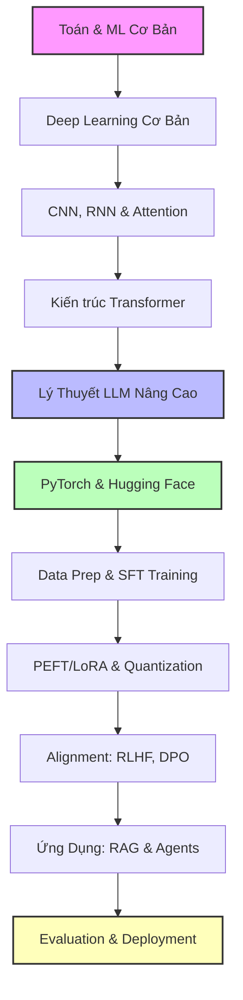

# LỘ TRÌNH HỌC TẬP TỪ DEEP LEARNING ĐẾN LLM (ROADMAP: FROM DEEP LEARNING TO LLMS)

Tài liệu này được biên soạn nhằm giúp bạn củng cố kiến thức từ nền tảng vững chắc (Deep Learning) cho đến các công nghệ tiên tiến nhất hiện nay (Large Language Models - LLMs). Lộ trình được chia làm 2 phần chính: **Lý Thuyết Cốt Lõi** (để hiểu bản chất, không bị mơ hồ) và **Thực Hành Thực Tế** (để có thể bắt tay vào làm dự án, train/fine-tune và deploy model).

---

## 🗺️ TỔNG QUAN LỘ TRÌNH (ROADMAP OVERVIEW)

---

## PHẦN 1: LÝ THUYẾT CỐT LÕI (CORE THEORY)

Mục tiêu của phần này là giải quyết sự "mơ hồ". Bạn cần hiểu **tại sao** mô hình lại hoạt động chứ không chỉ đơn thuần là biết **cách** chạy nó.

### Chương 1: Toán Nền Tảng & Machine Learning Cơ Bản
*Để không bị ngợp khi đọc các công thức toán trong các paper khoa học.*
* **Đại số tuyến tính (Linear Algebra):** Vector, Matrix, Phép nhân ma trận, Ma trận chuyển vị (Transpose), Giá trị riêng & Vector riêng (Eigenvalues/Eigenvectors).
* **Giải tích (Calculus):** Đạo hàm (Derivative), Đạo hàm riêng (Partial Derivative), Quy tắc chuỗi (Chain Rule) - nền tảng của Backpropagation.
* **Xác suất thống kê (Probability):** Xác suất có điều kiện, Định lý Bayes, Phân phối xác suất (Normal, Multinomial), Maximum Likelihood Estimation (MLE).
* **Machine Learning cơ bản:** 
  * Thế nào là học có giám sát (Supervised) vs Không giám sát (Unsupervised).
  * Thuật toán tối ưu hóa Gradient Descent (Độ dốc giảm dần).
  * Hiện tượng Quá khớp (Overfitting) vs Non-overfitting (Underfitting) và cách giải quyết (Regularization, L1/L2, Dropout).

### Chương 2: Deep Learning Cơ Bản (Bản Chất & Các Khái Niệm Cốt Lõi Cho LLM)
*Hiểu bản chất của mạng nơ-ron, cơ chế tối ưu hóa, ổn định hóa và kiểm soát quá khớp.*
* **Kiến trúc Feedforward Neural Network (FNN) & Embedding:** 
  * Cách các tầng nơ-ron biểu diễn và biến đổi đặc trưng qua các phép nhân ma trận liên tiếp.
  * Bản chất của Embedding Layer: Ánh xạ từ các ID từ vựng (Tokens) sang vector liên tục trong không gian đa chiều (nền tảng của LLM).
* **Hàm kích hoạt (Activation Functions):** 
  * Tại sao cần phi tuyến tính? Tác dụng của chúng đối với khả năng biểu diễn của mạng.
  * Phân biệt Sigmoid/Tanh (dễ gây Vanishing Gradient) với ReLU/GELU/SwiGLU (SwiGLU là hàm kích hoạt chuẩn trong LLaMA/Mistral).
* **Hàm mất mát (Loss Functions):** 
  * Bản chất Cross-Entropy Loss: Đo lường khoảng cách giữa phân phối xác suất dự đoán của model và nhãn thực tế (đối với LLM, đây là đo lường mức độ bất ngờ khi dự đoán token tiếp theo).
* **Lan truyền ngược (Backpropagation):** 
  * Chain Rule trong việc tính đạo hàm tự động (Autograd).
  * Vấn đề mất mát đạo hàm (Vanishing Gradient) và bùng nổ đạo hàm (Exploding Gradient) trong các mạng sâu.
* **Bản chất của Tối ưu hóa & Gradient Descent:**
  * **Stochastic Gradient Descent (SGD):** Nền tảng của tối ưu hóa.
  * **Thuật toán Adam & AdamW:** Cơ chế ghi nhớ động lượng (Momentum) và trung bình bình phương độ dốc tích lũy (Adaptive Learning Rate). Tại sao AdamW (tách Weight Decay ra khỏi công thức đạo hàm) lại là tiêu chuẩn vàng để huấn luyện LLM ổn định.
  * **Learning Rate Schedulers (Cosine Decay & Warmup):** Tại sao cần Warmup (tăng dần Learning Rate ở các step đầu để tránh shock trọng số) và Cosine Annealing (giảm dần Learning Rate về cuối chu kỳ train LLM).
* **Kiểm soát Quá Khớp (Overfitting & Underfitting) & Regularization:**
  * **Bản chất Overfitting trong LLM:** Xảy ra mạnh mẽ ở pha Fine-Tuning (khi dữ liệu ít mà tham số mô hình quá lớn).
  * **Weight Decay (L2 Regularization):** Tránh các trọng số bị tiến tới giá trị quá lớn, giữ cho bề mặt loss phẳng hơn.
  * **Dropout:** Tắt ngẫu nhiên các nơ-ron trong quá trình train để giảm sự phụ thuộc lẫn nhau giữa các nơ-ron. Tại sao trong LLM lớn đôi khi người ta tắt Dropout khi pre-train (để tận dụng tối đa capacity) nhưng lại bật khi SFT.
  * **Early Stopping:** Dừng train dựa trên Validation Loss.
* **Kỹ thuật Chuẩn Hóa (Normalization - Cực kỳ quan trọng để ổn định LLM):**
  * **Batch Normalization (BN):** Tại sao BN tốt cho CNN nhưng lại thất bại thảm hại trong RNN và Transformer (do độ dài chuỗi văn bản thay đổi linh hoạt).
  * **Layer Normalization (LN):** Chuẩn hóa theo chiều các feature của từng token. Bản chất toán học và sự khác biệt giữa Post-LN (gây mất ổn định khi mạng quá sâu) và Pre-LN (chuẩn hóa trước mỗi block giúp ổn định hơn).
  * **RMSNorm (Root Mean Square Normalization):** Giải pháp thay thế LN giúp tiết kiệm 10-50% chi phí tính toán chuẩn hóa bằng cách bỏ qua việc căn chỉnh trung bình (mean centering), chỉ chia cho căn bậc hai trung bình bình phương (RMS) - là tiêu chuẩn của các LLM hiện đại.

### Chương 3: Từ CNN, RNN Đến Cơ Chế Attention Nguyên Bản
*Sự phát triển lịch sử trước khi Transformer ra đời.*
* **CNN (Convolutional Neural Networks):** Ý tưởng về phép tích chập (Convolution), Pooling, tại sao CNN tốt cho hình ảnh (Spatial features).
* **RNN (Recurrent Neural Networks) & LSTM/GRU:** Mạng hồi quy xử lý dữ liệu dạng chuỗi (Sequence). Hạn chế của RNN (Vấn đề biến mất/bùng nổ gradient - Vanishing/Exploding Gradient).
* **Mô hình Seq2Seq (Encoder - Decoder):** Cách dịch máy đời đầu hoạt động bằng cách nén cả câu vào một Vector ngữ cảnh (Context Vector).
* **Cơ chế Attention (Chú ý) nguyên bản (Bahdanau/Luong Attention):** Khắc phục nút thắt cổ chai (bottleneck) của Seq2Seq bằng cách cho phép Decoder "nhìn" vào toàn bộ các trạng thái ẩn của Encoder.

### Chương 4: Cuộc Cách Mạng Transformer (Kiến Trúc Thay Đổi Mọi Thứ)
*Hiểu sâu sắc kiến trúc đứng sau mọi LLM hiện nay.*
* **Cơ chế Self-Attention (Tự chú ý):** 
  * Khái niệm Query ($Q$), Key ($K$), Value ($V$).
  * Công thức Scaled Dot-Product Attention: $\text{Attention}(Q, K, V) = \text{softmax}\left(\frac{QK^T}{\sqrt{d_k}}\right)V$.
  * Tại sao lại chia cho $\sqrt{d_k}$?
* **Multi-Head Attention:** Cho phép mô hình đồng thời chú ý vào thông tin từ các không gian biểu diễn khác nhau.
* **Mã hóa vị trí (Positional Encoding):** Tại sao Transformer cần Positional Encoding? Sự khác biệt giữa Absolute Positional Encoding (như trong BERT/GPT-2) và Relative/Rotary Positional Embedding (RoPE - dùng trong LLaMA).
* **Layer Normalization:** Khác biệt giữa Post-LN (Transformer gốc) và Pre-LN (các LLM hiện đại). RMSNorm (Root Mean Square Normalization).
* **Phân loại nhánh kiến trúc:**
  * **Encoder-Only:** BERT (phù hợp cho Classification, NER, Sentiment Analysis).
  * **Decoder-Only:** GPT series, LLaMA, Mistral (phù hợp cho sinh văn bản - Generative AI).
  * **Encoder-Decoder:** T5, BART (phù hợp cho dịch thuật, tóm tắt).

### Chương 5: Large Language Models (LLM) Nâng Cao
*Bước chuyển từ Deep Learning thông thường sang kỷ nguyên LLM.*
* **Tokenization:** Cách máy tính "đọc" chữ. Byte-Pair Encoding (BPE), WordPiece, SentencePiece. Khái niệm Token vs Word.
* **Pre-training Objectives:** Causal Language Modeling (Predict next token) vs Masked Language Modeling (Fill in the blank).
* **Scaling Laws (Luật tỷ lệ):** Mối quan hệ giữa kích thước tham số (Parameters), kích thước dữ liệu (Dataset size), và tài nguyên tính toán (Compute - FLOPs).
* **Context Length & KV Cache:** Hiểu cách mô hình lưu lại các Key và Value cũ để tăng tốc sinh token tiếp theo mà không cần tính toán lại từ đầu.

---

## PHẦN 2: THỰC HÀNH & TRIỂN KHAI THỰC TẾ (PRACTICAL & ENGINEERING)

Phần này chứa các kiến thức bạn bắt buộc phải biết khi nhảy vào code, xử lý dữ liệu, huấn luyện mô hình và đưa ứng dụng ra môi trường product.

### Chương 6: Làm Quen Với Framework & Hệ Sinh Thái LLM
*Công cụ làm việc hàng ngày của kỹ sư AI.*
* **PyTorch Core:**
  * Cách thao tác với Tensor (Tạo, nhân, slice, reshape).
  * Cơ chế `autograd` (tự động tính đạo hàm).
  * Viết một custom `Dataset` và `DataLoader`.
  * Viết một training loop cơ bản bằng PyTorch thuần.
* **Hệ sinh thái Hugging Face:**
  * `transformers`: Load model, tokenizer cực nhanh bằng `AutoModelForCausalLM` và `AutoTokenizer`.
  * `datasets`: Tải và tiền xử lý dữ liệu quy mô lớn.
  * `peft`: Thư viện chuyên cho Parameter-Efficient Fine-Tuning.
  * `trl`: Transformer Reinforcement Learning (dành cho SFT, DPO, PPO).

### Chương 7: Chuẩn Bị Dữ Liệu & Huấn Luyện SFT (Supervised Fine-Tuning)
*Nghệ thuật chuẩn bị dữ liệu chất lượng cao.*
* **Tiền xử lý dữ liệu:**
  * Làm sạch dữ liệu, xử lý khoảng trắng, lọc các đoạn text rác (HTML, ký tự lạ).
  * Thiết kế Prompt Template (ví dụ: ChatML, Alpaca format) để mô hình biết đâu là Instruction, đâu là Response.
* **Cắt ghép & Padding (Tokenization strategies):**
  * Định cấu hình `max_length`.
  * Chiến lược Padding (Left pad vs Right pad) - *Lưu ý cực quan trọng: Decoder-only model bắt buộc phải dùng Left Padding khi thực hiện batch inference.*
  * Packing (Ghép nhiều câu ngắn thành một sequence dài bằng `max_length` để tối ưu GPU).
* **Huấn luyện SFT:** Sử dụng `SFTTrainer` từ Hugging Face để fine-tune mô hình nền (Base model) thành mô hình hội thoại (Instruct/Chat model).

### Chương 8: PEFT (LoRA/QLoRA) & Kỹ Thuật Lượng Tử Hóa (Quantization)
*Cách train và chạy LLM khi không có hàng trăm GPU A100.*
* **Parameter-Efficient Fine-Tuning (PEFT):**
  * **LoRA (Low-Rank Adaptation):** Thay vì cập nhật toàn bộ hàng tỷ tham số, ta chỉ chèn thêm các ma trận nhỏ có rank thấp ($A$ và $B$) vào các layer chú ý. Giảm 99% số lượng tham số cần huấn luyện.
  * **QLoRA:** Kết hợp LoRA với mô hình nền đã được lượng tử hóa xuống 4-bit (NormalFloat4). Giúp train LLM 7B chỉ trên 1 GPU tiêu dùng (như RTX 3090/4090).
* **Lượng tử hóa (Quantization):**
  * Định dạng số thực trong AI: FP32, FP16, BF16 (khuyên dùng vì dải giá trị rộng như FP32 nhưng tốn ít bộ nhớ).
  * Post-Training Quantization (PTQ): Chuyển đổi trọng số từ 16-bit sang 8-bit hoặc 4-bit.
  * Định dạng Quantization phổ biến:
    * **GGUF:** Chạy CPU/GPU lai (rất phổ biến cho chạy Local với Ollama/Llama.cpp).
    * **GPTQ / AWQ:** Tối ưu hóa cực mạnh cho việc suy luận (Inference) trên GPU.

### Chương 9: Căn Chỉnh Hành Vi (Alignment: RLHF & DPO)
*Dạy mô hình cư xử an toàn, hữu ích và trung thực.*
* **RLHF (Reinforcement Learning from Human Feedback):**
  * Bước 1: Train mô hình Reward (Reward Model) để đánh giá câu trả lời nào tốt hơn dựa trên nhãn của con người.
  * Bước 2: Dùng thuật toán học tăng cường PPO để cập nhật LLM sao cho tối đa hóa điểm số từ Reward Model.
* **DPO (Direct Preference Optimization):**
  * Giải pháp thay thế RLHF không cần mạng Reward Model riêng biệt và cực kỳ ổn định.
  * Chỉ cần dữ liệu dạng cặp: `(Prompt, Chosen Response, Rejected Response)` và tối ưu hóa trực tiếp trên loss function của LLM.

### Chương 10: Xây Dựng Ứng Dụng LLM (Prompt, RAG & Agents)
*Ứng dụng LLM vào giải quyết bài toán thực tế.*
* **Prompt Engineering Nâng Cao:**
  * Few-Shot Prompting (đưa ví dụ mẫu).
  * Chain-of-Thought (CoT - yêu cầu suy nghĩ từng bước trước khi trả lời).
  * ReAct (Reason + Act).
* **RAG (Retrieval-Augmented Generation - Tạo lập tăng cường truy xuất):**
  * Khắc phục điểm yếu lớn nhất của LLM: Thiếu kiến thức nội bộ doanh nghiệp và bị ảo giác (Hallucination).
  * Kiến trúc RAG: 
    1. **Chunking:** Cắt nhỏ văn bản (Recursive Character Chunking, Semantic Chunking).
    2. **Embedding:** Biến các chunk thành Vector bằng Embedding Model (ví dụ: `text-embedding-3-small`).
    3. **Vector Database:** Lưu trữ và tìm kiếm (ChromaDB, FAISS, Qdrant, Pinecone).
    4. **Retrieval:** Tìm kiếm các chunk tương đồng nhất dựa trên Cosine Similarity.
    5. **Generation:** Đút các chunk tìm được làm ngữ cảnh (Context) kèm câu hỏi gốc vào LLM để sinh câu trả lời chính xác.
  * Kỹ thuật nâng cao: Query Rewriting, Re-ranking (sử dụng Cohere/BGE Reranker để lọc lại các chunk chất lượng).
* **AI Agentic Workflows:**
  * Function Calling: Cho phép LLM xuất ra định dạng JSON để gọi các hàm API bên ngoài.
  * Xây dựng Agent tự động lập kế hoạch và sử dụng công cụ (ví dụ: Duyệt web, chạy code Python).
  * Thư viện phổ biến: **LangChain**, **LlamaIndex**, **LangGraph** (cho agent phức tạp có trạng thái).

### Chương 11: Đánh Giá & Giám Sát (Evaluation & Monitoring)
*Làm sao biết mô hình của mình tốt hơn hay tệ đi?*
* **Đánh giá mô hình cơ sở (LLM Benchmarks):** MMLU (kiến thức tổng hợp), GSM8K (toán học), HumanEval (lập trình).
* **Đánh giá hệ thống RAG (RAG Triad):**
  * *Context Relevance:* Ngữ cảnh tìm được có liên quan đến câu hỏi không?
  * *Groundedness (Faithfulness):* Câu trả lời có thực sự dựa vào ngữ cảnh tìm được không (hay tự bịa)?
  * *Answer Relevance:* Câu trả lời có đúng trọng tâm câu hỏi không?
  * Thư viện hỗ trợ: **Ragas**, **TruLens**.
* **LLM-as-a-Judge:** Sử dụng các LLM mạnh hơn (như GPT-4o, Claude 3.5 Sonnet) để chấm điểm câu trả lời của LLM nhỏ hơn dựa trên tiêu chí định sẵn.

### Chương 12: Triển Khai (Deployment) & Phân Phối Tài Nguyên
*Đưa mô hình phục vụ hàng triệu người dùng một cách hiệu quả.*
* **Inference Serving Engines:**
  * **vLLM:** Công cụ phục vụ LLM cực nhanh nhờ cơ chế **PagedAttention** (quản lý KV cache như RAM ảo trong hệ điều hành), giúp tăng thông lượng (throughput) gấp hàng chục lần PyTorch thuần.
  * **Ollama / Llama.cpp:** Dùng cho phát triển cục bộ (local development) hoặc máy cấu hình yếu.
  * **TGI (Text Generation Inference):** Framework của Hugging Face phục vụ production.
* **Distributed Training & Scaling (Huấn luyện phân tán):**
  * Khi mô hình không vừa VRAM của 1 GPU:
    * **Data Parallelism (DDP):** Copy model lên nhiều GPU, mỗi GPU xử lý 1 phần dữ liệu.
    * **Tensor Parallelism:** Chia nhỏ các phép nhân ma trận của 1 layer ra nhiều GPU.
    * **Pipeline Parallelism:** Chia các layer khác nhau lên các GPU khác nhau.
    * Thư viện hỗ trợ: **DeepSpeed**, **FSDP (Fully Sharded Data Parallel)**.

---

## 🛠️ ĐỀ XUẤT TIẾN TRÌNH HỌC TẬP (SUGGESTED ACTION PLAN)

Để không bị nản, bạn nên áp dụng phương pháp **"Học cuốn chiếu song song"**:

1. **Tuần 1-2 (Nhập cuộc nhanh):** Chạy thử một vài mô hình có sẵn trên Hugging Face. Code thử một chương trình RAG đơn giản bằng Python + LangChain + ChromaDB. Trải nghiệm cảm giác mô hình chạy được trước.
2. **Tuần 3-4 (Bù đắp lý thuyết cốt lõi):** Quay lại học kỹ Chương 4 (Transformer) và Chương 2, 3. Vẽ lại kiến trúc Self-Attention ra giấy để hiểu tường tận.
3. **Tuần 5-6 (Học kỹ năng Fine-tune):** Chuẩn bị một dataset nhỏ (khoảng 1000 dòng dữ liệu chat). Tiến hành chạy QLoRA Fine-tune một mô hình 7B (ví dụ: LLaMA-3-8B-Instruct hoặc Qwen-2.5-7B-Instruct) trên Google Colab hoặc máy cá nhân.
4. **Tuần 7+ (Xây dựng dự án hoàn chỉnh):** Tạo một dự án thực tế (ví dụ: Chatbot chăm sóc khách hàng tự động tìm kiếm tài liệu nội bộ qua RAG, kết hợp với Agent có khả năng tự tính toán hóa đơn bằng Function Calling). Triển khai nó bằng `vLLM` hoặc `Ollama` làm backend API.

*Hãy kiên nhẫn. Lĩnh vực AI thay đổi từng ngày, nhưng các nền tảng về Toán, Backpropagation, Transformer và RAG sẽ luôn là xương sống giúp bạn tự tin học bất kỳ công nghệ mới nào xuất hiện sau này.*
